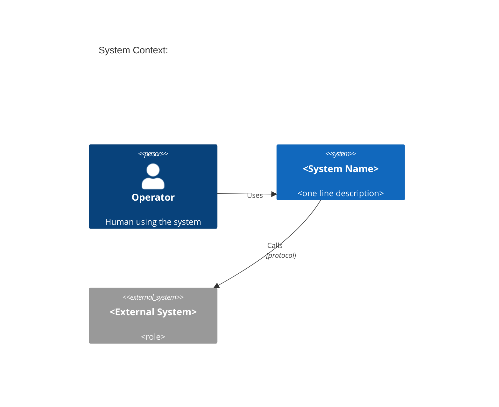
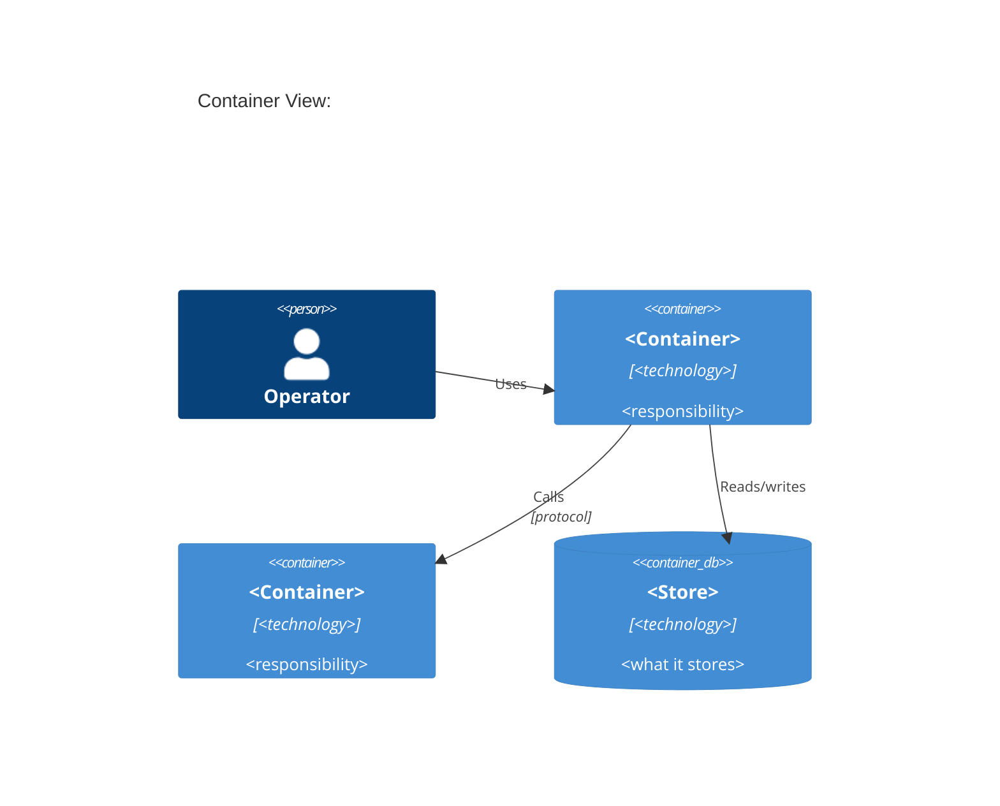
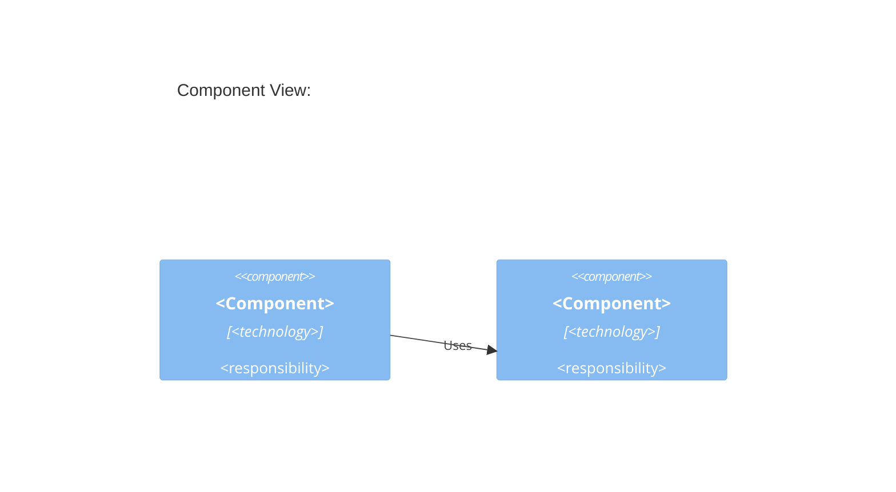

# C4 Synthesizer

Viewpoint-driven. Use the smallest diagram set that answers the operator's question.

## Output artifacts

| Diagram | Path | When |
|---|---|---|
| C4 Context | `architecture/c4-context.mmd` | always |
| C4 Container | `architecture/c4-container.mmd` | always |
| Component (per container) | `architecture/c4-component-<name>.mmd` | when container has meaningful internal parts |

## C4 Context template

## C4 Container template

## Component template

## Rules

- Every diagram must have a `title` line
- Every relationship must name the protocol or mechanism
- Do not include implementation details (class names, variable names) in context/container views
- Component diagrams: include only meaningful boundaries — not every file
- For TS→Rust migrations: annotate containers with `[TARGET: <rust-crate>]` in the description field
- Use subsystem names from repository-cartographer output for consistency

## Procedure

1. Read `code/subsystem-map.json` and `code/dependency-graph.json` from cartographer output
2. Identify external actors (operators, external APIs, file systems, MCP servers)
3. Generate C4 context first
4. Map subsystems to containers for the container diagram
5. For subsystems flagged as high-complexity in cartographer output: generate component diagram
6. Write all .mmd files
7. Validate Mermaid syntax (check for unclosed blocks, invalid keywords)

## Quality gates

- [ ] c4-context.mmd exists and renders
- [ ] c4-container.mmd exists and renders
- [ ] Every container in c4-container maps to a subsystem in subsystem-map.json
- [ ] All external dependencies from dependency-graph.json appear in context or container diagram
