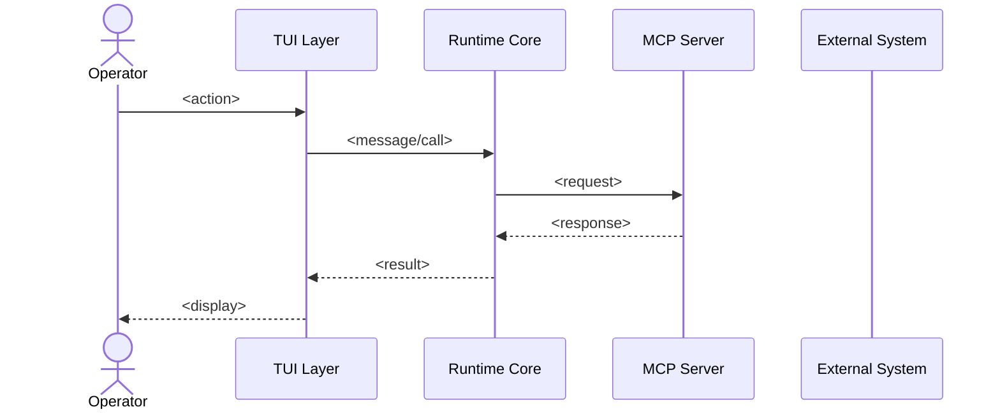

# Runtime Sequence Synthesizer

Show message order, not implementation detail. Audience is operator, not compiler.

## Output artifacts

`behavior/sequence/<flow-name>.mmd` — one file per key runtime flow

## Mermaid sequence template

## Key flows to capture (for night-agent-runner)

Capture at minimum:
1. **Agent dispatch** — operator submits prompt → TUI → QueryEngine → tool calls → response
2. **MCP tool call** — runtime core → MCP server → tool execution → result
3. **Session compaction** — compaction trigger → context reduction → state write
4. **Crash recovery** — process restart → state read → session resume
5. **Skill load** — plugin discovery → skill install → skill invocation

## Rules

- Every sequence must have a `title` line
- Use actor for humans/operators, participant for software components
- Use `-->>` (dashed) for return messages
- Use `Note over X: text` to explain non-obvious steps
- Max participants per diagram: 6 (split into sub-diagrams if needed)
- Do not show internal implementation steps — show the message exchange boundary

## Procedure

1. Read pseudocode-ledger.md to identify the key call chains for each flow
2. Read contracts/io-contracts.json for protocol and message types
3. For each key flow: trace the call path through pseudocode entries
4. Write one .mmd file per flow, named by flow (e.g., `agent-dispatch.mmd`)
5. Validate Mermaid syntax
6. Write a brief (3-5 sentence) narrative for each diagram in behavior/sequence/README.md

## Quality gates

- [ ] At minimum 3 sequence diagrams produced
- [ ] Every participant in a diagram maps to a real subsystem from subsystem-map.json
- [ ] All diagrams render valid Mermaid (no syntax errors)
- [ ] README.md names each diagram and its scope
