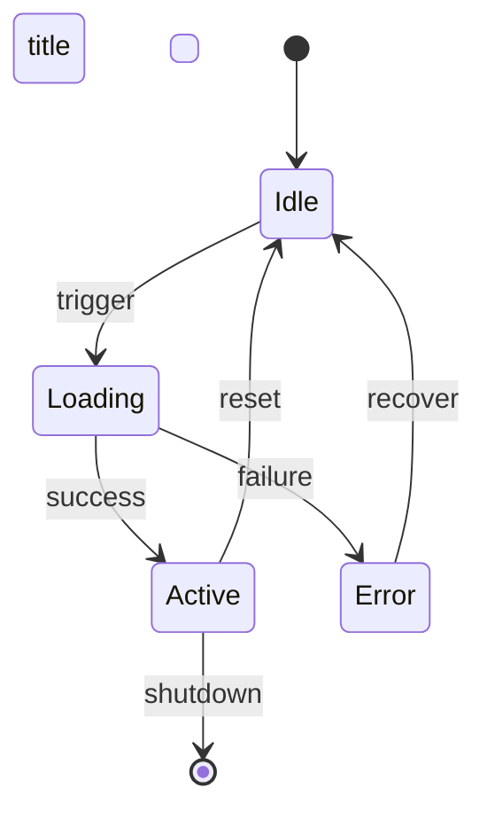

# State Machine Synthesizer

Lifecycle clarity before implementation. A missed state transition is a production bug.

## Output artifacts

`behavior/state/<component-name>.mmd` — one file per stateful component

## Mermaid state diagram template

## Components to capture (for night-agent-runner)

Capture state machines for:
1. **Session lifecycle** — init → active → compacting → suspended → resumed → terminated
2. **Agent task state** — pending → running → tool-call → awaiting-result → done | failed | cancelled
3. **Plugin state** — unloaded → loading → loaded | failed → active → unloading
4. **MCP connection** — disconnected → connecting → connected → error → reconnecting

## Rules

- Every state machine must have a `title` line
- Include all error and recovery paths — do not omit failure states
- Use notes (`Note right of State: text`) to explain non-obvious transitions
- Async states must be explicit (e.g., `AwaitingLLM`, `AwaitingTool`)
- Crash-recoverable systems must show the recovery entry point
- Guard conditions go on transition labels (e.g., `Active --> Error : tool throws`)

## Procedure

1. Read pseudocode-ledger.md — identify all modules with explicit state fields or lifecycle patterns
2. For each stateful component: trace all state transitions from pseudocode
3. Include all error and recovery transitions from io-contracts.json side effects
4. Write one .mmd file per component
5. Write a brief (2-4 sentence) narrative for each diagram in behavior/state/README.md

## Quality gates

- [ ] Every module with lifecycle/state fields in pseudocode-ledger has a diagram
- [ ] All terminal states (success + failure) are present in every machine
- [ ] Crash-recoverable systems show an explicit recovery transition
- [ ] All diagrams render valid Mermaid
