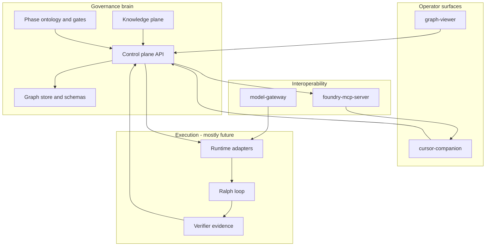

# Flagship Foundry: Full Project Scope and Execution Plan

## Baseline: what “Claude’s work” actually delivered

Per [project_foundry_status.md](file:///Users/evanmccall/.claude/projects/-Users-evanmccall-Projects-SDLC---Visual---Workflow---SoftwareEngineering-NewAge/memory/project_foundry_status.md) (and verified in-repo under `[flagship-foundry-work/](flagship-foundry-work/)`):

| Layer                  | Status                                                                                                                                                                                            |
| ---------------------- | ------------------------------------------------------------------------------------------------------------------------------------------------------------------------------------------------- |
| Control plane HTTP API | Present (`[apps/control-plane/](flagship-foundry-work/apps/control-plane/)`)                                                                                                                      |
| Orchestrator CLI       | Present (`[apps/orchestrator-cli/](flagship-foundry-work/apps/orchestrator-cli/)`)                                                                                                                |
| MCP server             | Present (`[apps/foundry-mcp-server/](flagship-foundry-work/apps/foundry-mcp-server/src/server.mjs)`) — tools include graph, import, plans, runs, continuity, `getPhasePolicy` / `checkCompliance` |
| Model gateway          | Present (`[packages/model-gateway/](flagship-foundry-work/packages/model-gateway/src/gateway.mjs)`) — OpenAI-shaped `/v1/chat/completions`, config-driven routing                                 |
| Visual layer           | `[apps/graph-viewer/](flagship-foundry-work/apps/graph-viewer/)` (React + XYFlow); ontology in `[ontology/](flagship-foundry-work/ontology/)`                                                     |
| Cursor companion       | Scaffolded (`[apps/cursor-companion/](flagship-foundry-work/apps/cursor-companion/package.json)`) — commands for control plane, import, knowledge, gap, focus, overlay                            |
| Runs                   | **Simulated** — [PROJECT_HANDOFF.md](PROJECT_HANDOFF.md) primary next tranche: real terminal adapter                                                                                              |

**Doc alignment:** Root [README.md](README.md) and [flagship-foundry-work/README.md](flagship-foundry-work/README.md) are the same product story: import-first, knowledge + gap analysis, focus views, approval-aware plans, run control starting simulated.

---

## North-star vision (“maximum” ecosystem)

Synthesize these sources into one target:

- **[ralph-integration-plan.md](ralph-integration-plan.md):** Foundry **above** Ralph; MCP universal; single model gateway; runtimes (Claude / Cursor / Codex / OpenClaw / Ralph) behind **adapters**; forward/backward traceability; adversarial loop before shards execute.
- **[research_writeup.md](research_writeup.md)** + **[model_swarm_integration_and_ide_plan.md](model_swarm_integration_and_ide_plan.md):** Role-based swarm (Specifier → Architect → Blast-radius → Adversary → Verifier → approval → Builder); provider registry + role policy; Cursor as first **split-view mirrored focus** IDE.
- **[deep-research-report.md](deep-research-report.md):** Graph as digital twin; **phase gates as graph queries** (DoR/DoD/Release/Operate); question flows → graph deltas; evidence stream from code/CI; optional deeper stack (Cytoscape/ELK, tree-sitter, etc.) as later scale tier.
- **[KNOWLEDGE_BASE_ARCHITECTURE.md](KNOWLEDGE_BASE_ARCHITECTURE.md):** Versioned sources, layered retrieval, catalogs under `[knowledge/](flagship-foundry-work/knowledge/)`.
- **[INTERACTIVE_DRILLDOWN_AND_DEBATE.md](INTERACTIVE_DRILLDOWN_AND_DEBATE.md):** Focus views + debate policy before implementation.
- **[ENVIRONMENT_PARITY_AND_MIGRATION.md](ENVIRONMENT_PARITY_AND_MIGRATION.md):** Scaffold/detect parity for `.cursor` / `.codex` / `.claude` without blind overwrite — `[environments/](flagship-foundry-work/environments/)`.
- **[AGENT_AND_SKILL_BLUEPRINTS.md](AGENT_AND_SKILL_BLUEPRINTS.md):** Blueprints in `[knowledge/templates/](flagship-foundry-work/knowledge/templates/)` projected to each runtime.
- **[knowledge-gap-report.md](knowledge-gap-report.md):** Weakest pack: **Environment Parity and Tooling** — scaffold + docs completion is in-scope for “maximum” maturity.
- **[05_sources_and_evidence_register.md](05_sources_and_evidence_register.md):** Evidence trail for external claims (models, MCP, runtimes).

**Non-goals for v1 “maximum” (unless you explicitly expand):** Replacing the IDE; building a full proprietary graph DB; certifying compliance frameworks beyond gate *hooks* and artifact links.

---

## Repository note

The parent workspace ([SDLC - Visual - Workflow - SoftwareEngineering-NewAge](.)) hosts SDLC rules, skills, and research markdown; **implementable product code for Foundry lives under `[flagship-foundry-work/](flagship-foundry-work/)`**. Scope should either treat `flagship-foundry-work` as the **canonical app repo** or define a sync policy so docs and code do not diverge.

---

## Workstreams (full project scope)

### WS1 — Operator extension (your stated starting point)

**Primary:** Harden `[apps/cursor-companion/](flagship-foundry-work/apps/cursor-companion/)` into the “visual cockpit”:

- Webview or panel: graph/focus/lifecycle/run timeline (reuse patterns from graph-viewer or embed via iframe/dev server URL where acceptable).
- Bi-directional focus: select graph node → open file; file active → highlight node/trail (per [model_swarm_integration_and_ide_plan.md](model_swarm_integration_and_ide_plan.md)).
- Controls: approve / start / pause / stop wired to real run APIs (once WS2 exists).
- Settings: control plane URL, manifests, safe defaults ([package.json](flagship-foundry-work/apps/cursor-companion/package.json) already has `flagshipFoundry.`*).

**Optional parallel (only if product scope includes SummerySky-style automation):** Chrome MV3 extension track per monorepo rules — **not** required to satisfy “Foundry extension” as defined in current README; treat as a separate epic if desired.

### WS2 — Real execution path (replaces simulation)

Implements [PROJECT_HANDOFF.md](PROJECT_HANDOFF.md) “primary next tranche”:

- **Runtime adapter interface** (process spawn, worktree, branch, env injection, stdout/stderr capture, artifact paths).
- First adapter: pick one (CLI-friendly) e.g. **Codex** or **Ralph** as first concrete integration — second adapter follows same contract ([ralph-integration-plan.md](ralph-integration-plan.md)).
- End-to-end: approved plan → run → evidence JSON → continuity update → fix-memory / handoff artifacts → graph patch hooks in `[packages/core/](flagship-foundry-work/packages/core/)`.

### WS3 — Ralph bridge

Per [ralph-integration-plan.md](ralph-integration-plan.md) Week 4–5 style deliverables:

- Compiler: Foundry executable shard → Ralph workspace layout (`prd.json`, `progress.txt`, etc.).
- State sync: Ralph completion → Foundry run state + evidence.
- Policy: Ralph only receives **already-approved** bounded shards.

### WS4 — Model provider registry and swarm orchestration

Per [research_writeup.md](research_writeup.md) and [model_swarm_integration_and_ide_plan.md](model_swarm_integration_and_ide_plan.md):

- Formalize **provider registry** + **role → provider** policy (may extend `[configs/model-routing/default.json](flagship-foundry-work/configs/model-routing/default.json)`).
- Orchestration service (could live in `packages/core` or control plane): sequence Specifier/Architect/Adversary/Verifier/Builder with structured outputs stored on the graph — **not** voting, structured convergence.

### WS5 — Gate and compliance as first-class queries

Connect [deep-research-report.md](deep-research-report.md) P0 concepts to existing ontology:

- Expose gate evaluation beyond CLI/MCP: HTTP endpoints and/or graph-viewer panels already started with `getPhasePolicy` / `checkCompliance`.
- Map DoR/DoD/Release/Operate to **assertions** over graph + artifacts (incremental; start with Flagship 11-phase ontology already in `[ontology/](flagship-foundry-work/ontology/)`).

### WS6 — Knowledge plane maturity

Per [KNOWLEDGE_BASE_ARCHITECTURE.md](KNOWLEDGE_BASE_ARCHITECTURE.md) and [BUILD_SUMMARY_2026-03-22.md](BUILD_SUMMARY_2026-03-22.md):

- Close **Environment Parity** gap ([knowledge-gap-report.md](knowledge-gap-report.md)): run scaffold, verify manifests, re-ingest.
- Retrieval layers wired into planning prompts (ecosystem → pack → framework → persona/runbook phase).

### WS7 — Interactive drill-down and debate UX

Per [INTERACTIVE_DRILLDOWN_AND_DEBATE.md](INTERACTIVE_DRILLDOWN_AND_DEBATE.md):

- Promote focus-view + debate artifacts from “generated Mermaid” to **interactive** surfaces in extension + graph-viewer.
- Persist debate rounds and reconciliation memos on plans/runs.

### WS8 — Evidence and traceability

Per [05_sources_and_evidence_register.md](05_sources_and_evidence_register.md) and handbook alignment:

- Standard evidence bundle format for verifier; link to graph nodes; export for audits.
- Forward/backward traceability APIs ([ralph-integration-plan.md](ralph-integration-plan.md) Phase 3).

### WS9 — Parity and migration UX

Per [ENVIRONMENT_PARITY_AND_MIGRATION.md](ENVIRONMENT_PARITY_AND_MIGRATION.md):

- `scaffold-env` enhancements: diff/detect existing `.cursor` / `.claude` / `.codex` / `AGENTS.md` / `.mcp.json` — **merge** strategy, not overwrite.

### WS10 — Optional “research tier” graph/extraction

From [deep-research-report.md](deep-research-report.md) (P1–P2): tree-sitter/SCIP, Cytoscape/ELK, SSDF/ASVS overlays — **phase later**, after WS1–WS3 prove value.

---

## Phased roadmap (recommended order)

| Phase | Focus                     | Exit criteria                                                                                   |
| ----- | ------------------------- | ----------------------------------------------------------------------------------------------- |
| **0** | Repo hygiene              | Single canonical root for app work; docs point to `flagship-foundry-work`; CI runs tests        |
| **1** | Extension MVP             | Companion drives import/knowledge/gap/focus from UI; overlays show plan/run state from live API |
| **2** | First real adapter        | One approved run executes in isolated worktree; evidence + continuity written back              |
| **3** | Ralph + gateway hardening | Shard export/import; SSH/local lane validated per plan                                          |
| **4** | Swarm + registry          | Role policy enforced; multi-provider routes tested                                              |
| **5** | Gates + knowledge closure | Phase queries + Environment Parity pack complete                                                |
| **6** | Scale tier                | Advanced extraction/visualization as needed                                                     |

This matches the **minimum actionable build order** in [ralph-integration-plan.md](ralph-integration-plan.md) but re-orders **Phase 1** to prioritize your **extension-first** ask while keeping the **real adapter** as the immediate hard dependency for “execution of the vision.”

---

## Risks

- **Scope coupling:** Building a rich graph-viewer inside the extension vs hosting graph-viewer separately — decide early (iframe vs shared component package).
- **Dual-repo confusion:** Parent folder research vs `flagship-foundry-work` implementation — mitigate with canonical pointers.
- **Simulation trap:** Feature work that does not reach WS2 delays all “real” value; keep adapter slice thin and vertical.

---

## Documents → workstream map (traceability)

| Document                                                                           | Primary workstreams |
| ---------------------------------------------------------------------------------- | ------------------- |
| [ralph-integration-plan.md](ralph-integration-plan.md)                             | WS2, WS3, WS4, WS8  |
| [research_writeup.md](research_writeup.md)                                         | WS4, WS5, WS1       |
| [PROJECT_HANDOFF.md](PROJECT_HANDOFF.md)                                           | WS2 (critical path) |
| [BUILD_SUMMARY_2026-03-22.md](BUILD_SUMMARY_2026-03-22.md)                         | WS6                 |
| [deep-research-report.md](deep-research-report.md)                                 | WS5, WS10           |
| [ENVIRONMENT_PARITY_AND_MIGRATION.md](ENVIRONMENT_PARITY_AND_MIGRATION.md)         | WS9, WS6            |
| [INTERACTIVE_DRILLDOWN_AND_DEBATE.md](INTERACTIVE_DRILLDOWN_AND_DEBATE.md)         | WS7                 |
| [KNOWLEDGE_BASE_ARCHITECTURE.md](KNOWLEDGE_BASE_ARCHITECTURE.md)                   | WS6                 |
| [model_swarm_integration_and_ide_plan.md](model_swarm_integration_and_ide_plan.md) | WS4, WS1            |
| [knowledge-gap-report.md](knowledge-gap-report.md)                                 | WS6                 |
| [AGENT_AND_SKILL_BLUEPRINTS.md](AGENT_AND_SKILL_BLUEPRINTS.md)                     | WS4, WS9            |
| [05_sources_and_evidence_register.md](05_sources_and_evidence_register.md)         | WS8 (provenance)    |

