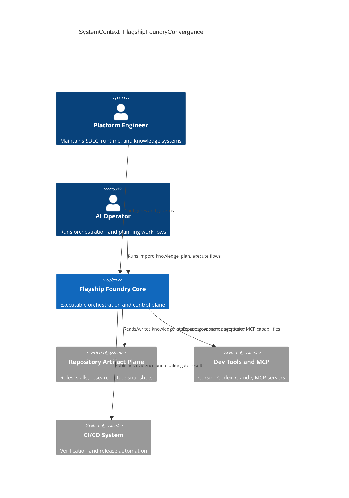
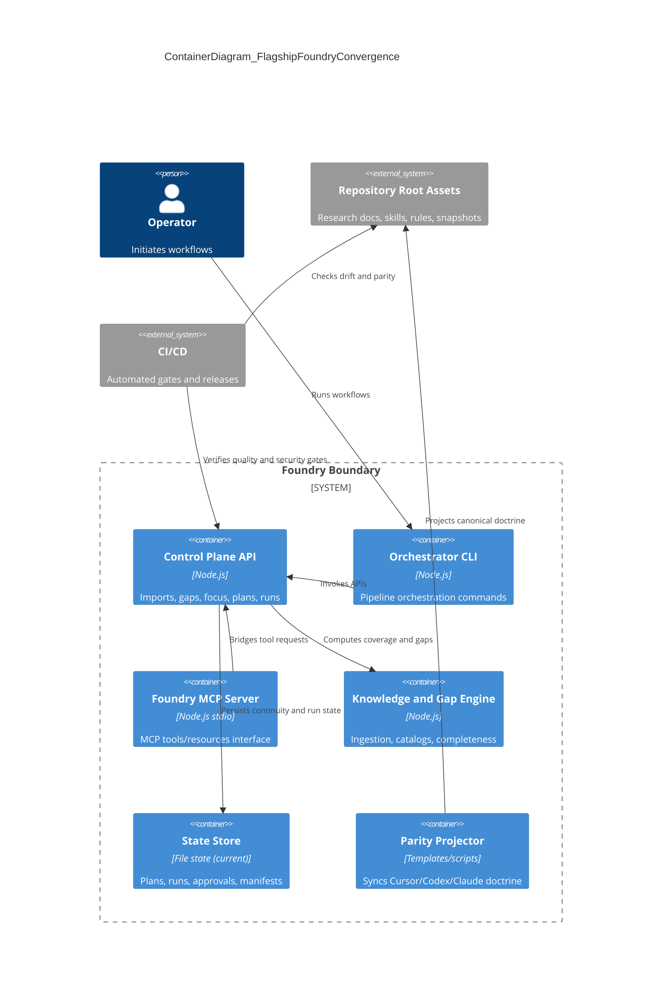

# Define Intent: Foundry Full-System Gap Closure

## Stage 1 — Problem Statement

- **Problem**: The repository has a strong executable core in [`/Users/evanmccall/Projects/SDLC - Visual - Workflow - SoftwareEngineering-NewAge/flagship-foundry-work`] but exhibits drift and duplication across governance, skill packs, continuity schemas, research bundles, and runtime artifacts at the root. This creates ambiguity in source-of-truth and slows reliable end-to-end operation.
- **Stakeholder**: Platform engineers, AI-agent operators, governance/SDLC owners, and maintainers of Cursor/Codex/Claude workflows.
- **Success Outcome**: One canonical, production-hardened system where executable runtime, knowledge catalogs, governance rules, and continuity state are synchronized with explicit ownership and low-drift automation.
- **Constraints**:
  - Preserve current runnable workflow in `flagship-foundry-work`.
  - Do not break existing `.cursor/.codex/.claude` user-specific setups.
  - Respect manual-approval defaults and blast-radius controls.
  - Keep plan epic-level (no deep implementation decomposition yet).
- **Known Risks**:
  - Migration errors from deduping mirrored artifacts.
  - Inconsistent policy propagation across skill trees.
  - Security regressions if control plane hardening is incomplete.
  - Operational disruption if continuity/state contracts diverge during transition.

## Stage 2 — Scope and Acceptance Criteria

## Scope

- **In Scope**:
  - Gap map from executable baseline (`flagship-foundry-work`) to listed repository areas.
  - Canonical ownership model (what lives where and why).
  - Epic-level remediation roadmap across runtime, knowledge, governance, continuity, and operations.
  - Verification gates and phased rollout checkpoints.
- **Non-Goals**:
  - Immediate code refactors or file moves.
  - Full task-level breakdown and ticketization.
  - Rewriting all historical research artifacts.

## Glossary

- **Executable baseline**: Production-capable code path in `flagship-foundry-work`.
- **Source of truth**: Canonical location owning an artifact type.
- **Drift**: Semantically equivalent artifacts diverging over time.
- **Continuity state**: Machine-readable task/lifecycle state (`current-task.json`).
- **Guardrail pack**: Policy/checklist bundle applied per domain.
- **Knowledge pack**: Structured domain knowledge used by planning/orchestration.
- **Parity projection**: Consistent doctrine rendered into Cursor/Codex/Claude variants.
- **Simulation mode**: Run execution using mock/synthetic adapters.
- **Operational readiness**: Security, observability, CI/CD, and reliability gates satisfied.
- **Evidence bundle**: Test/build/run artifacts proving gate completion.

## Acceptance Criteria

- Given the listed paths, when ownership mapping is applied, then each artifact type has one canonical source and documented sync direction.
- Given duplicated research/state artifacts, when dedup policy is adopted, then stale mirrors are archived or regenerated from canonical sources only.
- Given `.cursor/.codex/.claude` and `.foundry` divergence, when parity automation is executed, then schemas/skills/templates converge with compatibility tests.
- Given control-plane/runtime hardening epics, when executed, then auth, validation, rate limits, and observability are enforced on critical APIs.
- Given orchestration currently relies on simulation in places, when adapter hardening is complete, then at least one end-to-end real execution path is production-safe and evidenced.
- Given no active continuity task-state, when continuity bootstrap epic is complete, then lifecycle stage, `nextCommandSet`, and `doneCriteria` are machine-readable and updated per phase.
- Given CI/CD gaps, when pipeline epics are complete, then lint/test/build/e2e/sbom gates run automatically for affected changes.
- Given knowledge gap reports, when ingestion and completeness remediation run, then required packs reach complete or policy-approved threshold.

## Rollback Plan

- Apply a two-track rollout: preserve current baseline behavior while introducing canonicalization behind migration scripts and dry-run reports.
- Keep reversible snapshots for all moved/deduped artifacts.
- Gate each epic with smoke verification and fail-safe fallback to current baseline layout.
- Defer destructive cleanup until at least one full release cycle passes with parity checks green.

## Stage 3 — Visualize (C4)

## System Context Diagram

## Container Diagram

## Stage 4 — Applicable Principles and Guardrails

## Applicable Principles

- **complexity-budgets**: **yes** — scope includes cross-plane canonicalization; complexity must be constrained by clear ownership boundaries and phased migration.
- **contract-first**: **yes** — schema/continuity/API contracts need to be standardized before sync automation and adapter hardening.
- **observed-vs-declared-truth**: **yes** — runtime state in `state/` and report artifacts must be reconciled with declared governance/rules and canonical catalog definitions.

## Guardrail Packs

- `guardrail:typescript-core` — strict typing, boundary-safe contracts, reliable tests for changed TypeScript/JS surfaces.
- `guardrail:web-frontend` — applies to graph viewer/control-plane UI surfaces where relevant.
- `guardrail:chrome-extension-mv3` — apply only to extension-related artifacts under iterative/cursor-extension paths if modified in later phases.
- `guardrail:aws-serverless` — not primary for current baseline unless deployment architecture expands into serverless targets.

## Gap Analysis (Epic-Level)

- **Epic A — Canonical Source-of-Truth Map**
  - Define ownership matrix for executable code, governance rules, skill packs, schemas, research outputs, and runtime state.
  - Publish sync-direction policy (canonical -> projections only).
- **Epic B — Duplication and Drift Control**
  - Identify duplicate doc/report families (root vs package mirrors vs archives) and classify: canonical, generated, archive.
  - Add drift checks to detect divergent copies early.
- **Epic C — Continuity Contract Unification**
  - Align `.codex` and `.foundry` task-state schemas (including lifecycle stage support).
  - Bootstrap active continuity state so lifecycle routing is machine-readable.
- **Epic D — Skill/Rule Parity Pipeline**
  - Normalize `.cursor/.codex/.claude` shared doctrine projection with explicit compatibility tests.
  - Keep local environment overrides safe (detect-and-merge, no blind overwrite).
- **Epic E — Runtime Security Hardening**
  - Harden control plane with authn/authz, validation, payload controls, and rate limiting.
  - Remove broad CORS defaults and enforce explicit trust boundaries.
- **Epic F — Operational Reliability and Observability**
  - Add structured telemetry, timeout/retry policy, and error taxonomy across orchestration services.
  - Produce run-level evidence bundles for diagnosis and auditability.
- **Epic G — Real Execution Adapter Path**
  - Replace simulation-default run path with at least one production-safe terminal/task adapter and rollback controls.
  - Enforce safe execution boundaries (worktree isolation, policy checks).
- **Epic H — CI/CD and Quality Gates**
  - Introduce automated lint/test/build/e2e/security/sbom gates aligned to affected scope.
  - Tie release readiness to evidence-backed completion criteria.
- **Epic I — Knowledge Coverage Completion**
  - Close remaining incomplete packs (notably environment parity) and codify pack freshness SLAs.
  - Ensure gap recommendations auto-feed personas/runbooks/guardrails updates.
- **Epic J — Release and Operating Model**
  - Define phased rollout across discover->operate with explicit go/no-go gates.
  - Add incident and rollback playbooks for canonicalization migrations.

## Milestone Sequence

1. **M1 Foundation**: Epic A + C (ownership and continuity contracts).
2. **M2 Convergence**: Epic B + D + I (drift/parity/knowledge completion).
3. **M3 Production Core**: Epic E + F + G (security, observability, real adapter).
4. **M4 Industrialization**: Epic H + J (CI/CD gates and operational model).

## Stage 5 — Intent Packet Summary

- **Phase**: ready for `plan`
- **Primary Agent**: `@orchestrator`
- **Next Action**: invoke `/scope-chunker` on this intent packet to decompose epics into bounded work orders with acceptance tests and gate commands.
- **Key Decisions Pending**:
  - Final canonical home for root-level research artifacts (retain in root vs move under one docs namespace).
  - Archive retention policy for zip snapshots and iterative state copies.
  - Preferred auth model for control-plane APIs (local-only, token, or federated).
- **Definition of Ready Met**: **yes** (problem, scope, constraints, risks, acceptance criteria, rollback, principles, guardrails, and milestone roadmap are defined).

