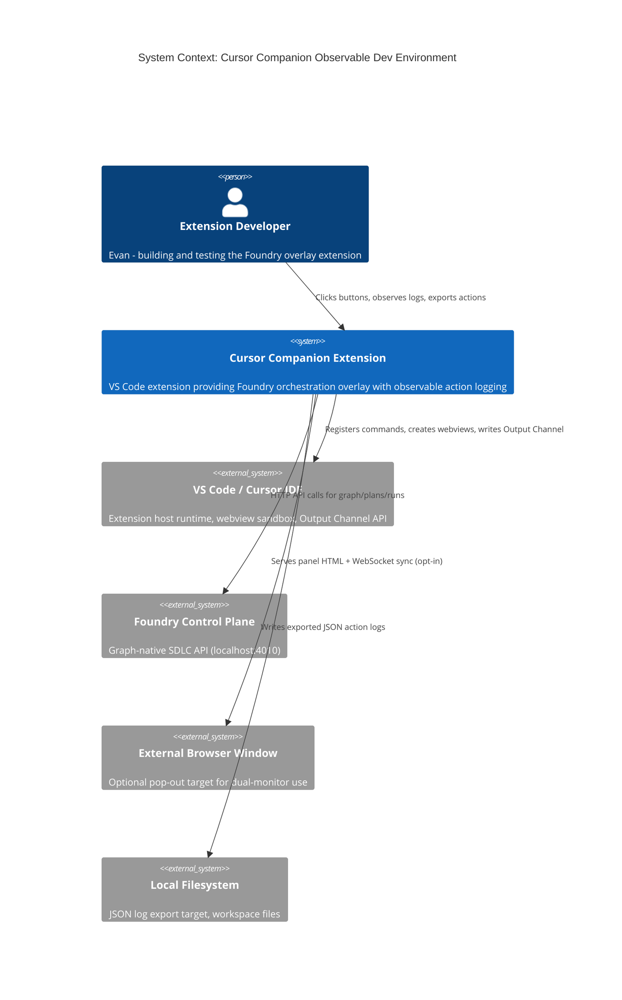
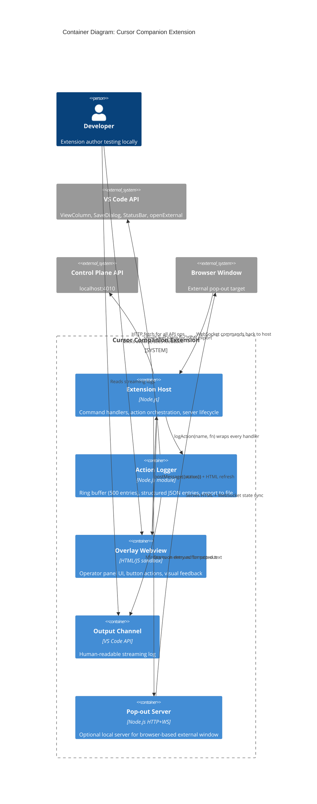

# Intent Packet: Observable Extension Development Environment

**Date**: 2026-04-10
**Author**: Evan McCall + Claude (define-intent pipeline)
**Status**: Ready for `plan` phase

---

## Problem Statement

- **Problem**: The Cursor Companion extension development loop is a black box. When a button is clicked and nothing visibly happens, there is no structured record of what did happen (or failed). The Output Channel logger exists but produces unstructured text with no action-level grouping, no export capability, and no way to capture "expected vs. actual." The pop-out window mechanism is broken (silently fails). Reloading after code changes gives no feedback that it took effect.
- **Stakeholder**: Extension developer (Evan) iterating locally on a VS Code extension for the first time, proving the system before porting to a web app.
- **Success Outcome**: Every user-initiated action produces a discrete, exportable JSON log entry showing what was triggered, what happened (or failed), and the result — visible in real-time, exportable to file, with the extension poppable into a separate window for dual-monitor work.
- **Constraints**: Must work within VS Code Extension API (no Electron hacks). Must not break existing control-plane communication. Pop-out must preserve panel state.
- **Known Risks**: VS Code webview sandboxing limits cross-window communication. Hot-reload is limited to full window reload (no HMR). Export-to-file requires `showSaveDialog` API. Browser pop-out adds a localhost server trust boundary.

---

## Scope

### In Scope

| # | Workstream | What changes |
|---|-----------|--------------|
| WS-1 | **Action Log System** | New `action-log.js` module: higher-order wrapper for all webview message handlers. Each action gets a structured JSON entry `{id, action, timestamp, status, result/error, durationMs}`. 500-entry ring buffer. JSON export via Save Dialog (all entries or last entry). |
| WS-2 | **Pop-out to New Window** | Two strategies: (a) Default — `ViewColumn.Beside` so panel can be dragged to second monitor. (b) Opt-in — local HTTP+WS server on random `127.0.0.1` port with token-gated handshake, opened via `vscode.env.openExternal`. |
| WS-3 | **Dev Loop Feedback** | Startup banner in Output Channel (version, host kind, timestamp). Inline "working..." feedback on button clicks. Error toasts + structured log entries. "Extension reloaded" banner on reactivation. |

### Non-Goals

- Hot Module Replacement (VS Code doesn't support it)
- Web app port (future phase)
- Changes to the control-plane API
- New UI features beyond observability and pop-out

---

## Glossary

| Term | Definition |
|------|-----------|
| **Action** | A single user-initiated operation triggered by a webview button click |
| **Action Log** | Structured ring buffer of Action entries with export capability |
| **Action Log Entry** | JSON object: `{id, action, timestamp, status, result, error, durationMs}` |
| **Pop-out** | Opening the extension panel in a separate OS window for dual-monitor use |
| **Extension Host** | The VS Code Node.js process that runs extension code |
| **Webview** | The sandboxed browser context that renders the overlay panel HTML |
| **Output Channel** | VS Code's built-in text log panel (View > Output) |
| **Ring Buffer** | Fixed-size (500) in-memory array that drops oldest entries when full |
| **Mini Server** | Optional localhost HTTP+WebSocket server for browser-based pop-out |

---

## Acceptance Criteria

- [ ] Given a user clicks any button in the overlay, when the action completes or fails, then a structured JSON entry is appended to the action log with `action`, `timestamp`, `status` (ok/error), `result` summary, and `durationMs`
- [ ] Given the action log has entries, when the user triggers "Export Log", then a Save Dialog opens and writes a JSON array of all entries to the chosen path
- [ ] Given the action log has entries, when the user triggers "Export Last Action", then only the most recent entry is exported
- [ ] Given the user clicks "Pop-out" (default mode), when the handler fires, then the overlay panel moves to `ViewColumn.Beside` where it can be dragged to a second monitor
- [ ] Given the user clicks "Open in Browser" (opt-in mode), when the handler fires, then a local server starts on `127.0.0.1` with a random port and token, and the browser opens the panel URL
- [ ] Given the browser pop-out is open, when the user clicks a button in the browser, then the action is relayed to the extension host via WebSocket and the result syncs back
- [ ] Given the extension activates, when the Output Channel opens, then a startup banner shows version, host kind, and timestamp
- [ ] Given any action handler throws, when the error is caught, then a VS Code error toast appears AND a log entry with the error message is recorded
- [ ] Given the user reloads the extension development host window, when the extension reactivates, then the Output Channel shows "Extension reloaded" with timestamp

---

## Rollback Plan

All changes are additive to existing files. Rollback = revert the commits. No schema migrations, no external service changes, no new npm dependencies.

---

## System Context Diagram (C4 Level 1)



## Container Diagram (C4 Level 2)



## Trust Boundaries

| Boundary | What crosses it | Mitigation |
|----------|----------------|------------|
| Webview <-> Extension Host | `postMessage` JSON only | Validate `action` field against allowlist |
| Extension Host <-> Control Plane | HTTP on localhost, no auth | Local-only, acceptable for dev |
| Extension Host <-> Browser (pop-out) | WebSocket on random local port | Bind `127.0.0.1` only, origin check, one-time token in URL |
| Extension Host <-> Filesystem | JSON export via `showSaveDialog` | User chooses path, no silent overwrites |

---

## Applicable Principles

| Principle | Applies | How |
|-----------|---------|-----|
| `observed-vs-declared-truth` | YES | Core to the intent. Action log captures observed runtime behavior vs declared intent (what the button was supposed to do). |
| `contract-first` | YES | Action Log entry schema defined before implementation. WebSocket protocol for browser pop-out needs a message contract. |
| `complexity-budgets` | YES | Mini HTTP+WS server adds a runtime dependency. Budget: <100 LOC, no external packages, Node.js built-ins only. |

## Guardrail Packs

- [x] Extension API only -- all VS Code interactions use official `vscode` API
- [x] Localhost binding -- pop-out server binds to `127.0.0.1` only, random port, one-time token
- [x] No new npm dependencies -- use Node.js built-in `http`, `crypto`, `fs`
- [x] Additive changes only -- existing handler signatures unchanged, action logger wraps functions
- [x] Ring buffer bounded -- 500 entries max, ~200KB ceiling

---

## Architecture Decision: Action Logger as Higher-Order Wrapper

The action logger wraps existing handlers without modifying their logic:

```javascript
// action-log.js contract
function withActionLog(actionName, handlerFn) {
  return async function (...args) {
    const entry = { id: uuid(), action: actionName, timestamp: new Date().toISOString() };
    const start = performance.now();
    try {
      const result = await handlerFn(...args);
      entry.status = 'ok';
      entry.result = summarize(result);
      return result;
    } catch (err) {
      entry.status = 'error';
      entry.error = err?.message ?? String(err);
      throw err;
    } finally {
      entry.durationMs = Math.round(performance.now() - start);
      ringBuffer.push(entry);
      outputChannel.appendLine(formatEntry(entry));
    }
  };
}
```

Zero changes to existing handler logic -- just wrap each handler at registration time.

---

## Intent Packet Summary

- **Phase**: ready for `plan`
- **Primary Agent**: @orchestrator
- **Next Action**: invoke `scope-chunker` to decompose into work orders
- **Key Decisions Pending**:
  1. WebSocket implementation -- use Node.js built-in `http` upgrade or minimal vendored WS? (recommend built-in)
  2. Should browser pop-out panel reuse exact same `overlayHtml()` output or a stripped-down version? (recommend same HTML, different CSP)
- **Definition of Ready Met**: YES
