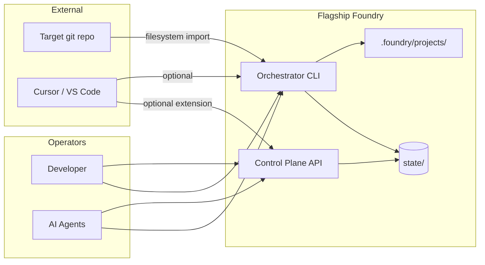
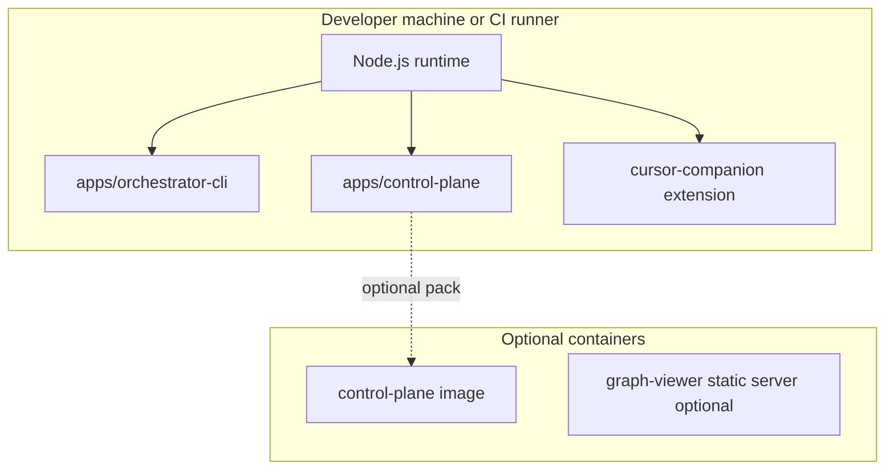

# Intent Packet: `.foundry` project root, ecosystem onboarding, Docker, and Cursor extension

**Date:** 2026-03-23  
**Slug:** `intent-foundry-dot-foundry-ecosystem-init-2026-03-23`

---

## Problem Statement

- **Problem**: Continuity and project state today are rooted under **`.codex/projects/`**, which reads as **Codex-specific** even though the same JSON contract is meant to drive **any** agent (Cursor, Claude Code, generic CI). Operators want a **neutral, Foundry-branded** location—**`.foundry/`**—so project tracking is not tied to one vendor. Separately, there is no **single, authoritative step-by-step** for “initialize Foundry against a real ecosystem” including agents, skills, and pipeline gates. Finally, teams need a decision on **Docker** for supporting services and clarity on whether a **local Cursor/VS Code extension** can **bootstrap or refresh** a repo with agents, skills, and pipeline requirements for the Foundry development pipeline.
- **Stakeholder**: Developers and platform owners adopting Flagship Foundry; AI agent operators; release/CI owners.
- **Success Outcome**: Foundry-owned project state lives under **`.foundry/`** (with a clear migration path from `.codex`), documented **ecosystem initialization** steps exist, **Docker** posture is decided with rationale, and a **local extension** path is defined to auto-init/re-init pipeline artifacts where feasible.
- **Constraints**:
  - Must respect **ADR-002** (contract authority in schema vs runtime instance path); changing the instance path requires **schema + code + tests** alignment (`continuity-state.schema.json` currently **patterns** `runtimeInstanceAuthority` to `.codex/projects/.../current-task.json`).
  - Must not break existing imports that scan **`.codex/`** for workspace content until an explicit migration/import strategy exists (`import-pipeline.mjs` treats `.codex/` as high-signal paths).
  - **Canonical product docs** remain under `flagship-foundry-work/docs/` per **ADR-001**.
- **Known Risks**:
  - **Migration blast radius**: repos with `.codex/projects/**` and rules referencing that path need coordinated updates (or symlink/shim period).
  - **Schema tightening**: relaxing or changing `runtimeInstanceAuthority` pattern affects validation and any tooling that assumes `.codex`.
  - **Extension scope creep**: auto-init can overwrite user files; must align with **ADR-004** (no blind overwrite) and explicit approval/dry-run where needed.

---

## Scope

- **In Scope**:
  1. **Design + implement** moving (or aliasing) **runtime continuity instance** from `.codex/projects/<id>/` to **`.foundry/projects/<id>/`** (or agreed layout under `.foundry/`), including updates to:
     - `schemas/continuity-state.schema.json` (`authority.runtimeInstanceAuthority` pattern),
     - `packages/core/src/continuity.mjs` (`projectDir`, `authorityFor`, paths),
     - `tests/continuity.test.mjs` and any other consumers,
     - ADR-002 narrative and `.cursor` rules that reference `.codex/projects/**/current-task.json`,
     - Optional: **migration note** (copy/symlink from `.codex` → `.foundry` for existing projects).
  2. **Author** a **step-by-step walkthrough** (operator doc) for initializing Foundry on a **filesystem-backed ecosystem**: import → knowledge → gap → plan → continuity → optional control plane + companion; include **agents/skills/pipeline** as “wire these artifacts from `knowledge/`, `.cursor/skills/`, runbooks, and CI gates” rather than inventing a new agent runtime.
  3. **Document** a **Docker** recommendation: which components *may* be containerized (control plane, optional graph-viewer, optional MCP server), when it helps (CI, team parity), and when **plain Node on host** is enough.
  4. **Assess** building a **local VS Code–compatible extension** (Cursor-compatible) to **initialize or re-initialize** Foundry scaffolding: invoke CLI (`init-project`, `import`, `scaffold-env`), prompt for config, optional API health check—aligned with existing `apps/cursor-companion/`.

- **Non-Goals** (this slice):
  - Replacing Codex/OpenAI/Cursor products or shipping a hosted multi-tenant service.
  - Full “one click” parity projection apply without approvals (violates **ADR-004**).
  - Mandatory Docker for all developers if local Node is sufficient.

---

## Glossary

| Term | Definition |
|------|------------|
| **Ecosystem** | A bounded workspace imported into Foundry (`ecosystemId`), with manifest + graph under `state/ecosystems/<id>/`. |
| **Continuity instance** | Runtime JSON (`current-task.json`) plus optional charter, holding phase, `nextCommandSet`, `doneCriteria`. |
| **Contract authority** | JSON Schema under `flagship-foundry-work/schemas/` that defines valid continuity shape (**ADR-002**). |
| **`.foundry`** | Target neutral directory for Foundry-owned project metadata (replacing or alongside `.codex` for continuity). |
| **Import source** | `filesystem` or `export-bundle` per `ecosystem-import-request.schema.json`. |
| **Control plane** | HTTP API in `apps/control-plane/` (Node). |
| **Local extension** | VS Code extension API–compatible extension run in Cursor/VS Code (dev or packaged). |

---

## Acceptance Criteria

- [ ] Given a repo adopting Foundry, when continuity is initialized, then **runtime instance path** resolves under **`.foundry/projects/<projectName>/current-task.json`** (or documented equivalent) and validates against updated schema.
- [ ] Given existing projects using `.codex`, when migration is needed, then documentation describes **at least one** supported path (fresh init, copy, or symlink) without silent data loss.
- [ ] Given a new engineer, when they follow the new walkthrough, then they can perform **import → knowledge → gap → plan** (and optional API) with explicit commands and expected `state/` outputs.
- [ ] Given a platform review, when Docker is evaluated, then the doc states **which services are optional in containers**, **security notes** (tokens, bind mounts), and **default recommendation** (e.g., dev: no Docker required; CI: optional Docker for reproducibility).
- [ ] Given the extension assessment, when documented, then it lists **feasible VS Code extension capabilities** (tasks, terminal, file templates), **integration points** (`node .../main.mjs`, `npm run api`), and **non-goals** (cannot auto-install proprietary Cursor CLI internals).

---

## Rollback Plan

- Revert continuity path changes behind a **feature flag or env** (`FLAGSHIP_CONTINUITY_ROOT=.codex|.foundry`) if issues arise; restore schema pattern to `.codex` if needed.
- Keep **backup** of `current-task.json` before migration scripts run.
- Extension: ship as **optional** local package; disable via workspace setting.

---

## System Context Diagram

High-level actors and systems (Mermaid).

**Trust boundaries**: Control plane auth (**ADR-006**) for non-loopback; secrets stay in env/KMS, not in `.foundry` committed files.

---

## Container Diagram

Major runtime units.

**Data flow**: Import/read repo → write `state/ecosystems/`; continuity writes **`.foundry/projects/`** (target); extension calls CLI/API over localhost.

---

## Applicable Principles

| Principle | Applies | How |
|-----------|---------|-----|
| artifact-authority | yes | Schema + `state/` remain authoritative; `.foundry` instance must validate against `continuity-state.schema.json`. |
| continuity-is-mandatory | yes | Moving roots must preserve resumable `nextCommandSet` / `doneCriteria`. |
| blast-radius-before-build | yes | Ecosystem init walkthrough should order **import → knowledge → gap → plan** before execute-mode runs. |
| approval-at-plan-boundary | yes | Extension must not auto-approve real plans without policy match. |
| independent-verification | yes | Init/migration changes need tests + verifier pass (`npm test`, `ci:targeted`). |
| fix-memory-compounds | partial | Document learnings in guardrails/knowledge when init failures repeat. |

---

## Guardrail Packs

- [ ] **Node platform / reliability** — timeouts, no blocking CPU on request threads for control plane in Docker.
- [ ] **Security baseline** — no secrets in `.foundry` committed files; bearer tokens for non-loopback API.
- [ ] **Browser injection / extension standards** — if extension injects scripts, follow workspace rules for sanitization (usually N/A for CLI-spawning extension).

---

## Docker analysis (architectural recommendation)

| Component | Container? | Notes |
|---------|------------|--------|
| **Orchestrator CLI** | **No** (default) | Runs on host against repo; needs direct filesystem access to `workspaceRoot`. |
| **Control plane** | **Optional** | Node HTTP server; Docker useful for **CI smoke** or **team-identical** dev URLs; local dev often `npm run api` on host. Bind mounts for `flagship-foundry-work` if containerized; set **ADR-006** env for tokens. |
| **Graph viewer** | **Optional** | If used, static or small Node service—container optional. |
| **Foundry MCP server** | **Optional** | Same as control plane—package per `apps/foundry-mcp-server`; Docker only if you need isolated deps. |

**Recommendation**: **Do not require Docker** for day-one Foundry adoption. Introduce **optional** `Dockerfile` / compose for **control plane + pinned Node** when teams need reproducible environments or CI integration tests. For **local-shell execute** runs (**ADR-008**), containerizing the *executor* is a **separate** decision (sandbox differs from macOS `sandbox-exec`).

---

## Local Cursor / VS Code extension (feasibility)

**Yes, you can build a local extension** (the repo already has `apps/cursor-companion/` as a starting point). Feasible capabilities:

- Commands: **“Initialize Foundry project”**, **“Re-import ecosystem”**, **“Start control plane”** (spawn terminal or `child_process`).
- Configuration: `flagshipFoundry.repoRoot`, `flagshipFoundry.importConfigPath`, `flagshipFoundry.controlPlaneUrl`.
- Run **CLI** with explicit args: `node apps/orchestrator-cli/src/main.mjs import <config>`, `init-project`, `scaffold-env`, etc.
- Optional: HTTP `GET /health` before dependent actions.

**Limitations**: “**CursorCLI**” as a product-specific CLI is not something this repo defines—extensions use the **VS Code extension API** + **terminal subprocess**. Cannot rely on undocumented Cursor internals. **Re-init** of skills/agents should mean **copying or merging templates** from `knowledge/`, `.cursor/skills/`, `environments/` with user confirmation (**ADR-004**).

---

## Step-by-step: Initialize Foundry into an ecosystem (walkthrough summary)

*Full operator doc should be extracted to `docs/guides/` in implement phase; this is the intent-level sequence.*

1. **Prereqs**: Node 20+, `cd flagship-foundry-work`, `npm install`.
2. **Create import config** with `source.type: "filesystem"` and `workspaceRoot` = absolute path to target repo.
3. **Import**: `node apps/orchestrator-cli/src/main.mjs import <config.json>` → verify `state/ecosystems/<ecosystemId>/`.
4. **Knowledge** (optional but recommended): prepare manifest under `examples/knowledge-sources/` pattern; `knowledge <manifest.json>`.
5. **Gap**: `gap` with request JSON referencing `ecosystemId` and `knowledgeBaseId` as needed.
6. **Plan**: `plan` with change request JSON; review approval policy.
7. **Continuity**: `init-project <name> <objective>` — **after `.foundry` migration**, this writes under **`.foundry/projects/<name>/`** (today: still `.codex` until implementation).
8. **Control plane** (optional): `npm run api` with env per README; use REST or Cursor companion.
9. **Agents / skills / pipeline**: wire **existing** repo assets—`.cursor/rules`, `.cursor/skills`, `knowledge/` packs, `runbooks/`, and CI per `docs/ci-release-gates.md`—rather than a single “agent installer” unless built as extension templates with approval.

---

## Intent Packet Summary

- **Phase**: ready for `plan`
- **Primary Agent**: `@orchestrator`
- **Next Action**: invoke **`/scope-chunker`** to decompose into work orders (schema + continuity + docs + optional extension spike + optional Docker compose)
- **Key Decisions Pending**:
  - Exact **`.foundry` layout** (`projects/` only vs additional `cache/` or `templates/`).
  - **Migration strategy** for existing `.codex` users (symlink vs one-time copy vs dual-read period).
  - Whether **import pipeline** should treat **`.foundry/`** as a first-class scan path like `.codex/` for workspace metadata.
- **Definition of Ready Met**: **partially** — problem, scope, AC, rollback, and architecture notes are clear; **pending** stakeholder sign-off on breaking schema pattern change and migration policy.

---

## Follow-on artifacts

- **ADR-011** (proposed): `docs/adr/adr-011-foundry-directory-layout-and-continuity-instance.md` — canonical `.foundry/projects/<slug>/` layout.
- **Scope chunk:** `docs/intent/scope-chunk-foundry-dot-foundry-2026-03-23.md` — work orders WO-FF-011-01 … WO-FF-011-05.

## References

- `flagship-foundry-work/schemas/continuity-state.schema.json` — `runtimeInstanceAuthority` pattern
- `flagship-foundry-work/packages/core/src/continuity.mjs` — `.codex` path construction
- `flagship-foundry-work/docs/adr/adr-002-continuity-schema-authority-and-bootstrap.md`
- `flagship-foundry-work/apps/cursor-companion/README.md`
- `flagship-foundry-work/docs/ci-release-gates.md`
