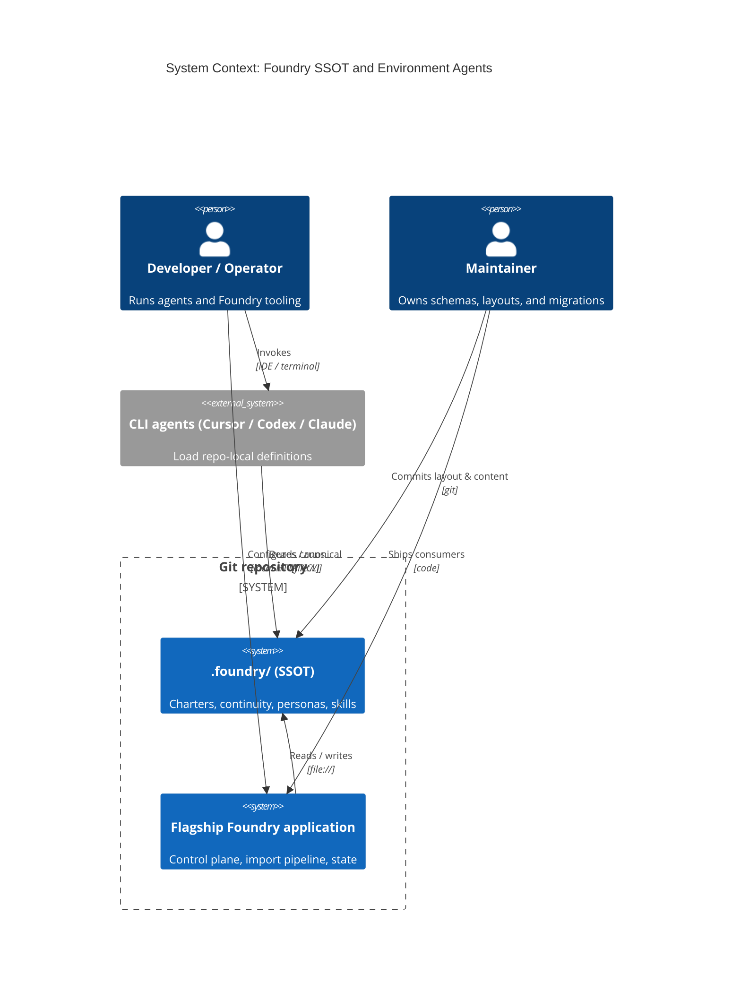
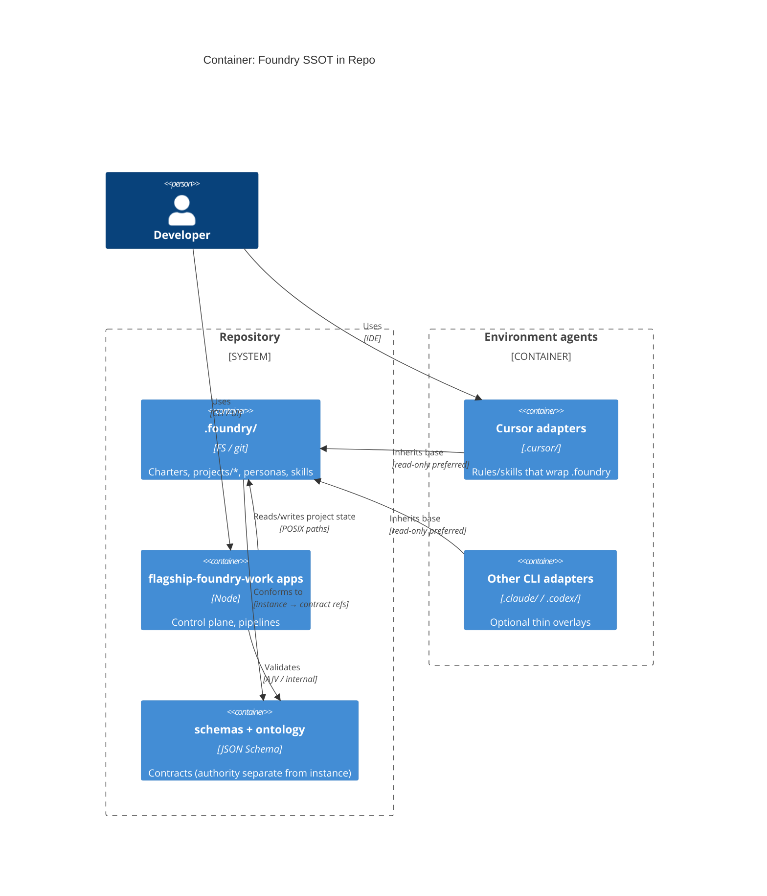

# Intent Packet: `.foundry` as SSOT for Charters, Task Tracking, Personas, and Skills

**Date:** 2026-03-23  
**Pipeline:** `/define-intent`  
**Related:** ADR-011 (`.foundry` layout and continuity instance)

---

## Problem Statement

- **Problem:** Foundry-related continuity (charters, `current-task.json`), operator personas (“personalities”), and executable skills are split across `.cursor/`, `.claude/`, `.codex/`, and `flagship-foundry-work/` (e.g. `personas/`, `knowledge/`). That fragmentation makes it unclear which copy is authoritative, complicates the Flagship Foundry application when it needs stable paths to read/write state, and forces each CLI environment to duplicate or drift from the same definitions.
- **Stakeholder:** Developers and operators running multi-agent SDLC workflows; maintainers of the Flagship Foundry control plane and import/bootstrap pipelines; CLI/agent integrators (Cursor, Codex, Claude Code, future tools).
- **Success Outcome:** A single, repo-root **`.foundry/`** tree is the canonical home for Foundry charter, per-project task tracking, persona definitions, and Foundry-owned skills; every environment agent **inherits** those definitions and may only **extend** with thin, documented adapter layers for tool-specific behavior.
- **Constraints:** Must align with ADR-002/ADR-011 split (schema authority in `flagship-foundry-work/schemas/`, runtime instance under `.foundry/projects/<slug>/`); avoid silent split-brain with legacy `.codex/projects/**` during migration; no secrets in `.foundry/`; respect existing Nx/workspace boundaries for application code vs metadata.
- **Known Risks:** Migration drift if some automation still reads old paths; merge conflicts if multiple agents write continuity concurrently; over-nesting `.foundry/` before consumers exist (per ontology discipline); breaking external docs or scripts that hardcode `.cursor` paths.

---

## Scope

- **In Scope:**
  - Define normative **directory layout** under `.foundry/` for: project charters, `current-task.json` (and schema pointers), **personas** (personalities), and **skills** (executable procedures) used by Foundry and consumed by the Flagship app.
  - Define an **inheritance model**: base definitions in `.foundry/`; per-environment **optional** overlays (e.g. `.cursor/skills/` → re-export or wrap) documented as non-authoritative extensions.
  - Specify **discovery contract** for the Flagship Foundry application (which paths to index, validation against schemas).
  - **Rollback and migration** story: symlink, copy, or dual-read period; update rules/docs that reference legacy locations.
- **Non-Goals:**
  - Moving the entire monorepo’s generic Cursor rules (unrelated to Foundry) into `.foundry/`.
  - Replacing every third-party CLI’s global config; only repo-local agent behavior tied to Foundry.
  - Re-implementing the control plane UI in this intent slice (layout and contracts only unless already scoped elsewhere).

---

## Glossary

| Term | Definition |
|------|------------|
| **SSOT** | Single source of truth: one canonical path and format; other locations are mirrors, overlays, or deprecated. |
| **`.foundry/`** | Repo-root namespace for Foundry-owned metadata and configuration instances (per ADR-011). |
| **Continuity instance** | Machine-readable task state (e.g. `current-task.json`) bound to a project slug. |
| **Charter** | Human-facing project SDLC constraints (`SDLC_CHARTER.md`) paired with continuity. |
| **Persona** | Structured agent personality/profile (role, tone, constraints) used to steer specialist behavior. |
| **Skill** | Executable procedure (e.g. markdown skill with steps) invoked by agents. |
| **Environment agent** | A CLI or IDE-integrated agent (Cursor, Codex, Claude Code) that loads repo-local definitions. |
| **Adapter / overlay** | Thin layer in a tool-specific folder that imports or wraps `.foundry` definitions without copying content. |
| **Flagship Foundry application** | The workspace’s Foundry tooling (e.g. control plane, import pipeline) that reads artifacts under agreed paths. |
| **Authority (contract)** | JSON Schema and ontology location under `flagship-foundry-work/schemas/` (and related), per ADR-002. |

---

## Acceptance Criteria

- [ ] Given a repository with `.foundry/projects/<slug>/` populated, when the Flagship Foundry app or documented CLI resolves project state, then **charter and `current-task.json` paths** are read from `.foundry/projects/<slug>/` without requiring `.codex/` for Foundry authority.
- [ ] Given persona and skill definitions committed under `.foundry/` (exact subpaths documented in a short README or ADR addendum), when an environment agent is configured per the handoff doc, then it **loads base personality and procedures from `.foundry/`** before applying any local extension.
- [ ] Given two environments (e.g. Cursor and Claude Code), when both are used on the same repo, then **behavioral drift from duplicated persona/skill text** is eliminated for Foundry-scoped content (one canonical text in `.foundry/`).
- [ ] Given a breaking path change, when operators follow the rollback section, then the repo can **revert to prior path resolution** (e.g. dual-read flag or symlink) without data loss.
- [ ] Given the import/bootstrap pipeline runs, when it classifies workspace files, then `.foundry/**` is **discoverable and labeled** as Foundry metadata (not conflated with unrelated app source).

---

## Rollback Plan

- Keep **legacy read paths** for one transition window (dual-read: try `.foundry` first, fall back to `.codex/projects/**` for continuity only), with explicit deprecation warnings in logs or import reports.
- Prefer **copy + verify** over destructive moves; use symlinks only where the team accepts cross-OS constraints.
- Revert application and rule changes via git; continuity JSON remains valid against the same schema—only **path strings** in `authority` or docs change.
- If persona/skill consolidation causes tooling breakage, restore thin **stub files** in legacy locations that only point to `.foundry/` paths (forwarding stubs), then remove in a follow-up slice.

---

## System Context Diagram

Trust boundaries: human operators and local CLIs run inside the **dev workstation**; the **Git repo** holds `.foundry/` and app code; external registry or cloud is out of scope unless already integrated.

---

## Container Diagram

**Data flow notes:** Writes to `current-task.json` should go through the same validation as today; persona/skill files are typically human-reviewed git content (public/internal; no secrets).

---

## Applicable Principles

Reference: `flagship-foundry-work/ontology/principle-catalog.json`.

| Principle | Applies | How |
|-----------|---------|-----|
| **artifact-authority** | yes | Canonical personas, skills, and continuity live as committed artifacts under `.foundry/`, not ad-hoc chat. |
| **blast-radius-before-build** | yes | Migration touches rules, pipelines, and multiple agent folders; enumerate affected paths before implementation. |
| **approval-at-plan-boundary** | yes | Layout and migration plans should follow existing plan/approval flows in Foundry. |
| **independent-verification** | yes | Verifier still validates against acceptance criteria; SSOT does not merge builder/verifier roles. |
| **continuity-is-mandatory** | yes | Task tracking remains resumable; paths update in continuity and derived mirrors as needed. |
| **fix-memory-compounds** | partial | Optional: record migration pitfalls as guardrails or fix-memory entries after cutover. |

*Thematic alignment (from ontology discipline): **contract-first** — schemas and README specify layout before bulk file moves; **observed-vs-declared-truth** — runtime state in `current-task.json` remains declared continuity; import reports reflect observed disk state.*

---

## Guardrail Packs

Reference: `flagship-foundry-work/guardrails/`

- [ ] **guardrail:workspace-governance** — Artifacts outrank chat; blast radius and handoff explicit; continuity updates on phase transitions.
- [ ] **guardrail:terminal-agent-adapters** — Adapter layers stay thin; no duplication of Foundry-canonical text outside `.foundry/` without a forwarding stub.
- [ ] **guardrail:nx-monorepo** — Application code changes stay in correct projects; `.foundry/` remains metadata-friendly for Nx boundaries.
- [ ] **guardrail:typescript-core** — If validation or loaders are TypeScript, keep strict typing at boundaries.

*(Add **guardrail:chrome-extension-mv3** / **guardrail:web-frontend** only if skills or personas embed extension/UI-specific rules in this slice.)*

---

## Intent Packet Summary

- **Phase:** ready for `plan`
- **Primary Agent:** @orchestrator
- **Next Action:** Invoke `/scope-chunker` with this packet to decompose into work orders (schema/path updates, `.foundry` README, adapter stubs, dual-read migration, Flagship discovery, test updates).
- **Key Decisions Pending:**
  - Exact subpaths under `.foundry/` for `personas/` and `skills/` (flat vs `projects/<slug>/`-scoped personas).
  - Whether environment overlays remain as symlinks, `import` re-exports, or generated stubs from a manifest.
  - Dual-read duration and telemetry for deprecated `.codex` Foundry paths.
- **Definition of Ready Met:** **Partially** — problem, scope, diagrams, principles, and rollback are defined; **pending** final agreement on subdirectory layout and stub mechanism for non-Foundry Cursor rules (explicitly out of scope for moving, but interaction must be clear).

---

## Handoff

**Invoke `/scope-chunker`** with this document as input to produce bounded implementation slices (file scope, verification commands, and migration ordering).
