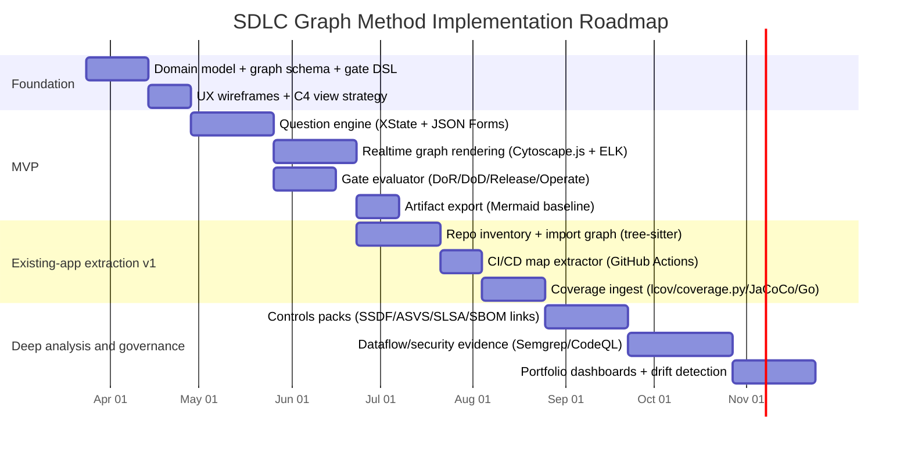
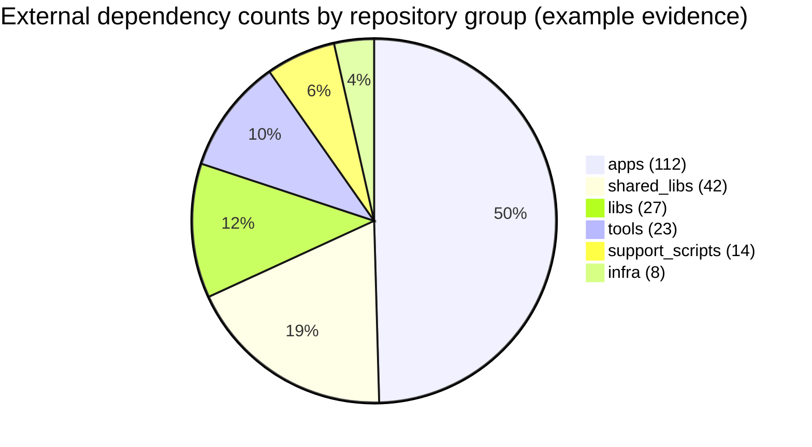

# Graph-Driven SDLC Analysis and Management Method Based on the Flagship Systems Handbook

## Executive summary

Your **Flagship Systems SDLC and Maintenance Cycle handbook (v1.0, March 18, 2026)** frames SDLC as a *system-definition workflow* where “better visualization and better definition reduce ambiguity,” and where “every meaningful decision produces an artifact,” each with an owner and update rule (handbook extracted text, lines 5, 42–47 in `/mnt/data/flagship_systems_sdlc_handbook.docx`). Building directly on that doctrine, the most effective “new method” is to treat SDLC management as maintaining a **living, queryable, versioned system graph**—a *digital twin* of intent and reality—fed by two streams:
- **Intent stream (new app workflow):** a question-driven definition flow that captures mission, constraints, stakeholders, compliance, NFRs, data flows, integrations, security, testing strategy, and stage gates. Each answer produces/updates nodes and edges and simultaneously produces artifacts (diagrams, schemas, ADRs) to reduce ambiguity (handbook extracted text, lines 36–49, 53–64, 312–322).  
- **Evidence stream (existing app extraction):** automated extraction from live codebases/infra/CI/CD/test results/telemetry to produce architecture & dependency diagrams, CI/CD pipeline maps, coverage heatmaps, and “top-down” overviews. Evidence is attached to graph elements with confidence scoring and provenance.  

To align with the handbook’s “artifacts and evidence” framing of SDLC phases (Discover → Define → Visualize → Architect → Plan → Implement → Verify → Release → Operate → Diagnose → Improve) and explicit gates (Definition of Ready/Done, Release gate, Operate gate) (handbook extracted text, lines 68–79), the system should treat **phase gates as graph queries** (e.g., “does this system have a context diagram + owners + rollback plan + test outline?”) rather than as checklists in disconnected tools.

A pragmatic recommended stack (given “no constraints” on languages/budget/hosting) is:
- **Question flow engine:** XState for statecharts and branching logic (supports state machines/statecharts; notes SCXML alignment) citeturn2search6, paired with JSON Schema for typed answers citeturn7search0turn7search4 and a schema-driven form renderer such as JSON Forms (data schema + UI schema) citeturn2search0turn2search4 or SurveyJS (JSON-driven forms + branching; optional commercial form builder) citeturn1search0turn1search3.  
- **Graph visualization:** Cytoscape.js for interactive graphs plus built-in graph algorithms and “headless” analysis capability citeturn0search2turn16search0turn16search4; add ELK for automatic layout across diagram types citeturn9search0turn9search6. For very large graphs, Sigma.js (WebGL) + graphology is a strong alternative citeturn10search0turn10search4.  
- **Architecture diagram standards:** C4 model as the primary top-down diagram taxonomy citeturn0search4, with Structurizr for C4 “models as code” rendering and embedding where appropriate citeturn0search7turn0search1; use Mermaid for lightweight diagrams in docs and exports citeturn9search5 (and optionally PlantUML for UML-heavy needs) citeturn9search4.  
- **Code intelligence & extraction:** tree-sitter for multi-language incremental parsing and tolerant AST extraction citeturn4search0; SCIP/LSIF-based indexing when you need higher precision code navigation and cross-repo symbol graphs (SCIP is explicitly language-agnostic) citeturn12search0turn12search5.  
- **Security/gap analysis:** integrate NIST SSDF concepts into gates citeturn5search3turn5search1, OWASP ASVS as a control catalog citeturn5search0, and add SAST/dataflow tools such as CodeQL (semantic analysis; “query code as data”) citeturn22search3turn3search4 and Semgrep (rule-based + taint tracking; note memory considerations for inter-file analysis) citeturn22search0turn4search2.  
- **Supply chain evidence:** generate SBOM/provenance artifacts and link them to graph elements using SLSA citeturn6search5 and SPDX/CycloneDX formats citeturn6search1turn6search0.

## Handbook-driven method

The handbook’s core operating claims can be operationalized as a set of product invariants:

**SDLC becomes “artifact-first” and “diagram-by-decision.”** The handbook explicitly frames visualization not as decoration but as an analytical language, recommending the C4 hierarchy (system → container → component → code) plus landscape/dynamic/deployment diagrams (handbook extracted text, lines 53–55; see also the C4 model’s official definition) citeturn0search4. This implies your tool should not simply “draw diagrams” but should:
- Ask questions that target *specific architectural decisions*.
- Maintain a **minimal visual set** driven by decision needs (context/container + scenario + deployment + observability), then expand when complexity justifies it (handbook extracted text, lines 53–64).

**Phases and gates are evidence-driven, not ceremony-driven.** The handbook defines a universal lifecycle in terms of outputs and evidence (Discover → … → Improve) and specifies concrete gate definitions: DoR, DoD, Release gate, Operate gate (handbook extracted text, lines 68–77). A graph-native implementation turns each gate into a query over artifacts and evidence such as:
- *DoR query:* acceptance criteria exist; risks captured; rollback idea; test outline.
- *Operate gate query:* telemetry/alerting/runbooks/ownership exist before production-ready.

**Artifacts must not drift.** The handbook warns that systems fail when artifacts disagree and recommends an “authority stack” from doctrine and phase state down through contracts, implementation, verification evidence, and operations evidence (handbook extracted text, lines 78–79). The new method therefore must support:
- A **single “system graph”** that can be rendered as many views (C4, deployment, trust boundaries, data flows) without duplicating the underlying truth.
- Provenance and ownership per node/edge, enabling “why do we believe this?” queries.

**Implication for your product:** the system is not “a diagram tool” and not “a requirements form.” It is a **graph-based definition + evidence engine** that continuously reduces ambiguity and surfaces drift.

## Interactive question-driven workflow and realtime graph

### Prioritized feature list

The list below is optimized for maximum leverage: immediate ambiguity reduction, fast onboarding for new apps, and measurable governance for existing apps.

| Priority | Feature | What it unlocks | Why it is first-order |
|---|---|---|---|
| P0 | **Question flow → Graph projection in real time** | Users see architecture emerge live; reduces misunderstanding early | Aligns with handbook’s “definition engine” doctrine (handbook extracted text, lines 48–49) |
| P0 | **Built-in SDLC phase + gate evaluator** (DoR/DoD/Release/Operate) | Enforces evidence-based readiness | Mirrors handbook’s explicit gates (handbook extracted text, lines 74–77) |
| P0 | **Artifact generation** (C4 context + container + deployment + initial DFD) as Mermaid exports | Makes “every decision produces an artifact” automatic | Mermaid supports text-defined diagrams that can be versioned citeturn9search5; C4 taxonomy is well-defined citeturn0search4 |
| P1 | **Graph editing + “assumption tagging” + confidence levels** | Separates declared intent vs inferred vs measured reality | Prevents drift and “diagram lies” |
| P1 | **Schema-driven question library** (JSON Schema + UI schema) | Lets you add domains and compliance packs without rewrites | JSON Schema is designed for machine-readable validation and interaction control citeturn7search4; JSON Forms uses schema + UI schema runtime mapping citeturn2search0 |
| P1 | **Stakeholder/ownership overlays** (ownership map, approval flows) | Clarifies responsibility boundaries | Matches handbook’s emphasis on ownership and control boundaries (handbook extracted text, lines 39–47) |
| P2 | **Integrated control catalogs** (SSDF/ASVS mappings as question packs + gates) | Makes compliance and secure SDLC auditable | NIST SSDF is explicitly meant to be integrated into any SDLC citeturn5search3turn5search1; ASVS is a structured verification standard citeturn5search0 |
| P2 | **Data classification + trust boundary modeling** | Enables threat modeling and “sensitive data map” views | Trust boundaries are a core diagram type in C4 and in your handbook’s catalog (handbook extracted text, line 339) |
| P2 | **Collaboration features** (multi-user edits, review diffs, approvals) | Turns definition into a managed workflow | Matches “approval boundaries” doctrine (handbook extracted text, line 40) |

### Question taxonomy that matches your handbook and your requested prompts

Your requested prompts map cleanly onto the handbook’s “first questions every new system should answer” plus the visualization catalog (handbook extracted text, lines 312–342). A suggested **top-level question set** (each section becomes a statechart subflow) is:

**Ecosystem and scope (System landscape + context views).**  
Ask what systems surround this one, who uses it, and what is in/out-of-scope. This directly populates C4 system landscape/context diagrams citeturn0search4.

**Business objectives and success metrics.**  
Capture outcomes and KPIs; connect them to capabilities and acceptance criteria. This is required to operationalize “success is measurable.”

**Stakeholders and responsibility model.**  
Capture roles (product, security, SRE, support), owners per component, escalation paths, approval boundaries. This supports the handbook’s insistence that artifacts have owners and update rules (handbook extracted text, lines 42–44).

**Compliance and policy constraints.**  
Select frameworks and obligations (e.g., SSDF practices citeturn5search3, ASVS requirement targets citeturn5search0, SBOM expectations via SPDX/CycloneDX citeturn6search1turn6search0). Produce a “controls graph” linked to system boundaries.

**Nonfunctional requirements (NFRs).**  
Reliability (SLO/SLI), performance budgets, scaling expectations, accessibility baseline (WCAG is a common anchor; your handbook references WCAG 2.2—see official W3C spec if you incorporate it), cost constraints, latency budgets. Track NFRs as constraints linked to components and flows.

**Deployment targets and environments (Deployment view).**  
Define environments (dev/stage/prod), runtime types (Kubernetes, serverless, VM), release strategies (blue/green/canary), rollback requirements. Build deployment diagrams and release gates.

**Data flows and state ownership (DFD + ownership map).**  
Define data objects, classifications, stores, retention, and where state is authoritative vs derived. This feeds data flow diagrams and security overlays. Consider JSON Schema for internal payload schemas citeturn7search4.

**Integrations (APIs, events, third parties).**  
Model synchronous calls and event-driven interactions. Use OpenAPI to represent HTTP contracts citeturn7search1 and AsyncAPI to represent event/message contracts citeturn7search3 (your handbook explicitly recommends this pairing).

**Security and threat boundaries.**  
Trust boundary transitions, authn/authz model, secrets handling, supply-chain integrity level (SLSA) citeturn6search5, logging/audit requirements, and security test obligations.

**Testing strategy and verification evidence.**  
Unit/integration/E2E/perf/security/accessibility test strategy; what coverage signals are required (nyc/lcov for JS citeturn14search4, coverage.py for Python citeturn15search10, JaCoCo for Java citeturn14search0, go tool cover for Go citeturn15search0turn15search7). Link test suites to flows/components they verify.

**Stage-gate criteria.**  
Allow teams to customize DoR/DoD/Release/Operate gates beyond the handbook defaults while retaining a baseline (handbook extracted text, lines 74–77).  

### Data model/schema mapping from questions to visualization elements

To keep the system extensible, treat **(a) question definitions**, **(b) answers**, and **(c) visual graph elements** as separate but linked entities. A robust minimal schema is a **property graph** (nodes + edges with properties), because your output artifacts (dependencies, data flows, deployments, ownership) are inherently relational.

**Core entities (conceptual).**
- **Question**: `{ id, section, prompt, help, jsonSchema, uiSchema, conditions, graphMutations, gateImpacts }`
- **Answer**: `{ questionId, value, timestamp, author, provenance="declared" }`
- **GraphNode**: `{ id, type, name, props, provenance, confidence, sources[] }`
- **GraphEdge**: `{ id, type, sourceId, targetId, props, provenance, confidence, sources[] }`
- **Artifact**: `{ id, type (Mermaid/C4/OpenAPI/AsyncAPI/etc), contentRef, generatedFrom, version }`
- **Gate**: `{ id, phase, requiredAssertions[], status, computedFrom }`

**Mapping rules (examples).**
- *Ecosystem question:* “List external systems you integrate with.”  
  - Nodes: `ExternalSystem(name, criticality)`  
  - Edge: `System --integratesWith--> ExternalSystem`  
  - Visualization: **C4 context** and optional **landscape** citeturn0search4
- *Business objective question:* “What business metrics define success?”  
  - Nodes: `Objective`, `Metric`  
  - Edge: `Objective --measuredBy--> Metric`  
  - Visualization: overlay labels on system boundary; drives acceptance criteria.
- *Deployment target question:* “Where does this run in prod?”  
  - Nodes: `Environment(prod)`, `DeploymentUnit(service/image/function)`  
  - Edge: `DeploymentUnit --deployedTo--> Environment`  
  - Visualization: **deployment** diagram view citeturn0search4
- *Data flow question:* “What data enters, where is it stored, and what leaves?”  
  - Nodes: `DataObject`, `DataStore`, `Endpoint/Event`  
  - Edges: `reads`, `writes`, `publishes`, `subscribes`  
  - Visualization: DFD + event flow (both are explicitly in your handbook’s visualization catalog; handbook extracted text, lines 335–337).
- *Security question:* “Where are trust boundaries?”  
  - Nodes: `TrustBoundary`, `IdentityProvider`, `SecretStore`  
  - Edge: `crossesTrustBoundary` (attach required controls)  
  - Visualization: trust boundary diagram; control overlays.

A practical way to implement “graphMutations” is to store them as a constrained DSL, e.g. “upsert node,” “upsert edge,” “set property,” so every answer produces a deterministic graph delta.

### Realtime graph update algorithm

Realtime behavior should be deterministic and auditable:

1. **User answers a question** → UI validates locally using JSON Schema semantics citeturn7search4.  
2. UI emits an **AnswerChanged** event to the backend (WebSocket/SSE).  
3. Backend applies the question’s **graph mutation plan** to produce a **GraphDelta**: `{ addedNodes[], updatedNodes[], removedNodes[], addedEdges[], ... }`.  
4. Backend recomputes **gate statuses** (DoR/DoD/Release/Operate) as boolean assertions over the graph snapshot (handbook extracted text, lines 74–77).  
5. UI applies GraphDelta without reloading the whole graph; triggers incremental layout (ELK can be invoked for auto-layout) citeturn9search0.

This event-sourced approach supports:
- **Time travel** (“what did we believe at design review?”),
- **Diff** (“what changed in system intent?”),
- **Auditability** (“who declared this integration?”).

### UX patterns for question flow and graph interaction

A UX that consistently reduces ambiguity should implement the handbook’s diagram rules (“one diagram, one question,” explicit boundaries, intentional arrows—handbook extracted text, lines 60–64) as product affordances:

**Question flow patterns.**
- **Progressive disclosure:** start with “novice path” prompts (problem, user, success metrics, entry data, likely components, risks) mirrored directly from the handbook’s novice questions (handbook extracted text, lines 312–321), then expand into advanced tabs (compliance, SLO math, threat model).  
- **Intent-first branching:** e.g., if “event-driven” is selected, enable AsyncAPI questions; if “HTTP API” is selected, enable OpenAPI questions citeturn7search3turn7search1.  
- **Gate-aware navigation:** show which unanswered questions block DoR/DoD/Release/Operate gates.

**Graph interaction patterns.**
- **Scope toggles:** Context ↔ Container ↔ Component (C4 levels) citeturn0search4.  
- **Overlay toggles:** Trust boundaries, data classifications, ownership, NFR constraints.  
- **Focus mode (“spotlight”):** click a node → highlight upstream/downstream dependencies; show “evidence panel” for provenance and confidence.  
- **Graph-driven editing:** allow controlled edits for “declared truth,” but keep extracted graphs read-only unless explicitly “promoted” to intent.

Cytoscape.js is a strong fit here because it is built for interactive graph visualization and can also be run headlessly for analysis tasks citeturn16search0turn0search2. React Flow is compelling when you need a “node editor” feel with rich drag/drop semantics citeturn0search8, but Cytoscape tends to be better for analysis-heavy graph workloads.

## Automated codebase extraction and artifact generation

Your second requirement—automated extraction from active codebases—benefits from a layered approach: **inventory → structure → semantics → runtime evidence**, each producing artifacts and updating the evidence graph.

### What “good” extraction looks like in practice

Your uploaded `emcnotary-full-repo-ai-context.txt` provides a realistic baseline pattern worth generalizing:
- It declares it will “build a file-level internal import graph,” auto-include internal files discovered via imports, and emit adjacency lists (snapshot lines 14–16 in `/mnt/data/emcnotary-full-repo-ai-context.txt`).  
- It records corpus scale (e.g., `fileNodes=1102`, `uniqueBlocks=931`) (snapshot lines 8–9).  
- It groups dependencies by repo areas and provides per-group dependency counts (e.g., `[apps] count=112`, `[shared_libs] count=42`) (snapshot lines 173 and 364).  

This is exactly the kind of **structured evidence** that should feed your system graph: each extracted artifact becomes “evidence edges” and “evidence nodes,” not just a static report.

### Extraction algorithms and methods

#### Language-agnostic methods

**Repository and build metadata extraction.**  
Parse package manager manifests and lockfiles to produce a package/module graph and third-party SBOM adjacency. This can be connected to supply-chain evidence nodes (SPDX/CycloneDX) citeturn6search1turn6search0.

**Import graph construction.**  
Even without full semantic parsing, import graphs are often extractable via tolerant parsing. tree-sitter is purpose-built as an incremental parsing library and aims to be general, fast, and robust even in the presence of syntax errors citeturn4search0—important for partially broken branches or mixed-language repos.

**Infrastructure and deployment extraction.**  
Parse IaC and platform descriptors (Kubernetes manifests, Terraform, CDK, docker-compose) to identify:
- deployment units,
- environment topology,
- service-to-service network edges,
- secrets/config injection points.

**CI/CD pipeline graph extraction.**  
For GitHub Actions specifically:
- workflows are DAGs of jobs; `jobs.<job_id>.needs` defines explicit dependencies citeturn8search2.  
- reusable workflows can be called, and GitHub documents limits and security considerations around reuse citeturn8search0.  

This enables a canonical “pipeline map” artifact by parsing YAML into a pipeline DAG and recording gates/approvals as pipeline-policy nodes.

**Testing and coverage evidence ingestion.**  
Coverage tools produce machine-readable outputs that can be mapped to files/modules:
- JS: `nyc --reporter=lcov` is a standard path to lcov output citeturn14search4  
- Python: coverage.py explicitly monitors execution and reports what could have run but did not citeturn15search10  
- Java: JaCoCo is a dedicated coverage library citeturn14search0  
- Go: `go test -coverprofile` + `go tool cover` are first-class official coverage mechanisms citeturn15search0turn15search7  

From these, you can compute:
- **coverage heatmaps** (per file/package/service),
- **risk overlays** (critical path + low coverage),
- **gate assertions** (e.g., minimum new code coverage).

**Dynamic/runtime evidence via observability and telemetry.**  
OpenTelemetry describes traces/metrics/logs as the signals that make a system observable citeturn5search2. A powerful extraction pattern is:
- attach traces to edges (service A → service B),
- attach latency/error distributions to flows (hot-path map),
- attach “observability completeness” to components (missing spans/metrics).

#### Language-specific higher-precision methods

When you do need precision beyond “import graphs,” you can combine:

**SCIP/LSIF indexing for semantic cross-reference graphs.**  
SCIP is a language-agnostic indexing protocol for describing code navigation data citeturn12search0 and is used in platforms like Sourcegraph for precise code navigation citeturn19search0. LSIF defines a standard dump format for language servers to precompute workspace knowledge citeturn13search1. These formats can power:
- definition/reference graphs,
- call graphs (depending on indexer),
- symbol-to-file/module relationships.

**TypeScript/JavaScript semantic extraction.**  
For TS-heavy repos, `ts-morph` is a TypeScript Compiler API wrapper designed for programmatically navigating and manipulating TS/JS code citeturn21search3turn21search1. This supports extracting:
- exports/imports with resolution,
- public API surfaces,
- typed call relationships (with limitations).

**Rule-based and dataflow security analysis.**
- CodeQL enables semantic analysis by querying code as though it were data citeturn22search3turn3search4 and can be used for dataflow-style vulnerability discovery when language support exists.  
- Semgrep supports taint tracking (sources → propagators → sinks) and documents tradeoffs: inter-file analysis is more powerful but consumes more memory (Semgrep recommends 4–8GB per core depending on usage) citeturn22search0.

These tools are highly relevant to your “data flow diagrams” requirement: for supported languages, security analyzers can generate *actual dataflow paths* that can be projected back into your system graph as “observed flows” (distinguished from “declared flows”).

### Producing the requested artifacts

Below is a concrete artifact matrix and the extraction sources that best support each.

**Architecture diagrams (C4 context/container/component).**  
- **Context:** declared external systems + detected dependencies (OpenAPI clients, SDK usage, outbound HTTP hosts).  
- **Containers:** repo/workspace structure + deployable units (Docker/K8s/serverless) + runtime entrypoints.  
- **Components:** internal dependency partitioning (module graph clusters).  
C4 is explicitly designed for hierarchical abstractions and diagram types citeturn0search4, and Structurizr is explicitly designed for “models as code” rendering of C4 diagrams citeturn0search7turn0search1.

**Dependency graphs (module/package/service).**  
- **Module/service resolution** from workspace manifests; clustering by deployable units.  
- **File import graphs** (tree-sitter baseline citeturn4search0; TS semantic refinement via ts-morph citeturn21search3).  
- **Cross-repo symbol edges** using SCIP/LSIF where available citeturn12search0turn13search1.

**Data flow diagrams (DFDs).**  
- Start with **declared DFD** from your question flow (high confidence by intent).  
- Overlay **observed DFD evidence** from:
  - Semgrep taint analysis (sources/sinks) citeturn22search0,
  - CodeQL dataflow queries citeturn3search4turn22search3,
  - runtime traces (OpenTelemetry) citeturn5search2.

**CI/CD pipeline maps.**  
- Parse workflow config into a DAG using job dependencies (`needs`) citeturn8search2 and reusable workflow calls citeturn8search0.  
- Record approvals/environment gates as policy nodes.

**Test coverage heatmaps.**  
- Parse standard coverage formats and map to modules/services (nyc lcov citeturn14search4, coverage.py citeturn15search10, JaCoCo citeturn14search0, Go coverprofile citeturn15search0turn15search7).

**Top-down system overviews for gap analysis.**  
- Use hierarchical clustering (system → container → component) to provide a “portfolio map.”  
- Compute “unknowns” explicitly: nodes with low confidence or missing owners, missing contracts (no OpenAPI/AsyncAPI), missing tests, missing telemetry.

## Tooling selection and comparison

### Tool comparison table with recommended choices

| Category | Option | Pros | Cons | Recommended use |
|---|---|---|---|---|
| Question flows | **XState** citeturn2search6 | Statecharts for complex branching; testable transitions; supports graph traversal utilities and model-based testing ecosystem | Requires engineering discipline; can be overkill for simple forms | **Preferred** for SDLC flows because gates/branching are core complexity |
| Question rendering | **JSON Forms** citeturn2search0turn2search4 | Clear separation: JSON Schema (data) + UI schema (rendering); runtime interpretation; React support | You still design custom UX components for advanced interactions | **Preferred** when you want strongly typed answers + extensible templates |
| Question rendering + builder | **SurveyJS** citeturn1search0turn1search3 | JSON-driven forms; strong branching/conditional logic; optional commercial “Survey Creator” builder | “Survey” mental model may not match SDLC artifacts unless adapted | Use when you want **non-engineers** to author question flows visually |
| Graph visualization (analysis-first) | **Cytoscape.js** citeturn16search0turn0search2 | Mature interactive graph library; can run headlessly; rich event model and algorithms | Styling and component integration requires care | **Preferred** for SDLC graph + analysis overlays (confidence, gates, diffs) |
| Graph visualization (editor-first) | **React Flow** citeturn0search8 | Excellent UX for node editors; lots built-in interactions | Less “graph analytics native” than Cytoscape | Use for editable “definition canvases,” especially workflow diagrams |
| Very large graphs | **Sigma.js + graphology (WebGL)** citeturn10search0turn10search4 | Built for thousands of nodes/edges in WebGL; graphology provides algorithms/events | More effort to build SDLC-specific behaviors | Use for portfolio-scale landscapes and dense dependency graphs |
| Auto layout | **ELK** citeturn9search0turn9search6 | Infrastructure for connecting editors/viewers to layout algorithms; multiple algorithms | Layout tuning can be nontrivial | **Preferred** for consistent auto-layout across views |
| Directed layout | **Dagre** citeturn10search5 | Simple client-side directed graph layout | Less capable than ELK for complex constraints | Use for fast DAG layouts (pipelines, dependency DAGs) |
| “Diagrams as code” | **Mermaid** citeturn9search5 | Text-based diagrams; easy to embed and version | Complex diagrams can get unwieldy | **Preferred** export format for generated artifacts in repos/docs |
| C4 modeling | **Structurizr** citeturn0search7turn0search1 | Built for C4; supports embeddings; diagrams as code | Code-level diagrams are not natively supported (by design) citeturn0search6 | Use for authoritative C4 model store and publishing |
| Parsing baseline | **tree-sitter** citeturn4search0 | Incremental; robust with syntax errors; multi-language | Syntax-level only unless extended | **Preferred** lowest-common-denominator AST for multi-language repos |
| Semantic indexing | **SCIP / LSIF** citeturn12search0turn13search1 | Language-agnostic index formats; power precise code navigation | Requires per-language indexers; build integration | Use for “high confidence” semantic edges and cross-repo navigation |
| SAST + dataflow | **CodeQL** citeturn22search3turn3search4 | Deep semantic analysis; query “code as data” | Setup complexity; language coverage limits | Use where you need auditable security/dataflow evidence |
| SAST + patterns/taint | **Semgrep** citeturn4search2turn22search0 | Fast pattern rules; taint mode; good developer ergonomics | Inter-file taint requires more resources citeturn22search0 | Use for portfolio-wide policy checks and quick wins |
| Quality gates | **SonarQube** citeturn22search1 | Explicit “ready for release” quality gates; integrates into CI | Can become a parallel “truth” unless integrated | Use as evidence source; map Sonar gates into your graph gates |
| Graph storage | **Neo4j** (property graph + Cypher + GDS) citeturn18search7turn18search2 | Native graph model; algorithms library; mature ecosystem | Separate persistence tier | Use when graph queries/algorithms become central to SDLC management |
| Flexible storage | **Postgres + jsonb** citeturn17search2 | Strong transactional store; jsonb indexing and efficient processing | Harder to do deep traversals than native graph DB | Use for MVP storage plus later optional Neo4j projection |
| Developer portal integration | **Backstage catalog + graph plugin** citeturn19search4turn19search6 | “Software catalog as source of truth”; entity relationships become navigable | Requires adopting Backstage model | Use if you want org-wide portal integration |
| Commercial deep code graphs | **SciTools Understand** citeturn19search5 | Ready-made dependency/call/control-flow graphs; “comparison graphs” | Commercial licensing; proprietary pipeline | Use when you need immediate deep graphs across many languages |

## Architecture, security, scalability, and roadmap

### Integration architecture

A clean architecture mirrors your handbook’s “artifact authority” approach by separating **definition**, **extraction**, **evidence**, and **presentation** layers.

```mermaid
flowchart LR
  U[User] --> UI[SDLC Studio UI<br/>(Questions + Graph Views)]
  UI <--> RT[Realtime Channel<br/>(WebSocket/SSE)]

  UI --> API[Backend API<br/>AuthZ + Gate Evaluator]
  API --> DS[(Definition Store<br/>JSON/Artifacts)]
  API --> GS[(Graph Store<br/>Property graph)]
  API --> OS[(Object Store<br/>Reports/Diagrams)]

  subgraph AE[Analysis Engine]
    EX[Extractors<br/>repo/ci/iac/tests] --> IR[Intermediate Representation<br/>(typed entities)]
    IR --> GUP[Graph Updater<br/>(evidence nodes/edges)]
    IR --> AG[Artifact Generator<br/>(Mermaid/C4/OpenAPI/AsyncAPI)]
  end

  API --> Q[Job Queue]
  Q --> AE
  AE --> GS
  AE --> OS
  AE --> API

  GS --> UI
  DS --> UI
```

**Key design point:** treat extraction output as **evidence** and keep it distinct from **declared intent**. The user can “promote” evidence into intent (e.g., accept inferred containers), but the system must retain provenance and confidence.

### Security and privacy considerations

Because this system touches source code, deployment topology, secrets-adjacent configs, and possibly telemetry, its threat model must be explicit.

**Data minimization + redaction.**  
Your existing snapshot tool already references “minified + redacted” code blocks (snapshot line 16 in `/mnt/data/emcnotary-full-repo-ai-context.txt`). Generalize this: store *structural facts*, not raw secrets.

**Least privilege and segmented execution.**  
- Run extraction in isolated workers with scoped repo access and no long-lived credentials.  
- Store credentials in a dedicated secrets system; avoid embedding tokens in jobs.  

**Secure SDLC integration.**  
NIST explicitly states few SDLC models address security in detail and that SSDF practices are meant to be integrated into SDLC implementations citeturn5search1turn5search3. Treat SSDF/ASVS as first-class gate packs.

**Agent/tool invocation safety (if you add “agentic orchestration”).**  
If you expose extraction and analysis as tools to AI agents, adopt MCP-style separation of concerns (resources/prompts/tools; lifecycle management) citeturn11search0 and follow strong authorization guidance. MCP’s spec highlights OAuth-based requirements (e.g., PKCE, HTTPS) and warns of “confused deputy” classes of issues; token audience validation is explicitly discussed citeturn11search7turn11search5.

### Scalability and performance estimates

Because constraints are “not constrained,” plan for both startup-scale and enterprise-scale.

**Graph size and rendering.**
- For small/medium portfolios, Cytoscape.js supports interactive graphs and can also be used headlessly for computations citeturn16search0turn0search2.  
- For portfolio-scale graphs with “thousands of nodes and edges,” Sigma.js is explicitly designed for WebGL rendering at that scale citeturn10search0.

**Layout cost.**
- Auto-layout should be optionally server-side for large graphs to keep UI responsive. ELK exists specifically to connect tooling to automatic layout algorithms citeturn9search0.

**Indexing and analysis cost drivers.**
- tree-sitter is designed to be fast and robust enough for frequent parsing updates citeturn4search0, supporting incremental updates per commit.  
- Semantic analyzers can be more expensive: Semgrep notes that inter-file taint analysis is more memory-intensive and gives concrete minimum guidance (4GB/core min, 8GB/core recommended) citeturn22search0. Plan dedicated worker classes (cheap “lint” workers vs expensive “dataflow” workers).

**CI/CD pipeline extraction.**
- Pipeline DAG extraction is computationally light (YAML parsing + DAG build), but must account for reusable workflows and dependency trees (GitHub documents both the model and reuse constraints) citeturn8search0turn8search2.

### Roadmap with milestones and effort estimates

A realistic delivery plan is to ship value in **three increments**, each ending in a usable product state.



**Effort sizing (engineering person-weeks, rough order-of-magnitude).**
- MVP (question engine + realtime graph + gates + Mermaid export): ~30–45 person-weeks depending on polish and collaboration features.  
- Extraction v1 (repo/import graph + CI map + coverage ingest): ~20–35 person-weeks; cost depends heavily on language diversity and CI variants.  
- Deep analysis (dataflow/security + compliance packs + drift dashboards): ~35–60 person-weeks; driven by analysis depth and false-positive management.

### Example “evidence chart” from your uploaded repo snapshot

Your `emcnotary-full-repo-ai-context.txt` includes per-group external dependency counts (e.g., `[apps] count=112`, `[shared_libs] count=42`, `[tools] count=23`) (snapshot lines 169–364). A system like this should render such evidence as a lens over the system graph. As an example, here is a pie chart representation of those counts:



This is the simplest instance of the broader pattern: **every extracted metric becomes an overlay on the architectural graph**, supporting “gap analysis and reducing ambiguity” by making the system’s structure and risk visible.

---

### Closing synthesis

The central insight—consistent with your handbook—is that SDLC management improves most when you stop treating diagrams, requirements, CI evidence, and code structure as separate artifacts, and instead treat them as **views over a single, evolving system graph** with explicit provenance, ownership, and gates. The C4 model provides the hierarchical “camera zoom” for architecture citeturn0search4, JSON Schema provides typed machine-readable contracts for definitions citeturn7search4, and modern analysis tools (tree-sitter citeturn4search0, SCIP citeturn12search0, CodeQL citeturn22search3, Semgrep taint tracking citeturn22search0, OpenTelemetry citeturn5search2) provide the evidence stream to keep that graph honest over time.