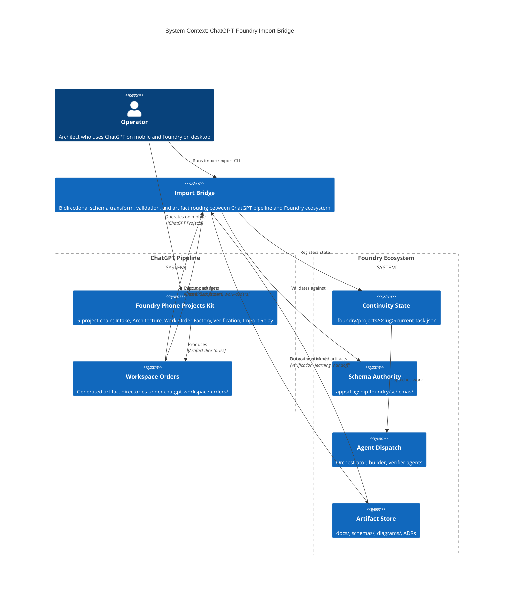
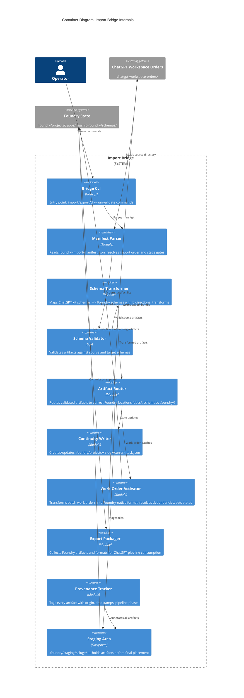

# Intent Packet: ChatGPT-Foundry Bidirectional Import Bridge

**Packet ID**: `ip-chatgpt-foundry-import-bridge-2026-03-31`
**Date**: 2026-03-31
**Status**: Draft — ready for architecture review
**Author**: Evan McCall (operator/architect)
**Source Pipeline**: chatgpt-workspace-setup/foundry-phone-projects-kit → chatgpt-workspace-orders/SDLC-Building-Blocks

---

## Problem Statement

- **Problem**: The Foundry ecosystem has no import bridge for externally-generated artifacts. ChatGPT Projects (via foundry-phone-projects-kit) produce high-quality intent packets, architecture packets, and work-order batches — but these sit in `chatgpt-workspace-orders/` with no path into the Foundry runtime (continuity state, plan execution, agent dispatch). Conversely, Foundry verification/learning artifacts have no export path back to the ChatGPT pipeline (Projects 4/5). The operator must manually translate artifacts between two incompatible authority systems in both directions.

- **Stakeholder**: Evan McCall — operator/architect who uses ChatGPT Projects on mobile for discovery/define/architect phases and Foundry (Claude Code / Cursor) for plan/implement/verify phases.

- **Success Outcome**: Operator runs import/export commands that bidirectionally bridge ChatGPT workspace artifacts and Foundry-native artifacts — validating against schemas, registering in continuity state, and making work orders executable by Foundry agents — with no manual file reformatting.

- **Constraints**:
  - Must not create a second source of truth — imported artifacts become Foundry-native upon ingestion
  - Must preserve the existing artifact authority stack (12-level hierarchy)
  - Must validate against Foundry schemas before accepting any artifact
  - Must not bypass approval gates or verification requirements
  - ChatGPT pipeline schemas are the *source* format; Foundry schemas are the *target* for inbound
  - Foundry schemas are the *source* format; ChatGPT pipeline schemas are the *target* for outbound
  - Must track provenance (origin workspace, pipeline phase, generation timestamp)
  - Must honor `foundry-import-manifest.json` sequencing from source deliverables

- **Known Risks**:
  - **R1**: Schema drift — ChatGPT kit schemas may diverge from Foundry schemas over time (Medium/High)
  - **R2**: Partial imports — Some deliverables may be incomplete / DoR not met (High/Medium)
  - **R3**: Authority confusion — Imported artifacts need clear provenance tracking (High/Medium)
  - **R4**: Work-order ID collisions with existing Foundry work orders (Medium/Low)
  - **R5**: Contract mismatches between ChatGPT-generated and Foundry-native schemas (High/Medium)
  - **R6**: Export leakage — Foundry runtime/sensitive state exported unintentionally (Medium/Medium)
  - **R7**: Stale round-trip — Artifacts modified in both systems without conflict detection (Medium/Medium)

---

## Scope

### In Scope
1. **Inbound import pipeline**: Ingest ChatGPT workspace output directories (intent packets, architecture packets, work-order batches) into Foundry-native format
2. **Schema transformation layer**: Map ChatGPT kit schemas → Foundry schemas with validation at both ends
3. **Manifest-driven import sequencing**: Honor `foundry-import-manifest.json` artifact ordering and `importStage` gates
4. **Continuity state registration**: Create/update `.foundry/projects/<slug>/current-task.json` from imported state
5. **Work-order activation**: Transform `work-order-batch.json` into Foundry-executable work orders with proper agent routing, model tier, and file scope
6. **Outbound export pipeline**: Package Foundry verification reports, evidence bundles, release notes, learning records, and handoff docs into ChatGPT pipeline Project 4/5 format
7. **Provenance tracking**: Tag every imported/exported artifact with origin, timestamp, and pipeline phase
8. **Validation gates**: Schema validation, DoR checklist verification, dependency resolution before activation

### Non-Goals
- Generic ETL or data pipeline framework
- Real-time sync between ChatGPT and Foundry (batch import/export only)
- Modifying the ChatGPT pipeline kit itself (it remains an independent upstream)
- Supporting non-Foundry target systems
- Auto-execution of imported work orders (approval gates remain human-controlled)
- UI/dashboard for import operations (CLI-first)

---

## Glossary

| Term | Definition |
|------|-----------|
| **ChatGPT Pipeline** | The 5-project chain (Intake → Architecture → Work-Order Factory → Verification → Import Relay) operated via foundry-phone-projects-kit |
| **Workspace Output** | A directory under `chatgpt-workspace-orders/` containing artifacts from one pipeline run |
| **Import Manifest** | `foundry-import-manifest.json` — declares artifact ordering, import stage, and post-import actions |
| **Import Stage** | One of: `pre_implementation`, `post_verification`, `knowledge_base_only` |
| **Schema Transform** | A mapping function that converts a ChatGPT kit schema instance to a Foundry schema instance |
| **Provenance Record** | Metadata tracking artifact origin (workspace, phase, timestamp, pipeline project) |
| **Activation** | The process of making an imported work order executable by Foundry agents |
| **Export Bundle** | A packaged set of Foundry artifacts formatted for ChatGPT pipeline Project 4/5 consumption |
| **Round-Trip Artifact** | An artifact that has been imported, modified in Foundry, and exported back |
| **Artifact Authority** | The Foundry 12-level hierarchy determining which artifact type takes precedence |

---

## Acceptance Criteria

- [ ] Given a ChatGPT workspace output directory with a valid `foundry-import-manifest.json`, when the operator runs the import command, then all listed artifacts are validated against their respective Foundry schemas and ingested in declared `importOrder`
- [ ] Given an imported intent packet, when ingestion completes, then a `.foundry/projects/<slug>/current-task.json` continuity file exists with `lifecycleStage: "define"` and references to ingested artifacts
- [ ] Given an imported architecture packet with ADRs and contracts, when ingestion completes, then ADRs are placed in `docs/adr/`, contracts in `apps/flagship-foundry/schemas/`, and diagrams in `docs/diagrams/` — all registered in continuity state artifacts catalog
- [ ] Given an imported `work-order-batch.json` with 15 work orders, when activation runs, then each work order is mapped to a Foundry-native work order with valid `agentRole`, `modelTier`, `taskClass`, and `fileScope` — and only `status: "ready"` orders are queued
- [ ] Given a work order with `dependsOn` references, when activation runs, then blocked orders are marked `status: "blocked"` and unblocked only when dependencies complete
- [ ] Given a schema validation failure on any artifact, when the import command runs, then the import halts with a structured error report identifying the failing artifact, field, and violation — no partial state is written
- [ ] Given completed Foundry verification and learning artifacts, when the operator runs the export command targeting a ChatGPT pipeline project, then artifacts are packaged in ChatGPT kit schema format with a valid `foundry-import-manifest.json` for the target project
- [ ] Given an imported artifact, when it is queried in Foundry, then its provenance record shows origin workspace, pipeline project number, generation timestamp, and import timestamp
- [ ] Given an existing Foundry project with active continuity state, when an import targets the same project, then the operator is warned of conflicts and must explicitly approve the merge
- [ ] Given the import bridge CLI, when run with `--dry-run`, then it reports what would be imported/transformed/placed without writing any files

---

## Rollback Plan

- All imports are idempotent — re-running with `--force` overwrites; without it, skips existing
- Feature-flag `FOUNDRY_IMPORT_BRIDGE_ENABLED` gates activation of imported work orders
- Imported artifacts are placed in a staging directory (`.foundry/staging/`) before final placement; operator confirms before commit
- Git branch isolation: imports create a dedicated branch `import/<slug>` for review before merge
- Export operations are read-only on Foundry state — no risk of data loss

---

## System Context Diagram

## Container Diagram

---

## Applicable Principles

| Principle | Applies | How |
|-----------|---------|-----|
| `artifact-authority` | **Yes** | Imported artifacts must respect the 12-level authority stack. ChatGPT-generated schemas (level 7) do not override Foundry doctrine (level 1) or ADRs (level 5). Provenance tracking ensures authority is never ambiguous. |
| `blast-radius-before-build` | **Yes** | Import must identify all affected systems/files before writing. The `--dry-run` flag and staging area enforce this. |
| `approval-at-plan-boundary` | **Yes** | Imported work orders are never auto-executed. Activation queues them; human approves execution. Staging → commit is also gated. |
| `independent-verification` | **Yes** | Imported verification artifacts from ChatGPT pipeline are informational only — Foundry verifier independently validates implementation claims. |
| `continuity-is-mandatory` | **Yes** | Every import/export operation updates continuity state. Interrupted imports can resume from staging. |
| `fix-memory-compounds` | **Yes** | Schema transform failures and validation errors become test fixtures for future imports. |

## Guardrail Packs

- [x] `guardrail:typescript-core` — All bridge code is TypeScript; strict mode, no `any`, schema-validated I/O
- [ ] ~~`guardrail:chrome-extension-mv3`~~ — Not applicable
- [ ] ~~`guardrail:web-frontend`~~ — Not applicable (CLI-first, no UI)
- [ ] ~~`guardrail:aws-serverless`~~ — Not applicable (local-first)

---

## Intent Packet Summary

- **Phase**: ready for `plan`
- **Primary Agent**: @orchestrator
- **Next Action**: invoke `scope-chunker` to decompose into work orders
- **Key Decisions Resolved**:
  1. **Schema transforms**: Code-generated from JSON Schema diffs (not hand-authored)
  2. **Bridge location**: `apps/flagship-foundry/packages/import-bridge/` (Nx package within monorepo)
  3. **Export target**: Dedicated project directory created for each pipeline run — intake files migrate in, next-step files export out (not inline into source ChatGPT directory)
  4. **Conflict resolution**: Manual diff comparison and merge — operator reviews conflicts and decides per-artifact
- **Definition of Ready Met**: **Yes** — Problem stated, scope bounded, acceptance criteria testable, risks identified, rollback documented, diagrams produced, principles applied, all architecture decisions resolved
