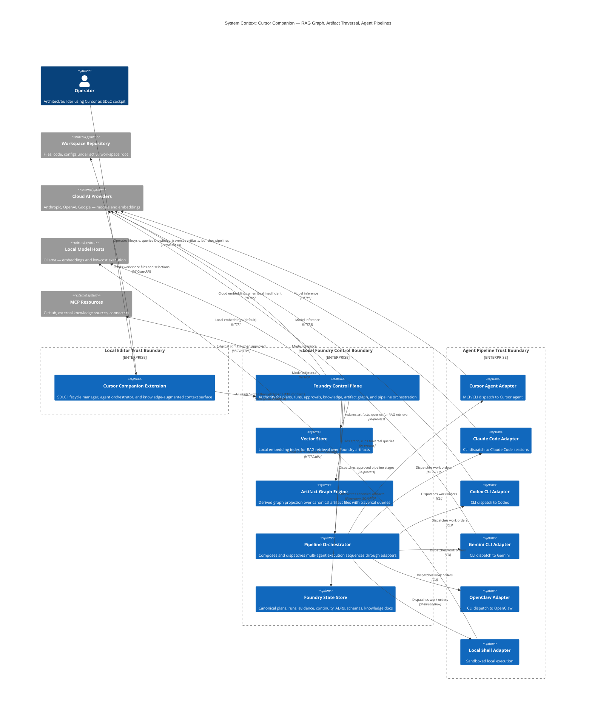
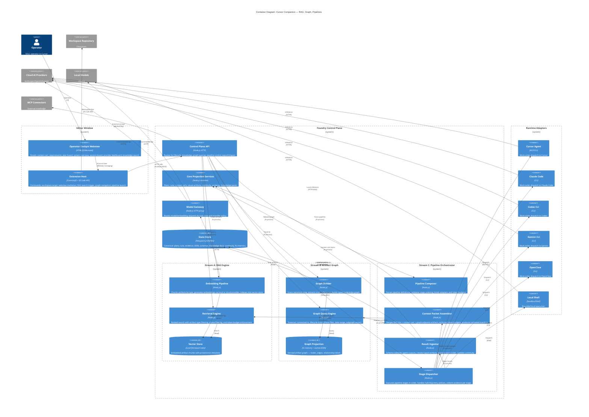

# Intent Packet: Cursor Companion — RAG Graph, Artifact Traversal, Agent Pipelines

**Packet ID**: `ip-cursor-companion-rag-graph-pipelines-2026-04-03`  
**Date**: 2026-04-03  
**Status**: Ready for `plan`  
**Author**: Claude Code `define-intent` pass for Evan McCall  
**Primary Surface**: `apps/flagship-foundry/apps/cursor-companion/`  
**Depends On**: `ip-cursor-companion-sdlc-operator-2026-04-02` (all constraints remain in force)

---

## Problem Statement

- **Problem**: The cursor-companion operator surface (scoped by `ip-cursor-companion-sdlc-operator-2026-04-02`) handles workspace targeting, context carts, requirement refinement, and plan/run lifecycle. But three critical capabilities remain disconnected:

  1. **Knowledge retrieval is passive** — Knowledge schemas exist (knowledge-pack, knowledge-document, gap-report) and the control plane has `/knowledge/ingest` and `/analysis/gaps` endpoints, but there is no active retrieval layer. The operator manually curates context carts from workspace files; there is no embedding-backed search, no graph-based relevance scoring, and no automatic context assembly from prior artifacts, ADRs, schemas, or fix-memory records. Evaluation of DoR criteria and work-order scoping happens without the system's own knowledge being queryable.

  2. **Artifact traversal is flat** — Plans, runs, evidence bundles, continuity state, ADRs, diagrams, schemas, and work orders are stored as independent JSON/markdown files. There is no graph that connects them — you can't ask "show me everything related to this work order" or "what artifacts were produced across the lifecycle of this feature." System overview requires manual file-by-file reading, and export/import of a coherent artifact set for handoff between agents or sessions doesn't exist.

  3. **Agent pipeline orchestration is stubbed** — Six terminal adapters are configured (Cursor, Claude Code, Codex, Gemini, OpenClaw, dry-run) and the run lifecycle exists in simulate mode, but execute-mode dispatch, multi-agent pipeline composition (e.g., architect->builder->verifier chains), result aggregation across agents, and round-trip context flow between Cursor and external AI pipelines are not wired.

- **Stakeholder**: Evan McCall as primary operator-architect using Cursor as the host. Secondary: any future Foundry operator who needs a single extension surface to query system knowledge, traverse lifecycle artifacts, and orchestrate multi-agent execution pipelines.

- **Success Outcome**: From cursor-companion, the operator can query the system's accumulated knowledge (artifacts, schemas, ADRs, fix-memory, prior plans) via RAG-backed retrieval, navigate a connected artifact graph for full lifecycle visibility, export bounded context packets to any configured AI agent pipeline, import structured results back with evidence binding, and compose multi-agent execution sequences — all grounded in Foundry's typed contracts and approval boundaries.

- **Constraints**:
  - All constraints from `ip-cursor-companion-sdlc-operator-2026-04-02` remain in force (extension as projection surface, control-plane authority, local-first, approval-gated execution, no secret leakage)
  - RAG retrieval is advisory context, not authoritative state — it supplements operator decisions, doesn't override artifact authority
  - Artifact graph is a derived view over canonical JSON/markdown files, not a separate database that could diverge
  - Agent pipeline orchestration stays within the work-order contract boundary — no freeform prompt dispatch outside approved plans
  - Export packets must be self-contained and schema-validated; import must produce typed artifacts with provenance tracking

- **Known Risks**:
  - **R1**: Embedding quality — Local embedding models (Ollama) may produce low-quality retrieval for code-heavy artifacts; fallback to cloud embeddings adds latency and cost
  - **R2**: Graph staleness — A derived artifact graph can fall out of sync with filesystem state if updates bypass the control plane
  - **R3**: Context window overflow — RAG-assembled context packets could exceed agent token budgets if relevance scoring isn't bounded by task-class context limits
  - **R4**: Pipeline composition complexity — Multi-agent chains introduce ordering, failure propagation, and conflict resolution concerns that don't exist in single-adapter runs
  - **R5**: Round-trip fidelity — Exporting context to an external agent and importing results requires schema-validated handoff contracts; lossy round-trips corrupt continuity
  - **R6**: Security surface expansion — RAG retrieval and artifact graph queries expose internal system state; access must respect the existing authorization model

---

## Scope

### In Scope

**Stream A: Knowledge-Based RAG Graph**

1. **Embedding pipeline** — Ingest Foundry artifacts (ADRs, schemas, plans, evidence bundles, fix-memory records, knowledge documents, continuity state, diagrams, glossary terms, principle cards) into a local vector store with chunking strategy tuned per artifact type.
2. **Retrieval engine** — Query the vector store from control-plane endpoints with relevance scoring, artifact-type filtering, phase filtering, and task-class context budget enforcement (per the existing budget table: 12k-32k tokens by class).
3. **RAG-augmented context assembly** — Extend the context cart to accept RAG-sourced items alongside manual selections. Items carry `authority: rag-retrieval` with provenance (source artifact ID, similarity score, retrieval timestamp).
4. **DoR evaluation with knowledge backing** — When checking Definition of Ready, query the RAG graph to surface related prior decisions (ADRs), known risks (fix-memory), existing contracts (schemas), and coverage gaps — presented as advisory evidence in the requirement refinement panel.
5. **Work-order scoping with RAG** — When the scope-chunker decomposes intent into work orders, RAG retrieval pre-populates `sourceArtifacts` and `constraints` fields from relevant prior artifacts with provenance annotations.

**Stream B: Artifact Graph and System Overview**

6. **Artifact relationship graph** — Build a derived graph (nodes = artifacts, edges = references/dependencies) from filesystem state. Node types: plan, work-order, run, evidence-bundle, ADR, schema, diagram, continuity-state, knowledge-document, fix-memory, principle-card, guardrail-pack, persona.
7. **Graph query API** — Control-plane endpoints for traversal: "everything connected to this work order," "all artifacts produced in phase X," "lifecycle trace for feature Y," "what changed since date Z."
8. **System overview projection** — A companion panel that renders the artifact graph as a navigable visualization (using the existing graph viewer infrastructure from `apps/graph-viewer/`), with filtering by phase, artifact type, date range, and project.
9. **Export as bounded packet** — Select a subgraph (e.g., all artifacts for a feature lifecycle) and export as a self-contained, schema-validated archive with manifest, suitable for handoff to another agent session or external review.
10. **Import with provenance** — Import an artifact packet produced by an external agent or prior session, validate against schemas, bind to the active ecosystem, and track provenance (source agent, session ID, import timestamp).

**Stream C: Agent Pipeline Orchestration**

11. **Execute-mode adapter completion** — Wire the existing terminal adapters (Cursor, Claude Code, Codex, Gemini, OpenClaw) to dispatch real work orders in execute mode, with task correlation, session logging, and evidence collection.
12. **Pipeline composer** — Define multi-step agent sequences (e.g., context-curator->systems-architect->builder->verifier) as typed pipeline definitions with stage ordering, failure policies (halt, skip, retry), and result aggregation rules.
13. **Context packet export for agent pipelines** — Before dispatching a work order to an adapter, assemble a bounded context packet (RAG hits + context cart + relevant artifacts from the graph) that fits within the target agent's token budget.
14. **Result ingestion from agent pipelines** — When an adapter completes, ingest structured results back into the ecosystem as typed artifacts (code changes, evidence, verification reports, ADR drafts), bind to the originating work order, and update continuity state.
15. **Session board enhancement** — Extend the session board panel to show live pipeline state: which agent is active, what stage of the pipeline, accumulated evidence, and blocking conditions.

### Non-Goals

- Building a custom embedding model or fine-tuning — use off-the-shelf embeddings (local via Ollama or cloud via provider APIs)
- Replacing the filesystem state store with a graph database — the artifact graph is a derived projection, not a new SSOT
- Real-time collaborative multi-operator workflows — remains single-operator, local-first
- Freeform prompt dispatch outside work-order contracts — all agent interactions flow through approved plans
- Building a visual graph editor for manually creating artifact relationships — relationships are derived from references in artifacts
- Billing-grade token accounting — usage tracking remains advisory per ADR-013 constraints

---

## Glossary

| Term | Definition |
|------|-----------|
| **RAG Retrieval** | Retrieval-Augmented Generation — querying a vector store of embedded artifacts to find relevant context for a given task or query. |
| **Artifact Graph** | A derived directed graph where nodes are Foundry artifacts (plans, ADRs, schemas, evidence, etc.) and edges represent references, dependencies, or temporal relationships between them. |
| **Context Packet** | A bounded, schema-validated bundle of artifacts, RAG hits, and context cart items assembled for handoff to an AI agent pipeline, constrained by task-class token budgets. |
| **Pipeline Definition** | A typed sequence of agent stages (e.g., architect->builder->verifier) with ordering, failure policies, and result aggregation rules. |
| **Provenance** | Metadata tracking the origin of an artifact or context item — source agent, session ID, retrieval method, similarity score, timestamp. |
| **Embedding Pipeline** | The process of chunking Foundry artifacts by type, generating vector embeddings, and indexing them in a local vector store for retrieval. |
| **Graph Traversal Query** | A control-plane request that walks the artifact graph to collect connected nodes — e.g., "all artifacts reachable from work-order WO-123." |
| **Result Ingestion** | The process of importing structured outputs from an agent pipeline back into the ecosystem as typed Foundry artifacts with provenance and work-order binding. |
| **System Overview** | A navigable visualization of the artifact graph showing lifecycle state, phase coverage, and artifact relationships for the active ecosystem. |
| **Advisory Retrieval** | RAG results carry relevance scores and provenance but do not override artifact authority — they supplement operator decisions. |
| **Pipeline Stage** | One step in a multi-agent pipeline, bound to a specific adapter, agent role, and work-order slice. |
| **Export Manifest** | A schema-validated index file within an exported artifact packet listing contents, schemas, provenance, and integrity checksums. |

---

## Acceptance Criteria

### Stream A: Knowledge-Based RAG Graph

- [ ] Given Foundry artifacts exist in the ecosystem (ADRs, schemas, plans, fix-memory, knowledge docs), when the embedding pipeline runs, then artifacts are chunked by type, embedded, and indexed in a local vector store with per-artifact provenance metadata.
- [ ] Given an operator query or task context, when RAG retrieval is invoked, then results are returned ranked by relevance, filtered by artifact type and phase, and bounded by the applicable task-class token budget.
- [ ] Given RAG results are available, when the operator views the context cart, then RAG-sourced items appear with `authority: rag-retrieval`, source artifact ID, similarity score, and the operator can accept, reject, or pin individual items.
- [ ] Given a requirement refinement session is active, when DoR evaluation runs, then the system surfaces related ADRs, fix-memory records, existing schemas, and coverage gaps from RAG as advisory evidence alongside the checklist.
- [ ] Given scope-chunker is invoked on an intent packet, when work orders are generated, then `sourceArtifacts` and `constraints` fields are pre-populated from RAG-retrieved prior artifacts with provenance annotations.

### Stream B: Artifact Graph and System Overview

- [ ] Given artifacts exist across lifecycle phases, when the artifact graph is built, then every artifact is a typed node and cross-references between artifacts produce directed edges with relationship labels (produced-by, depends-on, verifies, supersedes).
- [ ] Given the artifact graph is built, when the operator queries "everything connected to work-order X," then the traversal returns all transitively connected artifacts with path metadata.
- [ ] Given the operator opens the system overview panel, then the artifact graph renders as a navigable visualization with filtering by phase, artifact type, date range, and project.
- [ ] Given the operator selects a subgraph, when they invoke export, then a self-contained archive is produced with a schema-validated manifest, all referenced artifacts, and integrity checksums.
- [ ] Given an artifact packet from an external source, when the operator invokes import, then artifacts are schema-validated, bound to the active ecosystem with provenance (source, session, timestamp), and appear in the artifact graph.

### Stream C: Agent Pipeline Orchestration

- [ ] Given an approved work order and a configured adapter, when the operator launches execute mode, then the work order is dispatched to the real adapter with task correlation IDs, and the session board shows live status.
- [ ] Given a pipeline definition with multiple stages, when the operator launches the pipeline, then stages execute in order, each receiving the accumulated context packet, and failures are handled per the pipeline's failure policy (halt/skip/retry).
- [ ] Given a work order is about to be dispatched, when the context packet is assembled, then it includes RAG hits + context cart + graph-adjacent artifacts, bounded to the target adapter's token budget, with a validated manifest.
- [ ] Given an adapter completes execution, when results are returned, then structured outputs are ingested as typed Foundry artifacts, bound to the originating work order, and continuity state is updated.
- [ ] Given a multi-stage pipeline is running, when the operator views the session board, then they see the current stage, active agent/adapter, accumulated evidence per stage, and any blocking conditions.

---

## Rollback Plan

- **Stream A**: Embedding pipeline and vector store are additive infrastructure. Rollback = stop indexing, remove vector store directory, context cart falls back to manual-only curation. RAG endpoints return empty results gracefully.
- **Stream B**: Artifact graph is a derived projection. Rollback = disable graph build/query endpoints, system overview panel shows "not available." Canonical artifact files are untouched.
- **Stream C**: Execute mode is gated behind the existing approval boundary. Rollback = revert to simulate-only mode (already the default). Pipeline definitions are additive config. Result ingestion can be disabled without affecting manually-created artifacts.
- Each stream is independently deployable and independently rollback-safe. No stream modifies the authority of existing artifacts, plans, or continuity state.

---

## System Context Diagram (C4 Level 1)

**Saved**: `docs/diagrams/cursor-companion-rag-graph-pipelines-context-2026-04-03.mmd`

## Container Diagram (C4 Level 2)

**Saved**: `docs/diagrams/cursor-companion-rag-graph-pipelines-containers-2026-04-03.mmd`

### Trust Boundaries

- **Editor <-> Control Plane**: All extension->control-plane communication is typed HTTP contracts. Extension never writes directly to state store.
- **Control Plane <-> Adapters**: Work orders dispatched only through approval boundary. Adapters run in isolation; results are schema-validated before ingestion.
- **RAG Engine <-> State Store**: Embedding pipeline reads canonical artifacts. Vector store is derived; never authoritative.
- **Artifact Graph <-> State Store**: Graph is a projection rebuilt from canonical files. Graph projection is cached but disposable.
- **Cloud Provider Boundary**: Embedding and inference calls cross the network boundary. Secrets stay in environment/secure storage, not in exported context packets.

### Data Flow

- Artifacts flow: State Store -> Embedding Pipeline -> Vector Store -> Retrieval Engine -> Context Assembler -> Adapter -> Result Ingestor -> State Store (full cycle)
- Graph flows: State Store -> Graph Builder -> Graph Projection -> Graph Query -> Extension (read-only derived view)
- Pipeline flows: Pipeline Definition -> Composer -> Stage Dispatcher -> [Context Assembly -> Adapter -> Result Ingestion] per stage -> Evidence to Session Board

---

## Applicable Principles

| Principle | Applies | How |
|-----------|---------|-----|
| `principle:artifact-authority` | yes | RAG vector store and artifact graph are derived projections, never authoritative. Exported context packets reference canonical artifact IDs. Result ingestion produces new canonical artifacts — graph and vector store catch up on next rebuild/index. |
| `principle:blast-radius-before-build` | yes | Each stream introduces new control-plane modules. Affected surface must be expanded before implementation. Pipeline composer must compute blast radius per stage before dispatch. |
| `principle:approval-at-plan-boundary` | yes | Pipeline orchestration must not bypass approval model. Each pipeline stage dispatches an approved work order. Auto-approval policies respected but never silently introduced. |
| `principle:independent-verification` | yes | Agent pipeline results must be independently verifiable. Verifier stage receives evidence bundle, not builder self-assessment. Result ingestor requires verifier evidence or operator approval. |
| `principle:continuity-is-mandatory` | yes | Every pipeline stage emits continuity state updates. Interrupted pipelines capture: completed stages, in-progress stage, collected evidence, next resumable action. RAG/graph state is recoverable from canonical files. |
| `principle:fix-memory-compounds` | yes | Fix-memory records are first-class in the RAG index. DoR evaluation surfaces relevant fix-memory as advisory evidence. Historical fixes become progressively more discoverable. |
| `principle:complexity-budgets` | yes | RAG engine uses existing model gateway for embeddings. Artifact graph reuses graph-viewer infrastructure. Pipeline orchestrator extends existing run executor. Token budgets per task class are hard limits. |
| `principle:contract-first` | yes | 11 new schemas must be defined and reviewed before implementation: embedding-index-entry, rag-query, rag-result, artifact-graph-node, artifact-graph-edge, graph-traversal-query, export-manifest, import-receipt, pipeline-definition, context-packet, pipeline-stage-result. |
| `principle:observed-vs-declared-truth` | yes | RAG results are observed (similarity scores vary). Artifact authority is declared (canonical files). Context cart distinguishes RAG-sourced from manually-declared items. Session board separates observed execution status from declared plan/approval state. |

---

## Guardrail Packs

- [x] `guardrail:workspace-governance` — Every stream emits plan records, approval posture, continuity updates, and explicit blast radius. Export/import produce artifact records. Pipeline stages produce evidence per workspace governance contract.
- [x] `guardrail:terminal-agent-adapters` — All six adapters translate the same work-order contract. Pipeline dispatch preserves run-scoped isolation. Each invocation emits: adapter invocation envelope, session log, task result contract.
- [x] `guardrail:telemetry-and-observability` — Pipeline execution, RAG retrieval latency, embedding throughput, and graph rebuild performance emit telemetry. Before/after snapshots for evidence bundles. Run-task correlation keys flow through pipeline stages to session board.
- [x] `guardrail:nx-monorepo` — New modules added to `apps/flagship-foundry`. Affected verification runs before merge. Shared modules (core, model-gateway) are review surfaces when contracts change.
- [x] `guardrail:react-vite-ui` — Artifact graph visualization extends graph-viewer React app. UI is view over graph query contract. Shared components are blast-radius parents.
- [x] `guardrail:chrome-extension-mv3` — Keep orchestration and durable state out of extension UI. Extension host mediates between webview and control plane. Message contracts are diffed and verified.
- [ ] `guardrail:aws-serverless` — Not applicable. Local-first architecture, no cloud deployment in this slice.

---

## New Contracts Required (Contract-First Gate)

### Stream A: RAG Engine

| Contract | Purpose |
|----------|---------|
| `embedding-index-entry.schema.json` | One chunk in the vector store: artifact ID, chunk index, text, embedding vector reference, artifact type, phase, provenance metadata |
| `rag-query.schema.json` | Retrieval request: query text, artifact-type filter, phase filter, token budget, max results |
| `rag-result.schema.json` | Retrieval response: ranked items with source artifact ID, chunk text, similarity score, provenance, token count |

### Stream B: Artifact Graph

| Contract | Purpose |
|----------|---------|
| `artifact-graph-node.schema.json` | Node in the derived graph: artifact ID, type, phase, project, created/updated timestamps, summary |
| `artifact-graph-edge.schema.json` | Edge: source node ID, target node ID, relationship label (produced-by, depends-on, verifies, supersedes, references), extraction method |
| `graph-traversal-query.schema.json` | Traversal request: start node(s), direction, max depth, type filters, phase filters, date range |
| `export-manifest.schema.json` | Archive manifest: packet ID, ecosystem ID, artifact list with schema refs, provenance, integrity checksums, export timestamp |
| `import-receipt.schema.json` | Import result: packet ID, bound ecosystem ID, created artifact IDs, validation results, provenance (source agent, session, timestamp) |

### Stream C: Pipeline Orchestrator

| Contract | Purpose |
|----------|---------|
| `pipeline-definition.schema.json` | Typed sequence: pipeline ID, stages (ordered), per-stage: adapter ID, agent role, work-order ref, token budget, failure policy |
| `context-packet.schema.json` | Assembled context: packet ID, work-order ref, items (RAG hits + cart items + graph artifacts), total token count, manifest, provenance per item |
| `pipeline-stage-result.schema.json` | Per-stage output: stage ID, adapter ID, status, produced artifacts, evidence refs, telemetry refs, duration, failure details if any |

---

## ADR Candidates

| ADR | Decision Point |
|-----|---------------|
| ADR-014 | **Vector store technology choice** — File-based local index (e.g., HNSWlib, Vectra) vs. embedded SQLite-vec vs. external service. Recommendation: file-based local index for local-first constraint; re-evaluate if retrieval quality is insufficient. |
| ADR-015 | **Artifact graph derivation strategy** — Full rebuild on demand vs. incremental update on artifact write vs. event-driven rebuild. Recommendation: incremental update triggered by control-plane write operations, with full rebuild as fallback/recovery. |
| ADR-016 | **Pipeline failure propagation model** — Per-stage policies (halt/skip/retry) vs. pipeline-level policy vs. hybrid. Recommendation: per-stage policies with pipeline-level default, matching the existing run lifecycle's pause/resume model. |
| ADR-017 | **Context packet token budget enforcement** — Hard truncation vs. relevance-ranked pruning vs. operator-assisted selection. Recommendation: relevance-ranked pruning with operator override via context cart pinning. |

---

## Intent Packet Summary

- **Phase**: ready for `plan`
- **Primary Agent**: `@orchestrator`
- **Next Action**: invoke `scope-chunker` to decompose into bounded work orders across three streams
- **Key Decisions Pending**:
  - ADR-014: Vector store technology choice (file-based local vs. SQLite-vec vs. external)
  - ADR-015: Artifact graph derivation strategy (incremental vs. full rebuild vs. event-driven)
  - ADR-016: Pipeline failure propagation model (per-stage vs. pipeline-level vs. hybrid)
  - ADR-017: Context packet token budget enforcement (truncation vs. pruning vs. operator-assisted)
- **Definition of Ready Met**: yes
- **Stream Independence**: All three streams are independently implementable and independently rollback-safe. Recommended order: B (Graph) -> A (RAG) -> C (Pipelines), as the graph provides the relationship structure that RAG indexes, and pipelines consume both.
