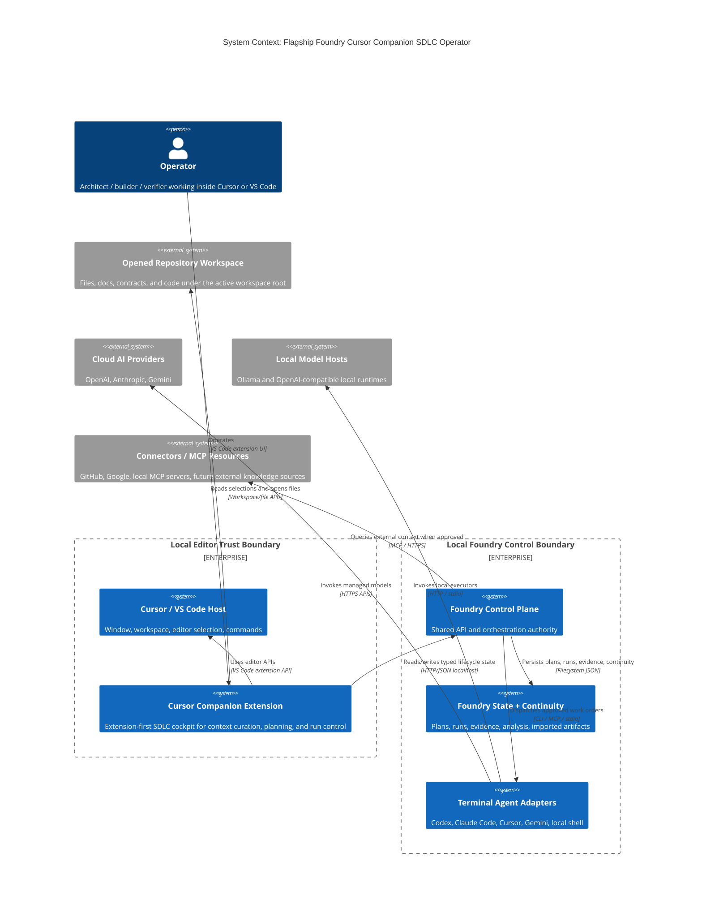
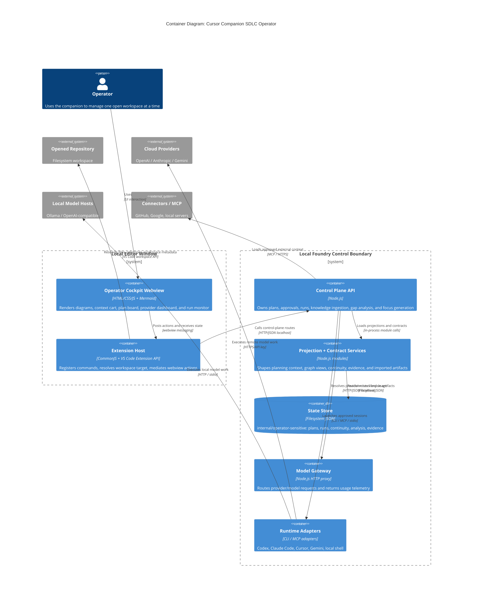

# Intent Packet: Cursor Companion SDLC Operator Surface

**Packet ID**: `ip-cursor-companion-sdlc-operator-2026-04-02`  
**Date**: 2026-04-02  
**Status**: Ready for `plan`  
**Author**: Codex `define-intent` pass for Evan McCall  
**Primary Surface**: `apps/flagship-foundry/apps/cursor-companion/`

---

## Problem Statement

- **Problem**: `apps/flagship-foundry/apps/cursor-companion/` already starts the control plane, imports the open workspace, ingests knowledge, runs gap analysis, generates focus graphs, and exposes basic plan/run controls. It does **not** yet operate as the full SDLC cockpit for the repository opened in Cursor. Context selection, requirement refinement, diagram generation, work-order inspection, provider/adapter posture, execution telemetry, and continuity state are still fragmented across CLI commands, raw state files, imported packets, and separate docs. That fragmentation makes it harder for AI to ingest the right context, harder for the operator to refine requirements into executable work orders, and easier to drift outside Foundry guardrails.
- **Stakeholder**: Primary: Evan McCall as operator/architect inside Cursor. Secondary: builders, verifiers, and future Foundry operators who need one extension-first surface for planning, approvals, execution, and review.
- **Success Outcome**: From any repository or folder opened in Cursor or another VS Code compatible host, the operator can open the companion, target the workspace, curate system context, generate and view diagrams/contracts/explainers, refine requirements to Definition of Ready, create and approve work orders, choose compliant providers/adapters within visible budget limits, and monitor approved execution without bypassing Foundry artifacts.
- **Constraints**:
  - The extension remains a **thin operator surface** over the control plane; it must not become a second source of truth.
  - Foundry artifacts, schemas, approvals, continuity, and evidence remain authoritative over chat history or panel-local state.
  - Initial scope stays **local-first** and **single-operator**; multi-user auth and cloud tenancy are deferred.
  - Execution remains approval-gated; the extension must not run arbitrary graph nodes outside approved plan/work-order contracts.
  - `apps/flagship-foundry/apps/cursor-companion/extension.js` remains the CommonJS entrypoint for the near-term slice, but helper modules may be added.
  - Secrets and provider credentials stay in environment or secure storage, not repo state.
  - “Pop-out” support for v1 must use host-supported new-window behavior or a second workspace window, not undocumented Cursor internals.
- **Known Risks**:
  - **R1**: The current monolithic extension host file becomes harder to evolve if new surfaces are added without refactoring.
  - **R2**: Multi-root or retargeted workspaces could bind plans/runs to the wrong repository if targeting is implicit.
  - **R3**: Diagram and explainer generation can become slow or noisy on large repos unless the context slice is explicit.
  - **R4**: Usage-limit visibility can be incomplete if vendor billing APIs are treated as authoritative before adapters report stable telemetry.
  - **R5**: VS Code/Cursor windowing APIs may not support a truly detached custom extension window; a host-window strategy is required.
  - **R6**: Runtime observations such as provider health, token usage, and run status can be confused with declared state unless they are modeled separately.
  - **R7**: Permissions and message contracts could sprawl if the extension starts to own orchestration logic that belongs in the control plane.

---

## Scope

### In Scope

1. **Operator shell refactor**: evolve the extension from a single overlay into a modular SDLC cockpit while keeping the current commands functional.
2. **Workspace target authority**: explicitly resolve, display, persist, and retarget the repository/folder currently open in Cursor so lifecycle operations are scoped to the intended workspace.
3. **Context cart and requirement refinement**: let the operator select files, graph nodes, imported artifacts, docs, and manual notes into a typed context bundle that AI can use to iteratively refine requirements.
4. **Definition of Ready workflow**: show knowledge gaps, unresolved assumptions, missing contracts, and readiness status before generating executable work orders.
5. **Visual artifact generation and viewing**: generate and render system context diagrams, flow controls, component UML, pseudocode explainers, schema/data-contract views, and blast-radius/focus visuals from explicit inputs.
6. **Plan and work-order board**: create plans, inspect work-order trees, review dependencies/file scope, approve plans, and surface blocked conditions from inside the extension.
7. **Provider, adapter, and usage posture**: expose routing policy, provider capabilities, adapter health, risk fit, and budget/usage snapshots for Codex, Claude Code, Cursor, Gemini, local hosts, and approved connectors.
8. **Approved execution lifecycle**: launch only approved work orders/plans, then monitor run status, logs pointers, continuity links, evidence references, and rollback posture from the extension.
9. **Secondary-window operating mode**: support using the companion in a separate editor window or moved tab while keeping the same workspace target and Foundry state.

### Non-Goals

- Building the full Theia-based product shell in this slice
- Multi-user collaboration, tenancy, or centralized auth
- Billing-grade reconciliation with vendor invoice APIs in v1
- Direct execution of arbitrary nodes or prompts outside approved plan/work-order contracts
- Freeform diagram editing canvas as a replacement for artifact-backed generation
- Editing canonical personas, skills, or runbooks inline from the extension before contract governance exists

---

## Glossary

| Term | Definition |
|------|-----------|
| **Cursor Companion** | The VS Code/Cursor compatible extension under `apps/flagship-foundry/apps/cursor-companion/`. |
| **Workspace Target** | The explicit repository/folder currently bound to the operator session. |
| **Context Cart** | A typed bundle of files, graph nodes, imported packets, docs, and manual notes selected for AI context. |
| **Requirement Refinement Session** | The guided process that turns a broad goal into a DoR-ready intent packet with explicit gaps and assumptions. |
| **Definition of Ready (DoR)** | The minimum state where scope, contracts, risks, acceptance criteria, and rollback are explicit enough to generate executable work orders. |
| **Visual Artifact** | A saved diagram or explainer such as C4, flow, UML, pseudocode, schema view, or blast-radius projection. |
| **Plan Board** | The extension surface for plan creation, approval posture, and work-order dependency review. |
| **Execution Budget Snapshot** | An operator-facing summary of routing, provider risk fit, adapter health, and usage-limit posture. |
| **Adapter** | The runtime bridge that translates approved work-order contracts into a target environment such as Codex, Claude Code, Cursor, Gemini CLI, or local shell. |
| **Provider** | The model backend or runtime endpoint selected by routing policy, such as OpenAI, Anthropic, Gemini, or Ollama. |
| **Session Projection** | The read model that combines run status, continuity, verifier posture, evidence pointers, and logs for display. |
| **Pop-out Mode** | Running the companion in a second editor window or moved tab while preserving the same workspace target and control-plane authority. |

---

## Acceptance Criteria

- [ ] Given a repository is open in Cursor, when the operator opens the companion, then the active **workspace target** is resolved and displayed explicitly before plan or run actions are allowed.
- [ ] Given a multi-root workspace or ambiguous root, when the operator retargets the companion, then the chosen root is persisted as a typed artifact and all subsequent plan/run/context actions use that target.
- [ ] Given the operator selects files, graph nodes, imported packets, and notes, when they add them to the **context cart**, then the bundle is saved as a typed artifact that can be reopened and reused.
- [ ] Given incomplete requirements, when the operator runs refinement, then the companion shows unresolved assumptions, knowledge gaps, missing contracts, and a Definition of Ready status that blocks work-order generation until minimum fields are present.
- [ ] Given a visual artifact request for system context, flow control, component UML, pseudocode, schema view, or data contract view, when generation succeeds, then the result is saved as a typed artifact and rendered in the companion with drill-down links back to source files where applicable.
- [ ] Given a plan is created for the active workspace target, when the operator opens the plan board, then they can inspect work-order dependencies, file scope, approval posture, blocked conditions, and linked artifacts from the extension.
- [ ] Given providers, adapters, and routing policy are configured, when the operator opens the provider surface, then the companion shows route selection, adapter capabilities, health, risk fit, and budget/usage snapshot for the configured surfaces including Codex, Claude Code, Cursor, Gemini, and local runtimes.
- [ ] Given an approved plan or approved work order, when the operator launches execution from the companion, then the run is dispatched only through the control plane and the companion displays run state, adapter ID, evidence references, continuity links, and rollback pointers.
- [ ] Given the operator wants a second-window workflow, when they invoke the pop-out flow, then the companion reopens in a host-supported new window or moved tab while keeping the same workspace target and without introducing hidden editor-only state.
- [ ] Given the new operator surfaces are disabled by feature flag or rollback, when the extension loads, then the current import, knowledge, gap-analysis, focus, plan, and run-control behavior continues to function.

---

## Rollback Plan

- Gate the new operator cockpit behind a feature flag and keep the current overlay command path available during rollout.
- Store new operator artifacts separately from existing plan/run state so rollback does not mutate current lifecycle history.
- Revert helper modules, new schemas, and new control-plane routes without deleting persisted plans/runs/evidence.
- Keep “pop-out mode” additive; if host-window behavior is unstable, fall back to the single-window panel without changing state authority.
- Treat provider budget snapshots as advisory projections first; disable the UI panel if telemetry proves unreliable rather than blocking execution incorrectly.

---

## Architecture Diagrams

### System Context (C4 L1)

**Saved**: `docs/diagrams/cursor-companion-sdlc-operator-context-2026-04-02.mmd`

### Container Diagram (C4 L2)

**Saved**: `docs/diagrams/cursor-companion-sdlc-operator-containers-2026-04-02.mmd`

---

## Applicable Principles

| Principle | Applies | How |
|-----------|---------|-----|
| `principle:complexity-budgets` | yes | Keep v1 bounded to one explicit workspace target per session, typed context bundles, projection-first budget views, and generated artifacts rather than a freeform canvas editor. |
| `principle:contract-first` | yes | Define `workspace-target`, `context-cart`, `requirement-refinement-session`, `visual-artifact`, and `execution-budget-snapshot` contracts before expanding UI behavior. |
| `principle:observed-vs-declared-truth` | yes | Separate declared requirements/plans/work orders from observed provider health, usage telemetry, run status, and logs pointers. |
| `artifact-authority` | yes | The companion renders and edits Foundry-controlled artifacts; it does not invent private hidden state outside artifact authority. |
| `approval-at-plan-boundary` | yes | Create/draft actions are allowed earlier, but execution remains approval-gated through the existing plan/work-order model. |
| `continuity-is-mandatory` | yes | Context refinement, planning, approval, execution, and handoff must all emit resumable state and linked artifacts. |

**Note**: the first three entries are already used by Foundry planning skills and prior scope-chunk artifacts even though the current JSON principle catalog emphasizes the canonical repo principles listed afterward.

---

## Guardrail Packs

- [x] `guardrail:typescript-core` — Require explicit contract types at boundaries, schema validation at ingress, and `typecheck`, `schema-validation`, plus targeted tests.
- [x] `guardrail:chrome-extension-mv3` — Keep orchestration and durable state out of ad hoc UI code, minimize permissions, diff message contracts, and run extension smoke verification.
- [x] `guardrail:web-frontend` — Treat accessibility and performance as acceptance criteria for the cockpit UI; avoid silent contract drift between panel state and control-plane state.
- [x] `guardrail:workspace-governance` — Every slice must emit a plan record, approval posture, continuity update, and explicit blast radius.
- [x] `guardrail:terminal-agent-adapters` — Adapter invocations stay thin, preserve run-scoped isolation, and emit task result contracts plus session logs.
- [ ] `guardrail:aws-serverless` — Not applicable for this local-first extension slice.

---

## Intent Packet Summary

- **Phase**: ready for `plan`
- **Primary Agent**: `@orchestrator`
- **Next Action**: invoke `scope-chunker` to decompose into bounded work orders for the first extension slice
- **Key Decisions Pending**:
  - Whether post-v1 usage-limit visibility should reconcile against vendor billing APIs or remain adapter-reported telemetry only
  - Whether long-term diagram editing belongs in the future Theia shell instead of the extension
  - Whether host-supported moved-tab/new-window behavior is sufficient for “pop-out mode” before a dedicated shell exists
- **Definition of Ready Met**: yes

