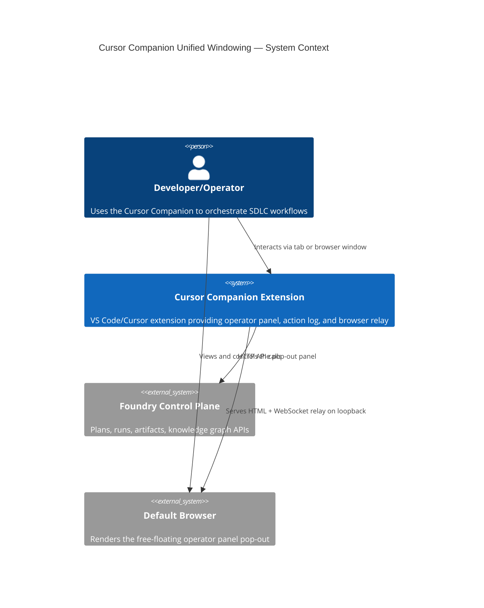
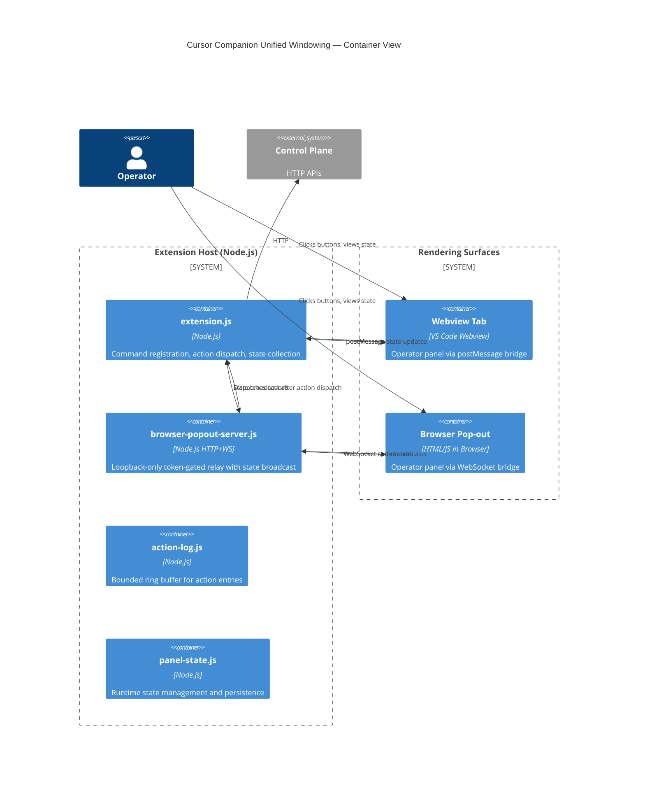

# Intent Packet: Cursor Companion Unified Windowing & State Sync

**Date**: 2026-04-10
**Author**: Evan McCall + Claude Code
**Slug**: `cursor-companion-unified-windowing`

---

## Problem Statement

- **Problem**: The Cursor Companion extension has three interrelated windowing/sync issues:
  1. **Pop-out opens CWD in a new window**: `createPopOutWindowHandler` calls `vscode.openFolder(workspaceRoot, true)`, which re-opens the workspace root in a brand-new VS Code/Cursor window. The user wants a free-floating window that stays connected to the active extension host — like how the webview tab is connected but detachable.
  2. **No bidirectional sync**: Operations executed in the webview tab (postMessage bridge) don't propagate to connected browser pop-out clients, and commands sent from the browser pop-out via WebSocket don't trigger a refresh of the webview tab. Each surface operates in isolation after initial render.
  3. **Browser pop-out lacks proper styling**: The `makeBrowserPopoutPage` default HTML is a minimal status/log page. When `renderPage` is used, it renders `overlayHtml` but the browser environment lacks VS Code CSS custom properties (`--vscode-*`), so the operator panel looks broken or unstyled in the browser.

- **Stakeholder**: Developer/operator using the Cursor Companion extension in Cursor or VS Code
- **Success Outcome**: A developer can detach the operator panel into a free-floating browser window that maintains full bidirectional state sync with the in-editor tab, and both surfaces render with consistent, polished styling.
- **Constraints**:
  - Must work within VS Code / Cursor extension API limitations (no native free-floating windows)
  - Must preserve the existing loopback-only, token-gated security model for the browser relay
  - Must not break existing webview tab functionality
  - Node built-ins only for the server (no npm dependencies)
- **Known Risks**:
  - VS Code extension API does not support native detachable windows — the browser pop-out is the only viable mechanism for a truly free-floating panel
  - WebSocket relay adds a round-trip for state sync; stale state flicker is possible
  - Race conditions if both surfaces dispatch actions simultaneously
  - Browser environment has no `acquireVsCodeApi()` — must handle graceful degradation

---

## Scope

### In Scope

1. **Replace `vscode.openFolder` pop-out with browser-based pop-out**: The "Open In New Window" button should launch the browser pop-out server and open the operator panel in the default browser, not re-open the workspace folder. This gives a true free-floating window attached to the running extension host.

2. **Bidirectional state sync via broadcast**:
   - **Tab -> Browser**: After any `dispatchOverlayAction` completes, broadcast the updated overlay state to all connected browser WebSocket clients so they re-render.
   - **Browser -> Tab**: After a browser client's command is processed, call `refreshOverlay` on the webview tab panel so it reflects the result.
   - Implement a `broadcastState` function on the browser-popout-server that pushes a `state-update` message type to all authenticated connections.

3. **Browser-appropriate styling for the operator panel**: Replace VS Code CSS custom property references (`--vscode-*`) with concrete fallback values in a standalone stylesheet that activates when `bridgeConfig.mode === 'browser'`. The browser rendering should visually match the dark theme of the in-editor panel.

### Non-Goals

- Electron-native or OS-level windowing
- Multi-workspace or multi-editor synchronization
- Cloud/remote relay (loopback-only constraint remains)
- Persisting browser window position/size across sessions
- Real-time collaborative editing between surfaces

---

## Glossary

| Term | Definition |
|------|-----------|
| Webview Tab | The VS Code webview panel opened via `flagshipFoundry.openOverlay`, using `postMessage` bridge |
| Browser Pop-out | A free-floating browser window served by the local HTTP+WS server on loopback |
| Browser Relay | The WebSocket connection between the browser pop-out and the extension host |
| Bridge Config | Object (`{ mode, wsUrl, token, protocolVersion }`) injected into `overlayHtml` to select transport |
| State Broadcast | Server-initiated push of updated overlay state to all connected browser clients |
| Operator Panel | The `overlayHtml` rendered surface showing orchestrator controls, observability, and visualizations |
| Pop-out Token | Cryptographic token gating access to the browser relay server |
| Transport | The communication mechanism: `webview` (postMessage) or `browser` (WebSocket) |

---

## Acceptance Criteria

- [ ] Given the operator panel is open as a tab, when the user clicks "Open In New Window", then the browser pop-out opens in the default browser showing the full operator panel (not a minimal status page), and the CWD is NOT re-opened in a new VS Code window.
- [ ] Given the browser pop-out is open and connected, when the user executes an action in the webview tab, then the browser pop-out reflects the updated state within 500ms without requiring a manual page reload.
- [ ] Given the webview tab is open, when the user executes an action in the browser pop-out, then the webview tab reflects the updated state within 500ms.
- [ ] Given the browser pop-out is open, the UI renders with proper dark-theme styling: readable text, styled cards, buttons, and layout matching the in-editor experience.
- [ ] Given no browser clients are connected, the "Open In New Window" button still works (starts the server and opens the browser).
- [ ] Given the browser pop-out is open, when the extension host deactivates, the browser pop-out shows a "disconnected" status gracefully.
- [ ] Given both surfaces are open, when an action errors, both surfaces display the error status consistently.

---

## Rollback Plan

1. Revert the `pop-out-window` action handler to the previous `vscode.openFolder` behavior
2. Remove the broadcast mechanism from `dispatchOverlayAction` (state sync is additive, not destructive)
3. The browser-popout-server's existing command/response protocol is unchanged — new `state-update` messages are additive
4. CSS changes are isolated to a browser-mode stylesheet block; removing it restores the previous rendering

---

## System Context Diagram

## Container Diagram

---

## Applicable Principles

| Principle | Applies | How |
|-----------|---------|-----|
| complexity-budgets | yes | Adding broadcast increases the message flow between surfaces; must keep the protocol simple (one new message type: `state-update`) |
| contract-first | yes | The browser-popout-message schema needs a new `state-update` message type defined before implementation |
| observed-vs-declared-truth | yes | Both surfaces must observe state from the same source (collectOverlayState) rather than caching stale local copies |

---

## Guardrail Packs

- [ ] guardrail:web-frontend — Browser pop-out CSS must not rely on VS Code custom properties; validate rendering in Chrome/Safari/Firefox
- [ ] guardrail:typescript-core — N/A (pure JS extension), but apply equivalent linting discipline

---

## Intent Packet Summary

- **Phase**: ready for `plan`
- **Primary Agent**: @orchestrator
- **Next Action**: invoke `scope-chunker` to decompose into work orders
- **Key Decisions Resolved**:
  1. **Keep both buttons** — `pop-out-window` (host-level window via `vscode.openFolder`) and `open-in-browser` (browser pop-out) remain separate actions. Fix `pop-out-window` to not re-open CWD; instead it should use the browser pop-out as the free-floating mechanism while keeping the button distinction for user intent clarity.
  2. **JSON state object** — `state-update` WebSocket messages carry a JSON state payload. The browser client re-renders client-side from the JSON, enabling partial updates and reducing bandwidth. The browser page needs a client-side renderer that maps the state JSON to DOM updates.
  3. **Static CSS file + advanced styling option** — Serve a standalone `browser-theme.css` via the HTTP server at `/theme.css?token=...`. Include a baseline dark theme with concrete values replacing `--vscode-*` properties. Provide an advanced styling hook: a `customThemeUrl` setting in `flagshipFoundry` configuration that, if set, loads an additional user-provided stylesheet, enabling custom branding/theming of the browser pop-out.
- **Definition of Ready Met**: yes — all decisions resolved, acceptance criteria testable, scope bounded, architecture sketched
