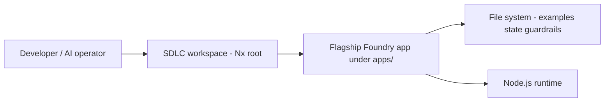
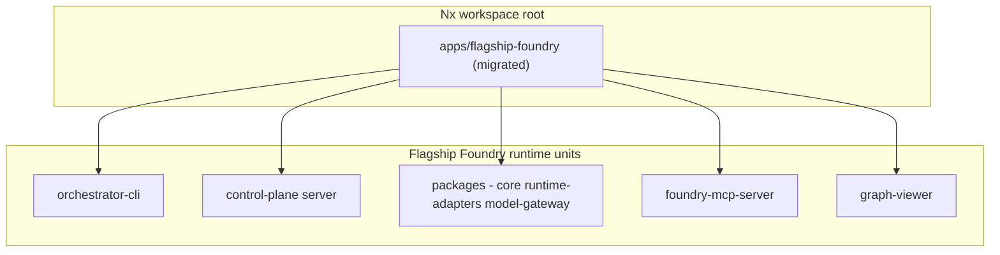

# Intent: Nx monorepo scaffold + `flagship-foundry-work` under `apps/`

**Created**: 2026-03-24  
**Source**: `/define-intent` — workspace root `SDLC - Visual - Workflow - SoftwareEngineering-NewAge`, migrate `flagship-foundry-work/`.

---

## Problem Statement

- **Problem**: The SDLC workspace is not yet an Nx monorepo at the root (no `nx.json` / root `package.json` in this tree). Flagship Foundry lives as a nested folder (`flagship-foundry-work/`) with its own Node layout (`apps/*`, `packages/*`), so it does not participate in a unified Nx graph, affected commands, or shared tooling with the rest of the workspace.
- **Stakeholder**: Developers and AI orchestration workflows that need one install graph, consistent verification (`nx affected`), and a clear place for runnable apps under `apps/`.
- **Success Outcome**: The repository root is a valid Nx + pnpm (or chosen package manager) monorepo, and the Flagship Foundry codebase is the primary application surface under the workspace `apps/` folder with scripts and CI still runnable.
- **Constraints**: Preserve Flagship behavior (CLI, control plane, MCP, tests); respect existing `.cursor` / Foundry conventions; avoid breaking relative paths to `examples/`, `state/`, `guardrails/` unless explicitly migrated; do not commit secrets; align with workspace architecture rules (tags, boundaries) where applicable.
- **Known Risks**: Path and import breakage; duplicate `apps/` semantics (workspace `apps/` vs package-internal `apps/`); test and script entrypoints drifting; long-running migration conflated with unrelated repo content (e.g. `iterative-development-storage/`).

---

## Scope

- **In Scope**:
  - Initialize Nx at the workspace root (or confirm alternate root if product owners designate a subfolder — default: repo root).
  - Add root `package.json`, lockfile strategy, and Nx configuration consistent with org standards (pnpm + Nx is the default assumption from workspace rules).
  - Relocate or re-home `flagship-foundry-work` so it lives under the monorepo `apps/` directory (exact naming: `apps/flagship-foundry` or `apps/flagship-foundry-work` — to be chosen in plan).
  - Wire Nx `project.json` (or inferred targets) for the migrated app(s) so `nx run`, `nx affected`, lint/test/build hooks work for the Foundry surface.
  - Update documentation pointers (README paths, any CI) that reference `flagship-foundry-work/`.
- **Non-Goals** (unless later slice):
  - Migrating every other folder in the repo (`iterative-development-storage/`, `.cursor`, etc.) into Nx projects.
  - Flattening Flagship’s internal `apps/*` and `packages/*` into top-level Nx `libs/*` (optional follow-up slice).
  - Changing Flagship product semantics or SDLC ontology content.

---

## Glossary

| Term | Definition |
|------|------------|
| **Workspace root** | Top-level directory of `SDLC - Visual - Workflow - SoftwareEngineering-NewAge`. |
| **Nx monorepo** | Nx-managed workspace with `nx.json`, projects, and graph-based tasks. |
| **`flagship-foundry-work`** | Current nested Node project: control plane, CLI, packages, examples, state. |
| **Workspace `apps/`** | Nx convention: runnable applications under `<root>/apps/`. |
| **Internal apps** | Existing `flagship-foundry-work/apps/*` (or post-move `apps/<name>/apps/*`). |
| **Affected graph** | Nx dependency graph used for `nx affected:*`. |
| **Guardrail pack** | JSON-defined checks under `guardrails/` used by Foundry. |

---

## Acceptance Criteria

- [ ] Given a fresh clone, when a maintainer runs the documented install at the workspace root, then dependencies resolve and Nx is available (`nx --version` or `pnpm exec nx graph`).
- [ ] Given the migration is complete, when `flagship-foundry-work` is removed from its old path, then no remaining docs or scripts at the root still point to the obsolete path (or redirects are documented).
- [ ] Given the Foundry package scripts (`cli`, `api`, `test`, sample flows), when run via Nx targets or documented root scripts, then they execute with the same runtime behavior as before migration (smoke: `test` + one sample script).
- [ ] Given a code change inside the migrated Foundry tree, when `nx affected -t test` (or equivalent) is run, then the Foundry project appears in the affected set appropriately.
- [ ] Given CI or local verification, when the recommended command set from plan runs, then lint/typecheck/test gates pass for the migrated scope.

---

## Rollback Plan

- Keep the pre-migration tree in git history; revert the migration commit(s) or restore `flagship-foundry-work/` at the original path.
- If using a branch, abandon the branch and restore `main` (or base) checkout.
- Document any temporary path shims if partial migration lands.

---

## System Context Diagram

*Trust boundary*: Anything that reads `state/` or imports workspaces crosses local disk trust; no new external services are required for scaffolding alone.

---

## Container Diagram

*Data flow*: Operators invoke Nx targets or npm scripts → Node executes CLI/API/MCP → reads/writes repo-local `state/`, `examples/`.

---

## Applicable Principles

Reference: `flagship-foundry-work/ontology/principle-catalog.json`.

| Principle | Applies | How |
|-----------|---------|-----|
| artifact-authority | yes | Nx `project.json`, `tsconfig` paths, and directory layout become authoritative; ad-hoc paths minimized. |
| blast-radius-before-build | yes | Migration must enumerate consumers of `flagship-foundry-work` paths and scripts before moving. |
| approval-at-plan-boundary | yes | Structural layout (single app folder vs flattening internal packages) should be fixed in plan before large moves. |
| independent-verification | yes | Verification (tests + sample script) should be run by someone other than the implementer when using formal SDLC. |
| continuity-is-mandatory | yes | Record new paths, Nx target names, and any URL/path updates in handoff notes. |
| fix-memory-compounds | partial | Only if migration exposes defects; capture in tests or docs. |

*Note*: The skill’s example principles (`complexity-budgets`, `contract-first`, `observed-vs-declared-truth`) are not present in the current `principle-catalog.json`; the table above uses the catalog actually shipped in-tree.

---

## Guardrail Packs

- [x] **guardrail:nx-monorepo** (`flagship-foundry-work/guardrails/nx-monorepo.json`) — treat `project.json`, tags, and path aliases as blast-radius inputs; prefer `nx affected` verification first.
- [ ] **guardrail:chrome-extension-mv3** — not primary for this slice unless graph targets extension code.
- [ ] **guardrail:react-vite-ui** — apply if `graph-viewer` or UI packages are refactored in the same slice.
- [ ] **guardrail:typescript-core** — no dedicated pack file under `guardrails/`; enforce via workspace TypeScript standards on any TS introduced at root.

---

## Intent Packet Summary

- **Phase**: ready for `plan`
- **Primary Agent**: @orchestrator
- **Next Action**: invoke **scope-chunker** to decompose into work orders (Nx init → path move → project wiring → script/CI/docs → verification).
- **Key Decisions Pending**:
  1. Migrate as **one Nx app** (`apps/flagship-foundry` containing existing internal `apps/` + `packages/`) vs **flatten** into multiple Nx projects at top level.
  2. Package manager at root: **pnpm** (workspace rules) vs npm — confirm lockfile policy.
  3. Whether other top-level folders become Nx projects in a later phase.
- **Definition of Ready Met**: **yes** — problem, scope, AC, rollback, and guardrails are stated; pending items are explicit plan inputs.

---

## Handoff

Use this document as input to `scope-chunker` for bounded implementation slices.
