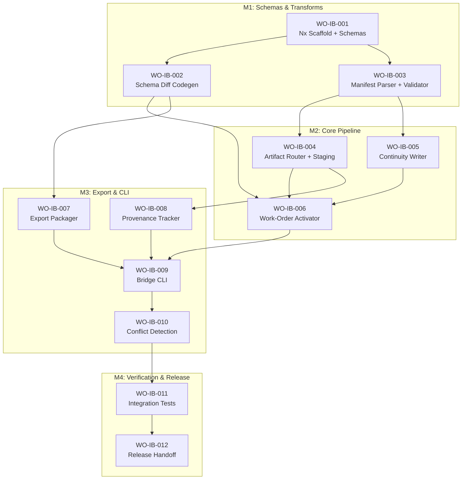

# Scope Chunk: ChatGPT-Foundry Bidirectional Import Bridge

**Source Intent Packet**: `docs/intent/intent-chatgpt-foundry-import-bridge-2026-03-31.md`
**Date**: 2026-03-31
**Bridge Location**: `apps/flagship-foundry/packages/import-bridge/`

---

## Impacted Node Inventory

| Node ID | Node Type | Change Type | Contracts | Guardrail Packs |
|---------|-----------|-------------|-----------|-----------------|
| `import-bridge` | package | **new** | manifest-parser, schema-transformer, artifact-router, wo-activator, export-packager | guardrail:typescript-core |
| `import-bridge/cli` | component | **new** | CLI arg parser, command router | guardrail:typescript-core |
| `import-bridge/schema-transforms` | component | **new** | ChatGPT kit ↔ Foundry schema maps (code-generated) | guardrail:typescript-core |
| `import-bridge/validators` | component | **new** | Ajv validator wrappers for both schema families | guardrail:typescript-core |
| `import-bridge/artifact-router` | component | **new** | Placement rules, staging area management | guardrail:typescript-core |
| `import-bridge/wo-activator` | component | **new** | Work-order batch → Foundry-native transform | guardrail:typescript-core |
| `import-bridge/export-packager` | component | **new** | Foundry → ChatGPT kit format packager | guardrail:typescript-core |
| `import-bridge/provenance` | component | **new** | Provenance record schema, annotation logic | guardrail:typescript-core |
| `.foundry/staging/` | directory | **new** | Staging area for pre-commit artifacts | — |
| `.foundry/projects/<slug>/` | directory | **modify** | continuity-state.schema.json | — |
| `apps/flagship-foundry/schemas/` | directory | **modify** | provenance-record.schema.json (new), import-bridge-config.schema.json (new) | — |
| `apps/flagship-foundry/packages/core/src/import-pipeline.mjs` | module | **modify** | Extend to call import-bridge for ChatGPT sources | guardrail:typescript-core |

---

## Work Order Sequence Summary

- **Total Work Orders**: 12
- **Milestones**: 4 (M1: Schemas & Transforms, M2: Core Pipeline, M3: Export & CLI, M4: Verification & Release)
- **Critical Path**: WO-IB-001 → WO-IB-002 → WO-IB-003 → WO-IB-004 → WO-IB-005 → WO-IB-006 → WO-IB-009 → WO-IB-010 → WO-IB-011 → WO-IB-012
- **Parallelizable**: [WO-IB-004, WO-IB-005] | [WO-IB-007, WO-IB-008] | [WO-IB-011, WO-IB-012]
- **Approval Gates**: WO-IB-001 (schema review), WO-IB-010 (dry-run demo), WO-IB-012 (release handoff)

## Work Order Sequence

1. **WO-IB-001**: Nx package scaffold + bridge schemas → @systems-architect (structured_generation) [depends: none]
2. **WO-IB-002**: Schema diff codegen — ChatGPT kit ↔ Foundry transforms → @builder (deterministic_transformation) [depends: WO-IB-001]
3. **WO-IB-003**: Manifest parser + schema validator → @builder (deterministic_transformation) [depends: WO-IB-001]
4. **WO-IB-004**: Artifact router + staging area → @builder (deterministic_transformation) [depends: WO-IB-003]
5. **WO-IB-005**: Continuity state writer (import-aware) → @builder (deterministic_transformation) [depends: WO-IB-003]
6. **WO-IB-006**: Work-order activator — batch transform + dependency resolver → @builder (deterministic_transformation) [depends: WO-IB-002, WO-IB-004, WO-IB-005]
7. **WO-IB-007**: Export packager — Foundry → ChatGPT kit format → @builder (deterministic_transformation) [depends: WO-IB-002]
8. **WO-IB-008**: Provenance tracker — annotation and query → @builder (structured_generation) [depends: WO-IB-004]
9. **WO-IB-009**: Bridge CLI — import/export/validate/dry-run commands → @builder (deterministic_transformation) [depends: WO-IB-006, WO-IB-007, WO-IB-008]
10. **WO-IB-010**: Conflict detection + manual diff merge flow → @builder (deterministic_transformation) [depends: WO-IB-009]
11. **WO-IB-011**: Integration tests + schema validation fixtures → @verifier (verification) [depends: WO-IB-010]
12. **WO-IB-012**: Release handoff + import bridge docs → @docs-release-agent (learning) [depends: WO-IB-011]

---

## Milestone 1: Schemas & Transforms

### WO-IB-001: Nx Package Scaffold + Bridge Schemas

- **Work Order ID**: WO-IB-001
- **Lifecycle Stage**: architect
- **Phase ID**: import-bridge-scaffold-schemas
- **System ID**: apps/flagship-foundry/packages/import-bridge
- **Task Class**: structured_generation
- **Agent Role**: systems_architect
- **Agent Persona**: curious_architect
- **Model Tier**: low_cost_executor
- **File Scope**:
  - `apps/flagship-foundry/packages/import-bridge/package.json` (new)
  - `apps/flagship-foundry/packages/import-bridge/tsconfig.json` (new)
  - `apps/flagship-foundry/packages/import-bridge/project.json` (new)
  - `apps/flagship-foundry/schemas/provenance-record.schema.json` (new)
  - `apps/flagship-foundry/schemas/import-bridge-config.schema.json` (new)
  - `apps/flagship-foundry/schemas/chatgpt-workspace-source.schema.json` (new)
- **Source Artifacts**:
  - `docs/intent/intent-chatgpt-foundry-import-bridge-2026-03-31.md`
  - `chatgpt-workspace-setup/foundry-phone-projects-kit/schemas/*.schema.json`
  - `apps/flagship-foundry/schemas/continuity-state.schema.json`
  - `apps/flagship-foundry/schemas/agent-work-order.schema.json`
- **Constraints**:
  - TypeScript strict mode, no `any`
  - Follow existing Nx package conventions from `packages/core/`
  - Schemas must extend, not duplicate, existing Foundry schemas
  - Provenance record must include: sourceWorkspace, pipelineProject, generatedAt, importedAt, artifactType
- **Expected Outputs**:
  - Working Nx package with build/typecheck/test targets
  - 3 new JSON schemas validated against JSON Schema 2020-12
- **Acceptance Criteria**:
  - [ ] `pnpm exec nx run import-bridge:typecheck` passes
  - [ ] `pnpm exec nx run import-bridge:build` passes
  - [ ] All 3 new schemas are valid JSON Schema 2020-12
  - [ ] provenance-record.schema.json includes sourceWorkspace, pipelineProject, generatedAt, importedAt, artifactType fields
- **Verification Plan**:
  - `pnpm exec nx run import-bridge:typecheck`
  - `pnpm exec nx run import-bridge:build`
  - `node --test apps/flagship-foundry/packages/import-bridge/src/__tests__/schema-validity.test.mjs`
- **Approval Required**: yes — schema review before downstream work orders consume
- **Rollback Notes**: Delete `apps/flagship-foundry/packages/import-bridge/` directory and 3 schema files
- **Status**: ready

**Principle Cards**:
- `principle:contract-first` — Schemas defined before any implementation module
- `principle:artifact-authority` — New schemas are level 7 (contracts/schemas) in the authority stack

---

### WO-IB-002: Schema Diff Codegen — ChatGPT Kit ↔ Foundry Transforms

- **Work Order ID**: WO-IB-002
- **Lifecycle Stage**: implement
- **Phase ID**: import-bridge-schema-transforms
- **System ID**: apps/flagship-foundry/packages/import-bridge
- **Task Class**: deterministic_transformation
- **Agent Role**: builder
- **Agent Persona**: conservative_builder
- **Model Tier**: low_cost_executor
- **File Scope**:
  - `apps/flagship-foundry/packages/import-bridge/src/transforms/intent-packet.transform.mts` (new)
  - `apps/flagship-foundry/packages/import-bridge/src/transforms/architecture-packet.transform.mts` (new)
  - `apps/flagship-foundry/packages/import-bridge/src/transforms/work-order-batch.transform.mts` (new)
  - `apps/flagship-foundry/packages/import-bridge/src/transforms/import-manifest.transform.mts` (new)
  - `apps/flagship-foundry/packages/import-bridge/src/transforms/verification-bundle.transform.mts` (new)
  - `apps/flagship-foundry/packages/import-bridge/src/transforms/index.mts` (new)
  - `apps/flagship-foundry/packages/import-bridge/src/codegen/schema-diff.mts` (new)
- **Source Artifacts**:
  - `chatgpt-workspace-setup/foundry-phone-projects-kit/schemas/*.schema.json` (source schemas)
  - `apps/flagship-foundry/schemas/*.schema.json` (target schemas)
  - `WO-IB-001` outputs (package scaffold, bridge schemas)
- **Constraints**:
  - Transforms are code-generated from JSON Schema diffs (architecture decision #1)
  - Each transform must be bidirectional (inbound + outbound)
  - No data loss — fields that exist in source but not target are preserved in a `_unmapped` extension object
  - Work-order transform must map ChatGPT `workOrderId` → Foundry `id`, `agentRole`/`agentPersona` → `personaIds`, `verificationPlan` → `commands`
- **Expected Outputs**:
  - 6 bidirectional transform modules
  - Schema diff codegen utility that can regenerate transforms when schemas change
- **Acceptance Criteria**:
  - [ ] Each transform round-trips: source → target → source produces equivalent output
  - [ ] Work-order batch transform maps all 15 ChatGPT work orders to valid Foundry agent-work-order instances
  - [ ] Codegen utility produces transform stubs from two JSON Schema files
  - [ ] No `any` types in transform code
- **Verification Plan**:
  - `node --test apps/flagship-foundry/packages/import-bridge/src/__tests__/transforms.test.mjs`
  - `pnpm exec nx run import-bridge:typecheck`
- **Approval Required**: no
- **Rollback Notes**: Delete `src/transforms/` and `src/codegen/` directories
- **Status**: blocked (depends: WO-IB-001)

**Principle Cards**:
- `principle:contract-first` — Transforms derived from schema contracts, not ad-hoc field mapping
- `principle:fix-memory-compounds` — Transform failures produce test fixtures for regression

---

## Milestone 2: Core Pipeline

### WO-IB-003: Manifest Parser + Schema Validator

- **Work Order ID**: WO-IB-003
- **Lifecycle Stage**: implement
- **Phase ID**: import-bridge-manifest-validator
- **System ID**: apps/flagship-foundry/packages/import-bridge
- **Task Class**: deterministic_transformation
- **Agent Role**: builder
- **Agent Persona**: conservative_builder
- **Model Tier**: low_cost_executor
- **File Scope**:
  - `apps/flagship-foundry/packages/import-bridge/src/manifest-parser.mts` (new)
  - `apps/flagship-foundry/packages/import-bridge/src/validator.mts` (new)
  - `apps/flagship-foundry/packages/import-bridge/src/__tests__/manifest-parser.test.mts` (new)
  - `apps/flagship-foundry/packages/import-bridge/src/__tests__/validator.test.mts` (new)
- **Source Artifacts**:
  - `chatgpt-workspace-setup/foundry-phone-projects-kit/schemas/foundry-import-manifest.schema.json`
  - `chatgpt-workspace-orders/SDLC-Building-Blocks/*/foundry-import-manifest.json` (real examples)
  - `WO-IB-001` outputs
- **Constraints**:
  - Must validate source artifacts against ChatGPT kit schemas before transform
  - Must validate target artifacts against Foundry schemas after transform
  - Must honor `importOrder` sequencing from manifest
  - Must enforce `importStage` gates (pre_implementation, post_verification, knowledge_base_only)
  - Must halt on first validation failure with structured error
- **Expected Outputs**:
  - `manifest-parser.mts` — reads and resolves `foundry-import-manifest.json`
  - `validator.mts` — Ajv-based dual-schema validation (source + target)
- **Acceptance Criteria**:
  - [ ] Parses all 3 real manifests from `chatgpt-workspace-orders/SDLC-Building-Blocks/`
  - [ ] Rejects a manifest with missing required fields (structured error with field path)
  - [ ] Rejects an artifact that fails schema validation (identifies artifact, field, violation)
  - [ ] Enforces import order — artifacts processed in declared sequence
- **Verification Plan**:
  - `node --test apps/flagship-foundry/packages/import-bridge/src/__tests__/manifest-parser.test.mts`
  - `node --test apps/flagship-foundry/packages/import-bridge/src/__tests__/validator.test.mts`
- **Approval Required**: no
- **Rollback Notes**: Delete manifest-parser.mts, validator.mts, and test files
- **Status**: blocked (depends: WO-IB-001)

---

### WO-IB-004: Artifact Router + Staging Area

- **Work Order ID**: WO-IB-004
- **Lifecycle Stage**: implement
- **Phase ID**: import-bridge-artifact-router
- **System ID**: apps/flagship-foundry/packages/import-bridge
- **Task Class**: deterministic_transformation
- **Agent Role**: builder
- **Agent Persona**: conservative_builder
- **Model Tier**: low_cost_executor
- **File Scope**:
  - `apps/flagship-foundry/packages/import-bridge/src/artifact-router.mts` (new)
  - `apps/flagship-foundry/packages/import-bridge/src/staging.mts` (new)
  - `apps/flagship-foundry/packages/import-bridge/src/__tests__/artifact-router.test.mts` (new)
- **Source Artifacts**:
  - Intent packet, architecture packet, work-order-batch (real examples from SDLC-Building-Blocks)
  - `WO-IB-003` outputs (manifest-parser, validator)
- **Constraints**:
  - Routing rules: ADRs → `docs/adr/`, contracts → `apps/flagship-foundry/schemas/`, diagrams → `docs/diagrams/`, intent/architecture packets → `docs/imported/`
  - All artifacts staged in `.foundry/staging/<slug>/` before final placement
  - Staging is atomic — either all artifacts place or none do
  - Must create project directory `.foundry/projects/<slug>/` if it doesn't exist
- **Expected Outputs**:
  - `artifact-router.mts` — maps artifact types to Foundry filesystem locations
  - `staging.mts` — manages `.foundry/staging/<slug>/` lifecycle (stage, commit, rollback)
- **Acceptance Criteria**:
  - [ ] Routes ADR files to `docs/adr/`, schemas to `apps/flagship-foundry/schemas/`, diagrams to `docs/diagrams/`
  - [ ] Creates `.foundry/staging/<slug>/` with all artifacts before commit
  - [ ] Commit moves all staged artifacts atomically; rollback cleans staging
  - [ ] Does not overwrite existing files without explicit `--force` flag
- **Verification Plan**:
  - `node --test apps/flagship-foundry/packages/import-bridge/src/__tests__/artifact-router.test.mts`
- **Approval Required**: no
- **Rollback Notes**: Delete artifact-router.mts, staging.mts, and test file
- **Status**: blocked (depends: WO-IB-003)

---

### WO-IB-005: Continuity State Writer (Import-Aware)

- **Work Order ID**: WO-IB-005
- **Lifecycle Stage**: implement
- **Phase ID**: import-bridge-continuity-writer
- **System ID**: apps/flagship-foundry/packages/import-bridge
- **Task Class**: deterministic_transformation
- **Agent Role**: builder
- **Agent Persona**: conservative_builder
- **Model Tier**: low_cost_executor
- **File Scope**:
  - `apps/flagship-foundry/packages/import-bridge/src/continuity-writer.mts` (new)
  - `apps/flagship-foundry/packages/import-bridge/src/__tests__/continuity-writer.test.mts` (new)
- **Source Artifacts**:
  - `apps/flagship-foundry/schemas/continuity-state.schema.json`
  - `.foundry/projects/flagship-foundry/current-task.json` (real example)
  - `WO-IB-003` outputs
- **Constraints**:
  - Must create valid `current-task.json` conforming to `continuity-state.schema.json`
  - Must set `lifecycleStage` based on import stage (pre_implementation → plan, post_verification → release)
  - Must populate `artifacts` catalog with imported artifact references
  - Must set `authority.runtimeInstanceAuthority` to correct `.foundry/projects/<slug>/current-task.json` path
  - Must not overwrite existing continuity state without conflict detection
- **Expected Outputs**:
  - `continuity-writer.mts` — creates/updates continuity state from imported artifacts
- **Acceptance Criteria**:
  - [ ] Creates valid `current-task.json` that passes Ajv validation against continuity-state.schema.json
  - [ ] Sets correct lifecycleStage based on importStage
  - [ ] Populates artifacts catalog with all imported artifact paths
  - [ ] Detects existing continuity state and flags for manual merge
- **Verification Plan**:
  - `node --test apps/flagship-foundry/packages/import-bridge/src/__tests__/continuity-writer.test.mts`
- **Approval Required**: no
- **Rollback Notes**: Delete continuity-writer.mts and test file
- **Status**: blocked (depends: WO-IB-003)

**Principle Cards**:
- `principle:continuity-is-mandatory` — Every import produces resumable continuity state
- `principle:observed-vs-declared-truth` — Imported state is declared (from ChatGPT); runtime observations come from Foundry execution

---

### WO-IB-006: Work-Order Activator — Batch Transform + Dependency Resolver

- **Work Order ID**: WO-IB-006
- **Lifecycle Stage**: implement
- **Phase ID**: import-bridge-wo-activator
- **System ID**: apps/flagship-foundry/packages/import-bridge
- **Task Class**: deterministic_transformation
- **Agent Role**: builder
- **Agent Persona**: conservative_builder
- **Model Tier**: low_cost_executor
- **File Scope**:
  - `apps/flagship-foundry/packages/import-bridge/src/wo-activator.mts` (new)
  - `apps/flagship-foundry/packages/import-bridge/src/dependency-resolver.mts` (new)
  - `apps/flagship-foundry/packages/import-bridge/src/__tests__/wo-activator.test.mts` (new)
- **Source Artifacts**:
  - `chatgpt-workspace-orders/SDLC-Building-Blocks/foundry-orchestration-composer-work-order-batch-2026-03-30/work-order-batch.json` (15 real work orders)
  - `chatgpt-workspace-setup/foundry-phone-projects-kit/schemas/work-order-batch.schema.json`
  - `apps/flagship-foundry/schemas/agent-work-order.schema.json`
  - `WO-IB-002` outputs (transforms), `WO-IB-004` outputs (router), `WO-IB-005` outputs (continuity)
- **Constraints**:
  - Must transform ChatGPT `work-order-batch.json` → array of Foundry `agent-work-order` instances
  - Field mapping: `workOrderId` → `id`, `phaseId` → `phase`, `agentRole`+`agentPersona` → `personaIds`, `verificationPlan` → `commands`, `acceptanceCriteria` → `acceptanceCriteria`
  - Must resolve `dependsOn` graph: only `status: "ready"` orders with no unmet dependencies get `status: "queued"`
  - Must detect circular dependencies and report error
  - Must prefix imported work-order IDs with project slug to prevent collisions
  - Must preserve `functionSpecs`, `fileScope`, `constraints` as extended metadata
- **Expected Outputs**:
  - `wo-activator.mts` — batch transform + activation logic
  - `dependency-resolver.mts` — DAG traversal, cycle detection, status propagation
- **Acceptance Criteria**:
  - [ ] Transforms all 15 real work orders from SDLC-Building-Blocks batch into valid Foundry work orders
  - [ ] Only WO-001A (and others with no unmet deps) are `status: "queued"`; rest are `status: "blocked"` or `status: "pending"`
  - [ ] Circular dependency in test fixture produces structured error
  - [ ] Work-order IDs are prefixed: `foundry-orchestration-composer/WO-001A`
  - [ ] Extended metadata (functionSpecs, fileScope) preserved in output
- **Verification Plan**:
  - `node --test apps/flagship-foundry/packages/import-bridge/src/__tests__/wo-activator.test.mts`
- **Approval Required**: no
- **Rollback Notes**: Delete wo-activator.mts, dependency-resolver.mts, and test file
- **Status**: blocked (depends: WO-IB-002, WO-IB-004, WO-IB-005)

**Principle Cards**:
- `principle:approval-at-plan-boundary` — Activated work orders are queued, not executed; human approves execution
- `principle:blast-radius-before-build` — Dependency graph exposes full blast radius before any work order runs

---

## Milestone 3: Export & CLI

### WO-IB-007: Export Packager — Foundry → ChatGPT Kit Format

- **Work Order ID**: WO-IB-007
- **Lifecycle Stage**: implement
- **Phase ID**: import-bridge-export-packager
- **System ID**: apps/flagship-foundry/packages/import-bridge
- **Task Class**: deterministic_transformation
- **Agent Role**: builder
- **Agent Persona**: conservative_builder
- **Model Tier**: low_cost_executor
- **File Scope**:
  - `apps/flagship-foundry/packages/import-bridge/src/export-packager.mts` (new)
  - `apps/flagship-foundry/packages/import-bridge/src/__tests__/export-packager.test.mts` (new)
- **Source Artifacts**:
  - `chatgpt-workspace-setup/foundry-phone-projects-kit/schemas/verification-bundle.schema.json`
  - `chatgpt-workspace-setup/foundry-phone-projects-kit/schemas/foundry-import-manifest.schema.json`
  - `chatgpt-workspace-setup/foundry-phone-projects-kit/templates/verification-report.template.md`
  - `chatgpt-workspace-setup/foundry-phone-projects-kit/templates/learning-record.template.md`
  - `WO-IB-002` outputs (bidirectional transforms)
- **Constraints**:
  - Exports target a new dedicated project directory (architecture decision #3)
  - Must produce: verification-report.md, evidence-bundle.md, release-notes.md, handoff.md, learning-record.md, artifact-manifest.json, foundry-import-manifest.json
  - Must generate valid `foundry-import-manifest.json` with `importStage: "post_verification"`
  - Export is read-only on Foundry state — no mutation
  - Must not export runtime secrets, environment variables, or credentials
- **Expected Outputs**:
  - `export-packager.mts` — collects Foundry artifacts, transforms to ChatGPT kit format, writes to project directory
- **Acceptance Criteria**:
  - [ ] Produces a directory with all 7 required files
  - [ ] Generated `foundry-import-manifest.json` validates against ChatGPT kit schema
  - [ ] Verification report maps to ChatGPT `verification-bundle.schema.json`
  - [ ] No Foundry runtime state or secrets in export
- **Verification Plan**:
  - `node --test apps/flagship-foundry/packages/import-bridge/src/__tests__/export-packager.test.mts`
- **Approval Required**: no
- **Rollback Notes**: Delete export-packager.mts and test file
- **Status**: blocked (depends: WO-IB-002)

---

### WO-IB-008: Provenance Tracker — Annotation and Query

- **Work Order ID**: WO-IB-008
- **Lifecycle Stage**: implement
- **Phase ID**: import-bridge-provenance
- **System ID**: apps/flagship-foundry/packages/import-bridge
- **Task Class**: structured_generation
- **Agent Role**: builder
- **Agent Persona**: conservative_builder
- **Model Tier**: low_cost_executor
- **File Scope**:
  - `apps/flagship-foundry/packages/import-bridge/src/provenance.mts` (new)
  - `apps/flagship-foundry/packages/import-bridge/src/__tests__/provenance.test.mts` (new)
- **Source Artifacts**:
  - `apps/flagship-foundry/schemas/provenance-record.schema.json` (from WO-IB-001)
  - `WO-IB-004` outputs (artifact-router)
- **Constraints**:
  - Every imported/exported artifact gets a provenance sidecar file `<artifact>.provenance.json`
  - Provenance record includes: sourceWorkspace, pipelineProject (1-5), generatedAt, importedAt, artifactType, transformVersion
  - Query API: given an artifact path, return its provenance chain
  - Round-trip artifacts get both import and export provenance entries
- **Expected Outputs**:
  - `provenance.mts` — annotation (write) and query (read) for provenance records
- **Acceptance Criteria**:
  - [ ] Every artifact placed by artifact-router gets a `.provenance.json` sidecar
  - [ ] Provenance record validates against provenance-record.schema.json
  - [ ] Query returns full provenance chain for a given artifact path
  - [ ] Round-trip artifact shows both import and export entries
- **Verification Plan**:
  - `node --test apps/flagship-foundry/packages/import-bridge/src/__tests__/provenance.test.mts`
- **Approval Required**: no
- **Rollback Notes**: Delete provenance.mts and test file
- **Status**: blocked (depends: WO-IB-004)

---

### WO-IB-009: Bridge CLI — import/export/validate/dry-run Commands

- **Work Order ID**: WO-IB-009
- **Lifecycle Stage**: implement
- **Phase ID**: import-bridge-cli
- **System ID**: apps/flagship-foundry/packages/import-bridge
- **Task Class**: deterministic_transformation
- **Agent Role**: builder
- **Agent Persona**: conservative_builder
- **Model Tier**: low_cost_executor
- **File Scope**:
  - `apps/flagship-foundry/packages/import-bridge/src/cli.mts` (new)
  - `apps/flagship-foundry/packages/import-bridge/src/commands/import.mts` (new)
  - `apps/flagship-foundry/packages/import-bridge/src/commands/export.mts` (new)
  - `apps/flagship-foundry/packages/import-bridge/src/commands/validate.mts` (new)
  - `apps/flagship-foundry/packages/import-bridge/src/commands/dry-run.mts` (new)
  - `apps/flagship-foundry/packages/import-bridge/src/__tests__/cli.test.mts` (new)
  - `apps/flagship-foundry/packages/import-bridge/bin/foundry-bridge.mjs` (new)
- **Source Artifacts**:
  - All WO-IB-003 through WO-IB-008 outputs
- **Constraints**:
  - CLI entry: `pnpm exec foundry-bridge <command> [options]`
  - Commands: `import <source-dir>`, `export <project-slug> <target-dir>`, `validate <source-dir>`, `dry-run <source-dir>`
  - Flags: `--force` (overwrite), `--stage-only` (don't commit), `--slug <name>` (project slug override)
  - `dry-run` must report all actions without writing files
  - Must create `import/<slug>` git branch for review (architecture decision — git isolation)
  - Must print structured summary on completion (artifacts imported, placed, skipped, errors)
- **Expected Outputs**:
  - `cli.mts` — argument parser and command router
  - 4 command modules
  - Executable `bin/foundry-bridge.mjs`
- **Acceptance Criteria**:
  - [ ] `foundry-bridge import chatgpt-workspace-orders/SDLC-Building-Blocks/foundry-intake-ai-orchestration-pipeline-2026-03-28` succeeds with structured output
  - [ ] `foundry-bridge dry-run` reports actions without writing files
  - [ ] `foundry-bridge validate` reports schema validation results
  - [ ] `foundry-bridge export` produces a valid ChatGPT kit project directory
  - [ ] `--force` flag overwrites existing artifacts; without it, skips and warns
- **Verification Plan**:
  - `node --test apps/flagship-foundry/packages/import-bridge/src/__tests__/cli.test.mts`
  - `pnpm exec nx run import-bridge:build`
- **Approval Required**: no
- **Rollback Notes**: Delete cli.mts, commands/, bin/ directories
- **Status**: blocked (depends: WO-IB-006, WO-IB-007, WO-IB-008)

---

### WO-IB-010: Conflict Detection + Manual Diff Merge Flow

- **Work Order ID**: WO-IB-010
- **Lifecycle Stage**: implement
- **Phase ID**: import-bridge-conflict-resolution
- **System ID**: apps/flagship-foundry/packages/import-bridge
- **Task Class**: deterministic_transformation
- **Agent Role**: builder
- **Agent Persona**: conservative_builder
- **Model Tier**: low_cost_executor
- **File Scope**:
  - `apps/flagship-foundry/packages/import-bridge/src/conflict-detector.mts` (new)
  - `apps/flagship-foundry/packages/import-bridge/src/diff-merge.mts` (new)
  - `apps/flagship-foundry/packages/import-bridge/src/__tests__/conflict-detector.test.mts` (new)
- **Source Artifacts**:
  - `WO-IB-009` outputs (CLI)
- **Constraints**:
  - Conflict detection compares incoming artifacts against existing files at target paths
  - When conflict detected: print diff, prompt operator for per-artifact decision (accept-incoming, keep-existing, manual-merge)
  - Manual merge opens diff in `$EDITOR` or prints unified diff to stdout
  - Must handle continuity state conflicts: existing `current-task.json` vs imported state
  - Architecture decision #4: manual diff comparison and merge
- **Expected Outputs**:
  - `conflict-detector.mts` — detects file-level and field-level conflicts
  - `diff-merge.mts` — presents diffs, collects operator decisions, applies merge
- **Acceptance Criteria**:
  - [ ] Detects when import would overwrite existing file at target path
  - [ ] Prints unified diff for conflicting artifacts
  - [ ] Operator can choose per-artifact: accept-incoming, keep-existing, manual-merge
  - [ ] Continuity state conflicts show field-level diff (not just file-level)
- **Verification Plan**:
  - `node --test apps/flagship-foundry/packages/import-bridge/src/__tests__/conflict-detector.test.mts`
- **Approval Required**: yes — dry-run demo with real SDLC-Building-Blocks data before proceeding
- **Rollback Notes**: Delete conflict-detector.mts, diff-merge.mts, and test file
- **Status**: blocked (depends: WO-IB-009)

---

## Milestone 4: Verification & Release

### WO-IB-011: Integration Tests + Schema Validation Fixtures

- **Work Order ID**: WO-IB-011
- **Lifecycle Stage**: verify
- **Phase ID**: import-bridge-integration-tests
- **System ID**: apps/flagship-foundry/packages/import-bridge
- **Task Class**: verification
- **Agent Role**: verifier
- **Agent Persona**: skeptical_verifier
- **Model Tier**: balanced_reasoner
- **File Scope**:
  - `apps/flagship-foundry/packages/import-bridge/src/__tests__/integration/import-intake.test.mts` (new)
  - `apps/flagship-foundry/packages/import-bridge/src/__tests__/integration/import-architecture.test.mts` (new)
  - `apps/flagship-foundry/packages/import-bridge/src/__tests__/integration/import-workorders.test.mts` (new)
  - `apps/flagship-foundry/packages/import-bridge/src/__tests__/integration/export-verification.test.mts` (new)
  - `apps/flagship-foundry/packages/import-bridge/src/__tests__/integration/round-trip.test.mts` (new)
  - `apps/flagship-foundry/packages/import-bridge/src/__tests__/fixtures/` (new directory)
- **Source Artifacts**:
  - All 3 real deliverables from `chatgpt-workspace-orders/SDLC-Building-Blocks/`
  - All WO-IB-001 through WO-IB-010 outputs
- **Constraints**:
  - Must test against real ChatGPT pipeline output (not synthetic fixtures)
  - Must verify end-to-end: source dir → validate → transform → stage → place → continuity state
  - Must verify export: continuity state → collect → transform → package → validate
  - Must verify round-trip: import → modify in Foundry → export → validate
  - Must verify failure paths: invalid schemas, missing files, circular deps, conflicts
  - Verifier is independent from builder (principle: independent-verification)
- **Expected Outputs**:
  - 5 integration test files
  - Fixtures directory with known-good and known-bad test data
- **Acceptance Criteria**:
  - [ ] All 3 real workspace outputs from SDLC-Building-Blocks import successfully
  - [ ] All imported artifacts pass Foundry schema validation
  - [ ] All 15 work orders from batch activate with correct dependency resolution
  - [ ] Export produces valid ChatGPT kit format
  - [ ] Round-trip preserves data integrity
  - [ ] Invalid input produces structured errors (not crashes)
- **Verification Plan**:
  - `node --test apps/flagship-foundry/packages/import-bridge/src/__tests__/integration/*.test.mts`
  - `pnpm exec nx run import-bridge:typecheck`
  - `pnpm exec nx run import-bridge:build`
- **Approval Required**: no
- **Rollback Notes**: Delete integration test directory
- **Status**: blocked (depends: WO-IB-010)

**Principle Cards**:
- `principle:independent-verification` — Verifier validates claims independently; does not trust builder assertions
- `principle:fix-memory-compounds` — Failures become fixtures for regression

---

### WO-IB-012: Release Handoff + Import Bridge Docs

- **Work Order ID**: WO-IB-012
- **Lifecycle Stage**: release
- **Phase ID**: import-bridge-release-handoff
- **System ID**: apps/flagship-foundry/packages/import-bridge
- **Task Class**: learning
- **Agent Role**: docs_release_agent
- **Agent Persona**: sync_editor
- **Model Tier**: balanced_reasoner
- **File Scope**:
  - `docs/handoff/handoff-import-bridge-2026-03-31.md` (new)
  - `docs/adr/adr-import-bridge-schema-codegen.md` (new)
  - `docs/adr/adr-import-bridge-conflict-resolution.md` (new)
  - `Runbooks/import-bridge-operator-guide.md` (new)
- **Source Artifacts**:
  - `docs/intent/intent-chatgpt-foundry-import-bridge-2026-03-31.md`
  - All WO-IB-001 through WO-IB-011 outputs
  - Verification evidence from WO-IB-011
- **Constraints**:
  - Handoff doc must include: what was built, how to use it, known limitations, next steps
  - ADRs document the two key architecture decisions (codegen transforms, manual merge)
  - Operator guide covers: import workflow, export workflow, conflict resolution, dry-run, troubleshooting
  - Must update continuity state to `lifecycleStage: "release"`
- **Expected Outputs**:
  - 1 handoff document
  - 2 ADRs
  - 1 operator runbook
- **Acceptance Criteria**:
  - [ ] Handoff doc covers all modules and their relationships
  - [ ] ADRs follow Foundry ADR template (context, options, decision, consequences)
  - [ ] Operator guide includes working examples using real SDLC-Building-Blocks data
  - [ ] Continuity state updated to release phase
- **Verification Plan**:
  - Manual review by operator
- **Approval Required**: yes — release handoff requires operator sign-off
- **Rollback Notes**: Delete handoff and ADR files
- **Status**: blocked (depends: WO-IB-011)

**Principle Cards**:
- `principle:continuity-is-mandatory` — Handoff ensures next operator can resume
- `principle:fix-memory-compounds` — Learning record captures what worked and what didn't

---

## Dependency Graph



---

## First Work Order (Ready to Execute)

**WO-IB-001: Nx Package Scaffold + Bridge Schemas** is the only work order with `status: ready`. All details above. To begin:

```bash
# Create the package directory
mkdir -p apps/flagship-foundry/packages/import-bridge/src/__tests__
mkdir -p apps/flagship-foundry/packages/import-bridge/bin

# Start with package.json, project.json, tsconfig.json
# Then create the 3 new schemas
```
