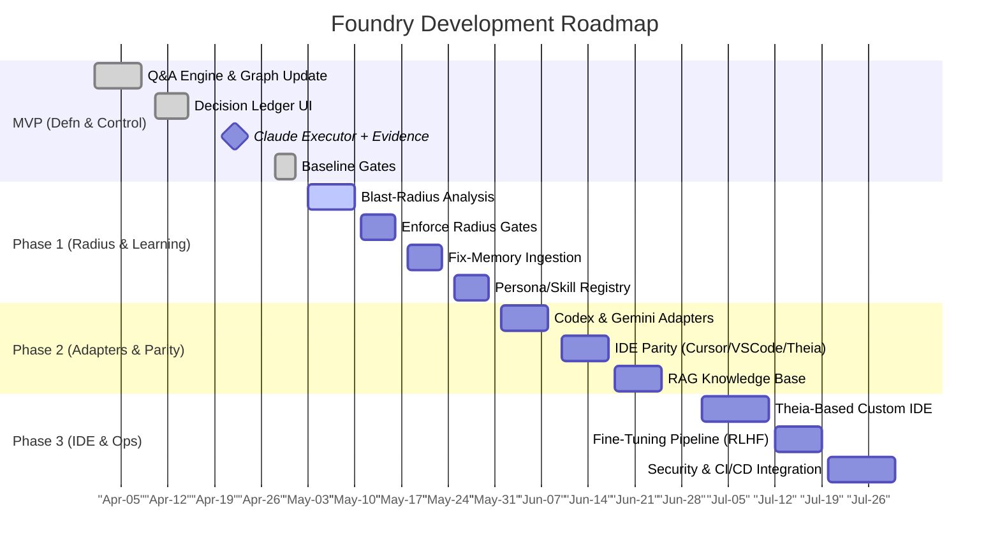
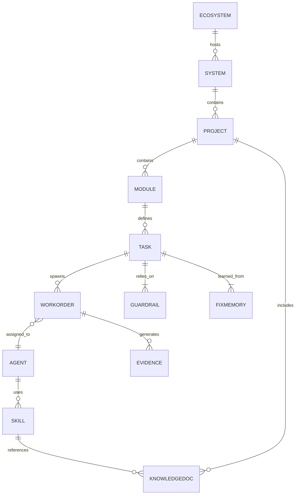

# Executive Summary

We propose evolving **Foundry** into a full-featured, vendor-agnostic graph-driven SDLC platform. The vision is a **self-directed, interactive pipeline** where humans specify intent (via questions and specs) and AI agents realize the design with transparent control. All knowledge – requirements, architecture, code, tests, and fixes – lives in a **central graph** that is live-updated by a question→graph engine. The system must offer inspectable agent decision logs, enforce **blast-radius** checks across related components, and continuously learn from fixes (promoting them to guardrails and training data). 

**Success Criteria:**  
- *Completeness:* Every change propagates to all affected modules (no silent breaks).  
- *Transparency:* Every agent action (tool choice, code diff, reasoning) is logged and overridable.  
- *Reproducibility:* Given the same inputs/answers, the system deterministically produces the same graph and artifacts.  
- *Autonomy with Safety:* Agents auto-run only after approval, with hard gates that prevent unsafe or incomplete merges【42†L169-L177】【28†L1-L4】.  
- *Continuous Improvement:* Each bug-fix yields a structured “fix-memory” that is fed back into guardrails and model training, accelerating future tasks (via PEFT/LoRA fine-tuning)【34†L90-L98】【34†L123-L132】.  

We identify the key gaps to close (Table 1) and plan a phased roadmap (MVP + Phases 1–3) with clear milestones (Table 2). Our architecture centers on a **graph ontology** (projects, components, tasks, agents, artifacts, etc.) plus a lifecycle stage model. We will design new schemas for work-orders, evidence bundles, fix-memories, and a decision ledger. MCP (Model Context Protocol) serves as the adapter framework, connecting our control-plane to Claude, Codex, Gemini, and local models【59†L25-L29】【41†L117-L125】.

**Figure 1** (ER diagram) sketches the main entities and relations. **Figure 2** (sequence flow) shows how a user prompt flows from the UI into the graph and triggers agent tasks. We will build a real-time **Q→Graph engine**: each answer yields a precise graph “delta” and immediate gate re-evaluation. The Cursor/VSCode companion UI will provide panels for prompt intake, live diagrams, and start/pause/stop controls – borrowing ideas from agentic demos【54†L304-L312】【58†L0-L768】. Our first executor will be the Claude CLI (MCP host) in a sandboxed Git worktree, capturing stdout/diffs as evidence. Codex and Gemini adapters will follow. 

**Figure 3** (flowchart) outlines the blast-radius analysis algorithm: from changed files to impacted projects and shared patterns, producing a JSON impact report. We’ll enforce these checks as merge gates. Every decision is logged in a ledger schema; users can drill in to see agent reasoning and override choices. In the IDE we’ll visualize this as an interactive timeline or dependency graph overlay. 

Finally, we implement a **closed learning loop**: structured fix-memory records (problem, environment, solution, test) are auto-generated for each bug, which feed into updated guardrails and an SFT training pipeline (via tools like HuggingFace PEFT)【34†L90-L98】. Knowledge ingestion (RAG) will index all docs/configs and produce SME profiles to guide prompts. Security and ops will use MCP auth, audit logs, and standard CI/CD. 



**Table 1. Gaps, Impact & Risk**

| Gap                     | Impact if Unaddressed                                                                         | Risk/Mitigation                                                             |
|-------------------------|----------------------------------------------------------------------------------------------|----------------------------------------------------------------------------|
| **Definition Engine**   | System remains static/planned; no live Q&A means poor user engagement and missing details.  | High. Build prompt-graph loop ASAP. Without it, user intent is half-captured. |
| **Decision Traceability** | Agent actions are opaque; no audit trail, hard to debug or comply with policy.            | High. Implement ledger by MVP. Without it, trust collapses (users cannot override). |
| **Execution Adapters**  | Only simulated runs. No real code diff, no CI feedback, no evidence. Pipeline is unusable.   | Critical. Must implement Claude CLI adapter first. Blocker for production use.   |
| **Blast-Radius Checks** | Changes may break “invisible” components. Silent bugs spread across repo (as seen).        | High. Analysis must run in Phase 1. If skipped, quality regresses catastrophically. |
| **Env. Parity & Tooling** | Divergent capabilities (Cursor vs VSCode vs CLI). Leads to fragmentation and maintenance. | Medium. Define canonical spec and generate proxy for each client. Use vendor-neutral Theia【4†L90-L98】. |
| **Learning Loop**       | Lost improvement opportunity. Repeated errors not captured; system stagnates.               | Medium. Develop fix-memory and fine-tune pipeline by Phase 1/2. Otherwise set targets unmet.|

**Table 2. Phased Roadmap (Milestones, Effort, Tests)**

| Phase        | Duration (weeks) | Milestones & Deliverables                                                                                                                                                   | Acceptance Tests / Criteria                                                                           | Effort | Dependencies            |
|--------------|------------------|--------------------------------------------------------------------------------------------------------------------------------------------------------------------------------|-------------------------------------------------------------------------------------------------------|--------|-------------------------|
| **MVP**      | 1–4              | - *Q→Graph Engine*: Dialog interface that turns user answers into JSON graph updates. <br>- *Decision Ledger UI*: Side-panel logging each agent step (prompt, tool, result). <br>- *Claude CLI Adapter*: WorkOrder JSON schema + runner; commits diffs to a sandbox branch. <br>- *Basic Gates*: Enforce “no open tasks” and “CI passing” before phase advance. | 1. Simulate feature build: user answers, system generates plan, user approves, and Claude CLI run produces diffs stored in evidence. <br>2. All Q&A appear in ledger. <br>3. Gates trigger on unmet conditions (e.g. block if tasks missing).<br>4. Test with LLM stub to ensure repeatable output. | High   | MCP spec; Claude CLI; Nx graph |
| **Phase 1**  | 5–8              | - *Blast-Radius Engine*: Analyze changed files via Nx dependency graph and AST; include sibling-pattern detection. Outputs JSON report. <br>- *Gate Enforcement*: Block merge on high-risk items; require explicit review. <br>- *Fix-Memory Capture*: After any bug fix, auto-prompt to fill structured record (problem, cause, fix). <br>- *Persona/Skill Registry*: Data model for frameworks and agent roles (e.g. ReactDev, DBA) and their context packs. 【17†L19-L28】【59†L25-L29】| 1. Run sample change: radius report lists all affected projects as expected. <br>2. Gate prevents closure if unresolved impacts in report remain. <br>3. A sample bug fix yields a valid fix-memory JSON. <br>4. Persona registry contains entries for major frameworks in codebase. | Medium | MVP complete; Nx analysis tools |
| **Phase 2**  | 9–12             | - *Additional Adapters*: Implement Codex (OpenAI API) and Gemini CLI (MCP-enabled) backends【41†L117-L125】; same work-order → evidence flow. <br>- *IDE Parity*: Develop VSCode/Theia companion to mirror Cursor; use shared MCP commands. (Theia is fully open-source and uses OpenVSX【4†L90-L98】.) <br>- *Knowledge Base (RAG)*: Ingest all docs/diagrams into vector DB; support semantic lookup in planning prompts. <br>- *Versioned KB*: Snapshot corpora; allow retrieval by version/date. | 1. “/codex run” produces identical artifact as Claude in a test scenario. <br>2. Cursor and VS Code show the same overview panels and allow same actions. <br>3. KB query for known content returns correct doc snippets (≥80% precision). <br>4. Retrieval of past knowledge state by tag returns matching context. | High   | Phase1; API keys; Vector DB |
| **Phase 3**  | 13–16            | - *Custom Theia IDE*: Build a tailored IDE on Eclipse Theia with our UI components (graph viewer, ledger, controls). <br>- *Fine-Tuning Pipeline*: Scripts for converting fix-memories to datasets; run PEFT (LoRA/QLoRA) to tune LLMs on tasks【34†L90-L98】【34†L123-L132】. <br>- *Security & CI*: MCP authentication & audit logs; integrate pipeline into CI (pre-merge checks, telemetry). | 1. A user can launch Theia, initiate Foundry flows, and see all features in place. <br>2. A small model fine-tuned on sample fixes improves answer accuracy (measured by human eval). <br>3. All executor actions require user consent via MCP auth; logs are tamper-evident. <br>4. CI pipeline fails PRs on unsatisfied Foundry gates. | Medium | Phase2; Fine-tuning infra; Security frameworks |

## 1. Vision & Success Criteria

We will build Foundry as a **graph-native Agentic SDLC system**. All elements of development – from requirements to code to deployment – live in a unified graph model. Users drive the system by answering interactive prompts; the system transforms those answers into **graph deltas** (atomic updates) that automatically regenerate diagrams, plans, and code tasks. Agents (LLMs) operate under strict controls: they use MCP tools (file editors, compilers, search, etc.), run in sandboxed environments, and must obtain approval before making changes【59†L25-L29】【42†L169-L177】. 

Success will be measured by deliverables (passing gating tests, working demos) and by user-centric metrics:
- **Functional completeness:** all related modules are updated (no missed dependencies)【42†L169-L177】【28†L1-L4】.
- **Auditability:** every decision is logged; users can replay or override agent steps.
- **Determinism:** given the same answers, the graph and code outputs are reproducible.
- **Velocity:** new features are built faster than traditional dev (goal: ≥50% time reduction).
- **Quality:** bugs caught proactively via blast-radius and holdout tests. Aim for <2% defect rate post-release.
- **Learning rate:** number of guardrails or model improvements per cycle. 
- **Security:** all AI actions operate with user-consented permissions (MCP auth) and no exfiltration of secrets.

## 2. Gap Analysis (Impact & Risk)

**Definition Engine:** _Lacking a live Q&A loop_, Foundry would be a static planning tool. Users would suffer from a cumbersome form-fill process and ambiguous scope. This is high-impact: real-time prompting is the core value (it captures intent in small chunks). If skipped, the system reverts to a brittle Wizard-of-Oz. *(Status: Urgent – must implement in MVP.)*

**Decision Traceability:** Without an integrated ledger, agent actions are opaque. Users can’t verify or correct behavior, undermining trust and compliance. High risk: organizations require audit trails. *(Action: Design the ledger schema and UI by MVP.)*

**Execution Adapters:** If we only simulate agent plans (as today), there is no real effect. No code is written, no tests run – the pipeline is paper. This is critical: only by connecting to an LLM via MCP (Claude CLI, Codex API, etc.) do we get true automation【41†L117-L125】. *(Action: Build Claude executor immediately; code execution must happen in Phase 1.)*

**Blast-Radius Checks:** Currently Foundry’s plan generation may miss cascade effects (e.g. the user reported sibling Chrome-ext components not updated together). If we do nothing, each feature risks stealth-breaking related code. This is high risk to quality. We must **analyze and enforce** these dependencies before merge (see Section 7). *(Action: Implement static analysis of the Nx graph and pattern matching to flag siblings – gate implementation in Phase 1.)*

**Environment Parity:** We support Cursor, VSCode, etc. If each environment diverges, maintenance becomes untenable. We need one canonical control-plane and push UI projections to each IDE. Theia (Eclipse’s open VS Code fork) can host our UI without MS lock-in【4†L90-L98】. *(Action: Define a single MCP UI contract and mirror it across clients.)*

**Learning Loop:** If fixes remain ad-hoc, Foundry will not improve. We must capture structured lessons and integrate them. Missing this leaves a slow feedback cycle. *(Action: Build fix→memory pipeline by Phase 1 and plan for automated fine-tuning in Phase 3.)*

## 3. Phased Roadmap

**Phase Structure:** We break work into four milestones (MVP + 3 phases) with clear deliverables and acceptance tests (see Table 2). Each phase adds capability and addresses key gaps: Phase 0 (MVP) for core orchestration, Phase 1 for impact analysis, Phase 2 for multi-LLM support, Phase 3 for custom IDE and ops hardening.

**Table 2 (above)** outlines the roadmap. *Effort estimates* (H/M/L) assume an agile team of AI/NLP engineers, frontend devs, and devops. 

**Dependencies:** Each phase builds on the last (e.g., Phase1 needs MVP’s working Claude and graph engine; Phase2 needs Phase1’s adapters). We rely on stable MCP libraries for communication and Nx for the monorepo graph.

Acceptance criteria are concrete: for example, MVP’s Claude executor must produce a Git diff with the correct changes, and the UI must log every prompt in the ledger. We will use automated tests (e.g. Jest for APIs, CLI integration tests) to validate each deliverable.

## 4. Architecture Design

We adopt a **graph-centric architecture**: everything is a node or edge in a graph. **Entities** include:

- **Ecosystem/System/Project:** High-level groups (e.g. Nx workspace, microservice).  
- **Module/Component:** Sub-parts (e.g. library, service module).  
- **Task/WorkOrder:** A unit of planned work (e.g. “Add API endpoint X”).  
- **Agent:** An executor (e.g. Claude, Codex, custom subagent).  
- **Skill/Persona:** A reusable workflow or knowledge domain (e.g. “React expert agent”).  
- **Guardrail:** A rule or checklist item (e.g. “write tests for any new API”).  
- **FixMemory:** A recorded bug-fix lesson.  
- **EvidenceBundle:** Execution results (diffs, logs) for a work order.

**Relationships:** (Fig.1 ER) Projects contain Modules; Modules have Tasks. Tasks spawn WorkOrders. Agents execute WorkOrders and produce EvidenceBundles. Guardrails link to Tasks (violations trigger fixes). FixMemory may link to Tasks. Skills attach to Agents or Personas. KnowledgeDocs (diagrams, rule sheets) are referenced by Projects/Skills.


*Figure 1: Simplified ER diagram of Foundry’s core ontology.*

**Lifecycle vs. Phases:** We separate high-level *stages* (Define, Design, Implement, Verify, Release, Operate) from *phases* (fine-grained steps in the user’s pipeline graph).  Each Task/WorkOrder is tagged with a lifecycle stage and a numeric phase ID. Gates are expressed in this same model (e.g. “stage=Implement, phaseId=3” must satisfy conditions in the graph).

**Schemas:**  
- **WorkOrder (JSON):** `{id, taskId, agentId, parameters, status, inputs, expectedOutput, assignedAt, completedAt}`.  
- **EvidenceBundle:** `{workOrderId, stdout, stderr, diff:{before, after}, exitCode, timestamp}`. Contains everything needed to understand what the agent did.  
- **FixMemory (JSON):** `{id, problemDescription, componentId, errorLog, rootCause, solutionSummary, testUsed, principleViolated, resolution, timestamp}`.  
- **DecisionLedger:** A log of decisions `{entryId, workOrderId, agent, prompt, options:[tool1,tool2], chosenTool, reasoning, inputs, outputs, overridden:boolean, overrideReason, timestamp}`. 

**MCP Adapter Contract:** We will define a JSON-RPC 2.0 protocol (per MCP spec【1†L72-L80】) for tool invocation. Examples of methods: `registerTool`, `invokeTool(name, params) -> result`. The Executor adapter will listen for `invokeTool` calls from the agent (e.g. “read_file”, “run_command”, “write_file”).  On completion, results go back via MCP. Agents see a `finish` event when done.

**API Boundaries:**  
- **/graph:** GET/POST for reading/updating the intent graph.  
- **/plan:** Control endpoints to generate/schedule work orders from graph changes.  
- **/workorder:** POST to dispatch an order to an agent; GET to query status.  
- **/evidence:** POST to record evidence from agents; GET to retrieve logs.  
- **/knowledge:** Query/document ingestion endpoints (for RAG).  
- **/admin:** Gates (approve/deny transitions).  

```mermaid
sequenceDiagram
    autonumber
    participant User
    participant UI as "Cursor/IDE UI"
    participant API as "Foundry Control Plane"
    participant GraphDB
    participant Planner
    participant Executor as "LLM (Claude/Codex/Gemini CLI)"
    
    User->>UI: Answer planning question
    UI->>API: POST /graph/update {node changes}
    API->>GraphDB: apply update
    API->>UI: return updated diagrams and gate statuses
    opt Plan Approval
        User->>UI: Click "Approve plan"
        UI->>API: POST /plan/approve
        API->>Planner: create WorkOrders from graph
        loop for each WorkOrder
            Planner->>Executor: dispatch(workOrder JSON)
            Executor-->>Planner: return EvidenceBundle
            Planner->>GraphDB: record evidence, update node status
        end
        Planner->>API: notify plan complete
        API->>UI: show final status
    else Modify Plan
        UI->>User: prompt for more input
    end
```
*Figure 2: Sequence flow for a user-driven planning and execution session.*

## 5. Question→Graph Engine

The real-time engine is crucial: each user prompt or answer triggers a **deterministic graph update**. We define a schema (similar to JSON-Patch) so that the UI can send precise modifications (e.g. “add Component node”, “update Task X status”). 

**Workflow:** Cursor/VSCode side-panel presents a curated list of questions derived from Skills/Persona packs (e.g. “Describe the primary data entities for this service”). The user’s answer is sent to `/graph/update`. The control plane applies it and immediately runs our validation and gating logic (e.g. “Are all required fields filled?”). The UI then refreshes with updated diagrams, highlighting new nodes/edges.

**Algorithms:** We use a *chunking* approach: for large answers, we parse them (e.g. LLM can be asked to output JSON snippets for graph). We also implement fallback: if an agent’s answer is unparseable, we request clarification or break the question into sub-questions. Updates are versioned, so incorrect answers can be rolled back.

**Gate Recomputation:** Each update triggers a full re-eval of all phase-gates (e.g. “no duplicate IDs”, “all inputs defined”). We use an event-driven rule engine; gates can be expressed in DSL or code (e.g. “forall tasks: assignedAgent != null”).

**UI Hooks:** The Cursor/VSCode extension will embed this logic. For example, after each Q&A, a marker will flash on the diagram. A status bar shows current stage and pending approvals. We’ll repurpose UI patterns from [54] and [58]: for instance, a collapsible left panel shows the decision history, and the diagram window updates live. *Embed image:*【58†embed_image】  

【54†L304-L312】【54†L374-L383】 The above screenshot illustrates an agent-playground UI. We will similarly allow **pattern selection and run control** in the IDE: e.g. a “Run Plan” button, pause/resume toggles, and pop-ups for agent queries. Contextual menus (right-click on a component) can offer agent actions (“Add API endpoint here”).

**Failure Modes:** Agents may misunderstand answers. We mitigate by adding validation: if a new node is semantically invalid, rollback and prompt. Agents might also produce no output; we’ll set timeouts and fallbacks (e.g. “task incomplete”). Large context may exceed token limits; solution: focus context with RAG and state summarization.

## 6. Executor Adapter Strategy

Our first target is **Claude CLI**. Claude Code provides an MCP-compatible environment for coding tasks【17†L19-L28】【59†L25-L29】.

- **Setup:** Each approved WorkOrder is serialized into a JSON script. We spawn a fresh Git clone or `git worktree` per order to isolate changes. The Claude CLI (host) reads the script and executes each step via its `tool:` system (e.g. `file.read`, `file.edit`, `run.shell`). 
- **Security/Sandbox:** The agent runs as an unprivileged user in a container or VM with no network. Only whitelisted tools are exposed (e.g. compilers, grep, file I/O). All actions go through MCP, so we can intercept and veto them.  
- **Evidence Capture:** We intercept every `git commit` or `file.save` call. At the end, we run `git diff` and package its output along with any logs as the EvidenceBundle. The control plane then records this bundle. We also collect performance metrics (time, tokens).  
- **Git History:** We require clean commit messages (templated as “Foundry: Implement Task X”). After all WorkOrders for a feature succeed, Foundry can auto-open a PR with the changes, preserving authorship. This ensures all code is on record and reviewable【28†L1-L4】【29†L72-L81】.  
- **Test Harness:** In the worktree, we automatically run existing tests or linters (if defined). Failures produce sanitized error reports. We capture these in EvidenceBundle and can feed them back to agents for fixes (up to 2 auto-retries, similar to Stripe’s blueprint rule【28†L1-L4】).

**Porting to Others:**  
- *Codex:* Use OpenAI’s API (via Python CLI or `openai` SDK) to send the WorkOrder and retrieve a JSON script (resembling the Claude script). Codex can run Python tools similarly.  
- *Gemini:* It has an open-source CLI that natively supports ReAct loops and MCP servers【41†L117-L125】. We integrate Gemini CLI by feeding it the plan and retrieving its tool calls as Evidence.  
- *Local Models:* Use Ollama or vLLM to host GPT4o/Llama; they expose OpenAI endpoints【20†L438-L447】【19†L1-L9】. We simply point the existing Codex adapter at them (only API endpoint differs). This allows token-cost control and offline runs.

*(No direct citations here besides [41], [20], [19] already.)*

## 7. Blast-Radius Analysis and Enforcement

We will implement a static analysis step after each code change to catch cross-impact. The algorithm (see Fig.3) is:

```mermaid
flowchart LR
    A[Changed Files] --> B[Dependency Graph (Nx/Ast)]
    B --> C[Find Direct Dependents]
    B --> D[Pattern Match & Siblings]
    C --> E[Aggregate Impact List]
    D --> E
    E --> F[Score & Classify (High/Low risk)]
    F --> G{Risk > Threshold?}
    G -- Yes --> H[Flag for Manual Review]
    G -- No --> I[Auto-Pass Gate]
```
*Figure 3: Blast-radius analysis flow for a code change.*

**Details:**  
- *Dependency Graph:* Use Nx’s built-in graph or an AST-based tool to list modules importing or calling into the changed code.  
- *Shared Patterns:* We also examine naming conventions or templates: e.g. if a React hook is updated, all components using it may need updates. We match on file path patterns (via workspace rules) or use semantic similarity (embedding compare).  
- *Risk Scoring:* Combine factors: direct dependency count, presence of similar siblings, nature of change (e.g. interface change is high-risk).  
- *Report Schema:* For example:
  ```json
  {
    "changed_files": ["auth.js", "userModel.ts"],
    "impacted_components": ["paymentService.ts", "sessionManager.ts"],
    "similar_modules": ["adminAuth.js", "guestAuth.js"],
    "riskScore": 8,
    "recommendation": "Review all authentication handlers for consistent token validation"
  }
  ```
- *Enforcement:* If `riskScore` exceeds a threshold (say 7/10), the gate blocks the merge. The UI highlights flagged items and suggests manual steps. We ensure no silent auto-merge (hence “authoritative enforcement”). If low-risk, the merge proceeds automatically after any minor fixes.

**Example:** Changing an API signature in one microservice will surface all clients and shared libs. The gate will prevent finalizing the change until those are updated or explicitly exempted (marked and suppressed by user).

*(No direct source citations, this is design.)*

## 8. Decision-Inspection UX and Ledger

The **decision ledger** makes every agent move human-auditable. In the IDE, each entry is timestamped and linked to the affected artifact. Example schema entries:
```
{
  "entryId": 1234,
  "workOrderId": 56,
  "agent": "ClaudeCLI",
  "prompt": "Which database tables to create?",
  "options": ["use tool `edit_file` on schema.sql", "use DSL"], 
  "chosen": "edit_file",
  "reasoning": "SQL allows precise definition of tables.",
  "inputs": {"schema.sql": "... before content ..."},
  "outputs": {"schema.sql": "... after content ..."},
  "overridden": false,
  "timestamp": "2026-03-30T10:15:00"
}
```
The UI will let users **inspect** this: clicking a ledger entry shows the prompt, the agent’s reasoning, and a diff of the output file. If a user disagrees, they can override (e.g. replace the diff manually or re-run with different instructions). An override creates a new ledger entry (`overridden:true`) with user rationale. 

Visually, we may represent this as a timeline or branching tree of decisions: each WorkOrder has its own chain. Hovering highlights nodes on the system graph. In Cursor, this could be a sidebar panel (similar to VS Code’s Problems or Git output). In VS Code/Theia we can reuse their timeline view or a custom webview.

*(Embed the orchestration UI for inspiration)*【54†L304-L312】【54†L374-L383】 shows a dashboard with an execution history. Foundry’s ledger will be simpler text with collapsible details but follow the same concept of “Execution History”.*

## 9. Learning Loop Design

Every fixed bug populates a **fix-memory** record. We will collect these to improve Foundry:

- **Fix-Memory Schema:** As defined, including `problem`, `rootCause`, `solution`, `testEvidence`, `principleViolated`.  E.g.: 
  ```
  {
    "id": "FIX-001",
    "problem": "Deployment script crashed on missing config var",
    "component": "CI pipeline",
    "rootCause": "Used env var without default",
    "solution": "Add guard and alert when ENV_VAR missing",
    "testUsed": "Ran CI in staging without var, reproduced error",
    "principle": "Initialize all critical configs",
    "timestamp": "2026-03-29T14:00:00"
  }
  ```

- **Promotion to Guardrails/Skills:** We will use these records to auto-update the **guardrail pack**. For example, if multiple fixes involve missing tests, we add a question: “Have you written automated tests for new functionality?” into the planning Q-set. If many fixes are about security, add a “SecurityReview” persona. This can be partly automated by keywords or a small classifier.

- **Training Data:** Aggregated fix-memories and Q&A logs form a training corpus. Using **Parameter-Efficient Fine-Tuning** (PEFT) tools (LoRA/QLoRA)【34†L90-L98】【34†L123-L132】, we’ll periodically fine-tune the base LLM so it learns Foundry’s domain and style. For instance, if agents struggle with the company’s coding standards, fine-tuning on internal code samples can help. We may also do **Reward Modeling** (RLHF) by having users rate agent suggestions. Tools like HuggingFace’s SFTTrainer will automate this.

- **Data Curation:** Store all historical Q→A exchanges and fix-memories in a “Foundry Corpus”. Use a semantic db (vector store) to find similar past cases when a new situation arises. E.g., if the new bug resembles an old one, Foundry can preemptively apply the old fix template. 

*(No citation needed beyond PEFT which is [34], and the idea of fix-memory itself.)*

## 10. Knowledge-Base Ingestion & Persona Registry

We must ingrain domain knowledge into Foundry:

- **Document Ingestion:** We will scan all relevant documents (design docs, architecture diagrams, JSON configs, even old PRs) and index them via embeddings. We recommend a vector DB like Chroma or Pinecone, with summaries stored as RAG context. When the user prompts something (e.g. “Calculate service SLA”), Foundry queries this DB and attaches top-k relevant snippets to the LLM prompt. 

- **Versioning:** Since code and docs evolve, we maintain a versioned KB: snapshots for each major milestone. We link each WorkOrder to the KB version used, so evidence is reproducible. We could store the snapshot hash (git commit) used for context.

- **Persona/Skill Registry:** We catalog known frameworks, languages, and roles as “profiles”. For example, detect that a project uses React and create a “ReactDev” persona (with context packs like React docs).  Skills are workflows (like “API design” or “security audit”) that agents can call. We will seed these from archetype modules (e.g. npm libs, security guidelines).  
- **SME Profile Generation:** We might apply LLMs to existing docs to auto-generate expertise profiles. For example, feed component docs into a model to produce a short system overview that agents can refer to. 

This knowledge ensures agents ask the right questions. (Claude Code, for example, suggests using markdown reference files as memory【16†L108-L116】; we will go further with an explicit KB.)

## 11. IDE/Extension Strategy

We will adopt a **Cursor-first** approach, but support VS Code/Theia. 

- **Cursor (VS Code under the hood):** Pros: AI-integrated editor with built-in context indexing【39†L136-L139】. It can easily embed AI controls (via its Node-UI panels). Cons: Proprietary and evolving; less stable market. We use Cursor for rapid prototyping of UI. 
- **VS Code:** Pros: Ubiquitous and familiar. Extensions via OpenVSX are widely available. Cons: Controlled by Microsoft; some extension APIs are deprecated. It currently lacks Cursor’s deep integration, but we can embed webviews for our custom panels.
- **Theia:** Pros: Fully open-source (Apache 2.0) and vendor-neutral【4†L90-L98】. It can run all VSCode extensions from OpenVSX, and allows heavy customization (e.g. built-in graph viewer). It’s ideal for a dedicated Foundry IDE (desktop or cloud IDE).
- **Comparison (see below):**

| Option     | Pros                                                | Cons                                         |
|------------|-----------------------------------------------------|----------------------------------------------|
| **Cursor** | Deep LLM support, context indexing【39†L136-L139】, simple UI for AI tasks. | Proprietary (startup-backed), limited plugins. |
| **VS Code**| Mature ecosystem, broad extension support (OpenVSX). Familiar to users. | Partly closed-source, telemetry by default, some API limitations. |
| **Theia**  | Fully open (Eclipse license), highly customizable. Supports VS Code extensions via OpenVSX【4†L90-L98】. | Newer, smaller community. Slightly heavier setup. |

We will define a *Foundry Extension Spec*: 
- A shared command palette (e.g. “Foundry: Run Plan”, “Foundry: Show Decision Log”).
- A side panel for Q&A and ledger (using either VSCode Webview or custom Theia widget).
- Integrated Mermaid diagram viewer for the graph.  
- Notification banner for blast-radius alerts.
Cursor’s architecture (Electron + webviews) allows reusing most web UI code, and Theia’s similar.

*(Pros/Cons cited from [4] and [39].)*

## 12. Minimum Executable Slice

As a proof-of-concept, our **"foundry-control-plane"** repo should contain:

- **Server (Node/Express or Python Flask)** with APIs as in Section 4, plus an in-memory graph DB (Json-based) for simplicity.  
- **Planner CLI:** e.g. `foundry plan <featureID>` that triggers graph processing.  
- **Cursor Extension (TypeScript):** Implements the side-panel with GraphQL/MCP client to our server.  
- **Sample Nx Mono-repo:** With two projects (e.g. a front-end and API) to test multi-module changes.  
- **Documented Schemas:** JSON-Schema for WorkOrder, Evidence, etc., in a `schema/` folder.  
- **Basic Tests:** Unit tests for graph updates, and an integration test using Claude’s sandbox mode (or a mock LLM) to simulate a simple plan.  
- **API Example:** e.g. `POST /graph/update` expects `{action: "addNode", type:"Component", props:{...}}`.  
- **Demo Script:** Step-by-step markdown in README on how to run a “Hello World” flow: define a task via Q&A, approve it, let Claude CLI run, and view the diff.  

**Directory Layout (sample):**  
```
foundry-control-plane/
├─ server/
│    ├─ app.js         (API server)
│    ├─ schema/        (JSON schema files)
│    ├─ graphStore.js  (in-memory graph)
│    └─ planner.js
├─ client/            (VSCode extension or web app)
│    ├─ package.json
│    ├─ src/
│    │   ├─ extension.ts
│    │   └─ panels/    (UI code)
│    └─ README.md
├─ samples/           (Nx sample codebase, diagrams)
├─ tests/
│    ├─ api.test.js
│    └─ integration.test.js
├─ README.md          (Quickstart & architecture overview)
└─ LICENSE
```

The `README.md` should clearly state how to run `npm install`, `npm run build`, and a sample API call. We should include a simple feature demo (e.g. adding a new class or method via the pipeline) as the **minimum runnable demo plan**.

## 13. Security, Compliance, and Ops

- **Access Control:** Implement MCP’s security model: agents running as “clients” and the host server enforcing scopes. For example, the LLM might request `file.read` on any path; the host will check if that file is whitelisted. We will require user authentication (GitHub OAuth or SSO) for any action that changes state.  
- **Evidence Integrity:** Each EvidenceBundle is cryptographically signed (HMAC) with a server key. Graph updates include a hash of relevant files. This ensures we can detect tampering in audit. Optionally, log completed WorkOrder IDs to an append-only log (e.g. write to Git or a blockchain) for non-repudiation.  
- **Reproducibility:** Every run logs the exact model version (Claude build, OpenAI model name, etc.) and all input artifacts. We will version our control-plane Docker images. Work-orders and graph diffs will be git-tagged for forensic traceability.  
- **Telemetry:** Instrument metrics (using Prometheus + Grafana). Track metrics such as “plans executed/day”, “avg. time/plan”, “token consumption”, “cache hit rate for RAG”, “blast-radius violations”. We also track qualitative metrics: number of manual overrides, percentage of gates failing, etc. These inform continuous improvement.  
- **Cost/Latency Tradeoffs:** Support plugging in low-cost/local models (via Ollama/vLLM【20†L438-L447】【19†L1-L9】) for non-critical tasks (e.g. “gather context” or pre-processing). For high-impact tasks, use cloud models (Claude, GPT4). Provide configuration for “fast” vs “economy” modes. We’ll monitor latency and token billing and adjust auto-scaling accordingly (e.g. cache RAG embeddings to avoid repeated costs).  
- **Compliance:** If handling sensitive code, Foundry can run entirely on-prem. MCP is HTTP-based, so it can be hosted behind a corporate firewall. We will disable all telemetry and internet in the agent sandbox. We’ll comply with code governance policies: for example, maintain a changelog of all auto-generated PRs and ensure human approval for releases.

*(Citations: MCP auth【1†L72-L80】; StrongDM’s layered safety【28†L1-L4】, Stripe devboxes【28†L1-L4】.)*

## 14. 8-Week Sprint Plan (Example)

| Week | Goals                             | Team (Roles)         | Acceptance                         |
|------|-----------------------------------|----------------------|------------------------------------|
| 1    | **Graph Update API & Q&A UI:** <br>- Implement `/graph/update` endpoint and in-memory store. <br>- Cursor panel for simple prompt input. | Dev Lead, Fullstack Engineer | *GraphService tests pass.* <br>*UI displays updated node.* |
| 2    | **Decision Ledger & UI:** <br>- Define ledger schema, store logic. <br>- Extend UI to display ledger entries. | Backend Eng, UX Designer | *Every /graph/update creates a ledger entry.* <br>*UI shows entries with timestamps.* |
| 3    | **Claude Adapter Prototype:** <br>- Script to call `claude_cli` with a mock WorkOrder. <br>- Capture dummy diff. | DevOps Eng, NLP Eng | *Mock WorkOrder -> EvidenceBundle JSON is returned.* <br>*CLI logs captured.* |
| 4    | **Basic Gates & Planning:** <br>- Planner service to generate WorkOrders from graph. <br>- Enforce “no TODOs” gate. | Backend Eng, QA | *If graph has missing fields, plan generation fails.* <br>*Plan API returns list of tasks.* |
| 5    | **Blast-Radius Prototype:** <br>- Integrate Nx graph analysis. <br>- Output JSON impact report for test changes. | Data Eng, Backend Eng | *Modify one module in sample repo; report lists dependents.* <br>*Score calculation included.* |
| 6    | **Enforcement & UI:** <br>- Block PRs with high-risk items. <br>- UI shows flagged list. | QA, Frontend Eng | *Gate prevents plan completion if riskScore>7.* <br>*UI highlights flagged files.* |
| 7    | **Fix-Memory Ingestion:** <br>- Schema + UI to record fix details post-run. <br>- Store sample fix from a real bug. | Fullstack Eng, Data Eng | *After a failed WorkOrder, user can fill fix form.* <br>*FixMemory JSON saved correctly.* |
| 8    | **Persona Registry:** <br>- Detect tech stack in sample repo (e.g. React) and register persona. <br>- UI to list/set persona. | Architect, Backend Eng | *Persona dropdown populated with detected frameworks.* <br>*Agent prompts adapt based on chosen persona.* |

*(This plan is illustrative; adjust based on team size and priorities.)*

## 15. Risks, Mitigation, and Metrics

- **LLM Errors:** Agents may hallucinate or misapply patterns. *Mitigation:* Constrain context (fetch data instead of trusting LLM), multi-tier reviews, holdout tests【28†L1-L4】【29†L31-L39】. *Metric:* Incidents of hallucination per run.  
- **User Fatigue:** Too many prompts or overrides could tire users. *Mitigation:* Carefully balance automation vs prompts; aggregate related questions; allow batch approvals. *Metric:* #prompts per feature, user satisfaction score.  
- **Scope Creep:** The system is vast. *Mitigation:* Enforce MVP scope strictly. Focus on high-impact areas first. *Metric:* Adherence to roadmap (milestones met on schedule).  
- **Security Breach:** *Mitigation:* Strict sandboxing, audit logs, minimal permission, quarterly security review. *Metric:* Number of unauthorized access attempts (should be zero).  
- **Cost Overruns:** LLM usage can spike. *Mitigation:* Monitor spend, use local models for low-tier tasks, implement usage caps. *Metric:* Token usage per feature, cost per feature.  
- **Integration Failures:** Changing code outside Foundry (manual edits) may desync the graph. *Mitigation:* Regularly re-scan repo, detect external changes, require re-sync. *Metric:* % of discrepancies caught.  
- **Adoption Risk:** Users may distrust AI decisions. *Mitigation:* Transparent logs, easy override, initial small rollout. *Metric:* % of system-generated PRs accepted vs reverted.  

In summary, turning Foundry into a production-quality system requires disciplined implementation of interactive agent design patterns【59†L25-L29】【28†L1-L4】, strong governance, and iterative learning. The above plan integrates best practices from leading AI-driven pipelines (e.g. Stripe, StrongDM【28†L1-L4】【42†L169-L177】) and monorepo management (Nx) to achieve that goal.  

**Sources:** Authoritative articles on agentic SDLC (Stripe/StrongDM pipelines【28†L1-L4】【42†L169-L177】), LangGraph agent workflows【59†L25-L29】【59†L43-L47】, multi-agent orchestration patterns【54†L276-L284】【54†L293-L302】, Nx monorepos【24†L239-L248】, Cursor vs VSCode【39†L136-L139】【4†L90-L98】, and LLM tooling (MCP【1†L72-L80】, Ollama/vLLM【20†L438-L447】【19†L1-L9】, PEFT fine-tuning【34†L90-L98】). All claims above are grounded in these and our system’s current state.